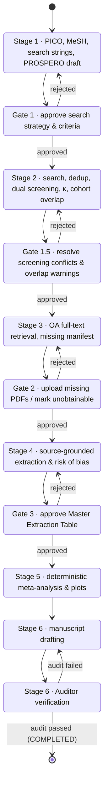

# Architecture — SysRev Meta-Analysis Agent

A PRISMA 2020-compliant, human-in-the-loop (HITL) pipeline for systematic reviews and
meta-analyses. This document describes the state machine, data contracts, persistence
model, external clients and the verification workflow. It also lists what is
implemented today and what is not.

---

## 1. Non-negotiable guardrails

| # | Guardrail | Where it is enforced |
|---|-----------|----------------------|
| G1 | **Zero fabrication of literature.** Bibliographic records come only from deterministic API clients (PubMed E-utilities, Europe PMC, OpenAlex, Crossref) or user-uploaded PDFs. An LLM never writes a citation, identifier or study datum from its weights. | `src/apis/*` build `StudyRecord`s only from fields present in API responses. Invalid identifiers are **dropped, never "repaired"**. Each record carries a `SearchProvenance` (database, query, endpoint, timestamp, reported hit count). |
| G2 | **Zero LLM arithmetic.** Effect sizes, pooled estimates, heterogeneity, bias tests and Median/IQR→Mean/SD conversions are computed by deterministic code. | `ExtractedValue` rejects any value that is not literally the number printed in its `verbatim_quote` (§4.3). Derived numbers can only originate from `src/stats_engine` (§9.5), run from a human-approved analysis plan; the only other derivation is the Summary of Findings absolute effect (`src/reporting/absolute_effects.py`, §9.9): a documented transformation of an engine result with a human-entered, sourced baseline risk. The Auditor cross-checks manuscript numbers against `stats_output.json`. |
| G3 | **Humans own every gate.** The pipeline cannot pass a HITL gate without a recorded, authenticated human decision. | `PipelineStateMachine` refuses gate exits unless `actor_type == HUMAN` and a matching `GateDecision` is supplied (§3). The HTTP gate endpoint requires an enrolled reviewer's bearer token, and the repository refuses to persist a gate decision without an active enrolled reviewer (§6). |
| G4 | **Append-only audit trail.** | `state_transitions`, `gate_decisions` and `source_evidence` rows raise on ORM update/delete (§5). |

---

## 2. Repository layout

```
src/
  core/            Settings, enums, identifier normalisation, exceptions
    schemas/       Pydantic v2 data contracts (one module per stage)
  state/           State machine (machine.py), SQLAlchemy models (db.py), repository.py
  apis/            Async, rate-limited clients: PubMed, Europe PMC, OpenAlex, Unpaywall, Crossref
  screening/       Deduplication, Cohen's kappa + conflicts, PRISMA tracker, cohort-overlap detector,
                   dual automated (LLM) screening + human adjudication, reviewer-reporting facts
  llm/             Provider-agnostic LLM interface, config and registry (no provider built in);
                   Session 8: discovery.py (official model-list endpoints), model_registry.py
                   (catalogue snapshots, verification, preview)
  fulltext/        Stage 3: OA retrieval (Europe PMC XML, Unpaywall PDF), safe download,
                   content-addressed storage, uploads + identity matching, Gate 2 manifest
  pdf_extractor/   pdfplumber/pypdf parsing (pages, blocks, tables, labels) + evidence grounding;
                   cache.py (Session 8: parse-once cache keyed by content hash and parser)
  extraction/      Stage 4: proposals → verification → Master Extraction Table; RoB drafts
  stats_engine/    Stage 5 deterministic statistics (§9.5), validated against R metafor
validation/        R reference script, metafor comparison, VALIDATION_REPORT.md
  auditor/         Stage 6 deterministic, completeness-aware Auditor (Session 6)
  manuscript/      Stage 6 evidence package, marker renderer, drafting, references, exports
  reporting/       Session 7: PRISMA 2020 flow diagram and checklists, GRADE / Summary of
                   Findings, synthesis without meta-analysis, SWiM, reporting audit checks
  api_server/      FastAPI app: project state, guards, gate decisions, Stage 2-4 review routes
  search/          Session 5: database registry, protocol editor, search execution, RIS/BibTeX/CSV
                   import, preparation for screening, PRISMA derivation, PRISMA-S report;
                   Session 8: amendments.py (protocol amendments), update-search preparation
  ui/              Local Streamlit reviewer UI (Session 4; protocol & search pages in Session 5;
                   Session 8: operations_pages.py + frozen.py)
tests/
  unit/            Schemas, identifiers, state machine, persistence, clients, screening, API
  integration/     End-to-end Stage 1→6 flow; opt-in live API smoke tests (`-m live`)
  fixtures/        Synthetic API payloads and a dependency-free synthetic-PDF builder
                   (10.5555 test-prefix DOIs; invented content; not real citations or data)
```

---

## 3. The 6-stage state machine

`src/state/machine.py` is the single source of truth for *what may happen next*. Any
orchestrator (a future LangGraph graph, the CLI, the FastAPI layer) must request
transitions through `PipelineStateMachine.transition()` / `.submit_gate_decision()`;
there is no API that sets a phase directly.



### 3.1 Gate rules

* Only a `HUMAN` actor may leave a gate phase, and only with a `GateDecision` whose
  `gate` matches the current gate.
* `APPROVED` moves forward (guards are evaluated); `REJECTED` moves back (guards are
  skipped — you can always go back) and **must** carry comments.
* `GATE_OUTCOMES` fixes the destination of each verdict; a decision cannot be used to
  jump elsewhere.

### 3.2 Guards

Guards are pure functions over a `GuardContext` snapshot. **Guards fail closed:**
`GuardContext` has no default values, so no caller can obtain a passing guard by
omitting a fact, and `Repository.build_guard_context()` derives every value from
persisted rows. Absent data (no PRISMA snapshot, no manifest rows, no decisions) is
reported as missing work, never as completion.

Screening status is computed per record from the stored `ScreeningDecision`s
(`screening_status()`): a record is *decided* only when an authenticated human
adjudicator decided it, or Reviewer 1 and Reviewer 2 agree on include/exclude. A
`ScreeningConflict` resolution is never a source of truth: it is persisted only as a
mirror of a matching human ADJUDICATOR decision by an active enrolled reviewer
(`save_conflict()` also checks that the conflict matches the stored reviewer decisions),
and the guards ignore conflict rows entirely, so an injected or fabricated resolution
cannot release a missing or conflicting record. A disagreement counts as unresolved
even if no `ScreeningConflict` row was ever saved.

| Transition | Guard (all must hold) |
|------------|------------------------|
| Gate 1 → Stage 2 | Protocol exists; ≥1 search strategy; every strategy `syntax_validated`; every MeSH term `verified` against NLM MeSH; selected databases and strategies agree; **the current version is `approved` by an active enrolled reviewer whose name matches (`approved_reviewer_id`)** (Session 5) |
| Stage 2 → Gate 1.5 | Once the search log is used (§9.7): every approved strategy has an execution, import or a reasoned "not searched" entry; no unacknowledged count discrepancy; records deduplicated after the last search/import; every record attributable to a logged run. Then: ≥1 stored record; **every unique (non-duplicate) record has title/abstract decisions from both reviewers** (a human adjudication decides the verdict but never substitutes for a missing pass); PRISMA snapshot recorded, internally consistent and consistent with stored records |
| Gate 1.5 → Stage 3 | As above, plus 0 unresolved title/abstract disagreements; 0 unresolved possible-duplicate pairs; 0 unresolved cohort-overlap warnings; PRISMA shows 0 records awaiting screening; ≥1 record included |
| Stage 3 → Gate 2 | **Every title/abstract-included record has a full-text manifest entry** |
| Gate 2 → Stage 4 | As above, plus every manifest entry is downloaded, uploaded, `UNOBTAINABLE` with a reason, or structured-text-only **with a human acknowledgement that no usable PDF is available**; **every linked PDF has a positive identity check** (`CONFIRMED` by the deterministic matcher or `HUMAN_CONFIRMED`; a missing check counts as unconfirmed) |
| Stage 4 → Gate 3 | **Every retrieved report has a final full-text eligibility decision** (dual review, adjudication or resolved conflict); **every full-text outcome resting only on automated passes is confirmed by an authenticated human**; ≥1 report included; every included report has ≥1 extracted arm, belongs to a study (§9.3) that has one, or is recorded as qualitative-only by a human; **no included report lacking data is XML-only or without a confirmed PDF**; no arm belongs to a non-included report; 0 values without `SourceEvidence`; **Session 9: every accepted arm-level value of an included report is represented by a valid arm built from exactly the current accepted values (H1); no accepted value, arm value or latest approved risk-of-bias assessment cites a PDF other than the one now linked (H3); no number has an ambiguous printed form without a recorded reading (M5)** (§9.11) |
| Gate 3 → Stage 5 | As above, plus every arm approved by a human; **0 master-table items awaiting review; every included study has a human-approved risk-of-bias assessment; no outcome receives arm data from two reports of the same cohort without a documented human resolution (§9.3)**; PRISMA recorded, consistent with stored records and final (nothing awaiting screening, retrieval or assessment) |
| Stage 5 → Stage 6 | **Session 9 (H2): every Gate 3 → Stage 5 condition above is re-checked on the current data** (Stage 5 operations such as link changes can affect them), and if the Gate 3 approval recorded a fingerprint of the approved data (`gate3_basis`), those data must be unchanged; plus **a verified `stats_output.json`**: stored (append-only) with a matching SHA-256, schema- and results-hash-valid, computed from the *latest* human-approved analysis plan and from the *current* approved extraction data (input hash recomputed; any later change blocks Stage 6 until Stage 5 is re-run) (§9.5) |
| Stage 6 → Audit | Manuscript draft exists |
| Audit → COMPLETED | **Session 6:** the latest `AuditReport` was made by the current Auditor (Session 7: 1.3.0, with the `reporting` scope, §9.9), is complete and passed, examined the *current* manuscript version (content SHA-256) and the *current* evidence fingerprint (recomputed); every `REQUIRES_HUMAN_REVIEW` finding is acknowledged by an active enrolled reviewer for that exact content/evidence; and an authenticated human signed off that version and audit (§9.8) |
| Audit → Stage 6 | Always allowed (returning to drafting certifies nothing) |
| **Every forward transition** (Session 8) | No protocol amendment awaiting a decision and no work pending re-review after an approved amendment (`amendment_problems`, §9.10). Gate rejections and Audit → Stage 6 are not affected |

**PRISMA cross-check.** The stored `PRISMACounts` snapshot must agree with the database:
total identified = stored records; duplicates removed = records with `duplicate_of`;
records screened / excluded / awaiting screening = derived title/abstract status;
reports not retrieved / assessed = manifest `UNOBTAINABLE` / retrieved entries; reports
included and Σ(exclusion reasons) = derived full-text status. Removals other than
duplicates (automation, other reasons) are not yet recorded per record, so any non-zero
value is reported as unverifiable and blocks progress.

`GuardViolationError.violations` lists every failed condition, and
`GET /projects/{id}/guards` exposes them to the UI before a reviewer acts.

---

## 4. Data contracts (`src/core/schemas`)

All models inherit `StrictModel` (`extra="forbid"`, whitespace stripping,
`validate_assignment=True`) or `FrozenModel` (immutable). Unknown fields are rejected,
which blocks an LLM from smuggling extra keys into structured output. All timestamps
must be timezone-aware.

### 4.1 Stage 1 — `protocol.py`
* **`PICOProtocol`** — title, question, P/I/C, `review_design`
  (`comparative` | `single_arm`), `outcomes: list[OutcomeDefinition]` (≥1 primary), study
  designs, inclusion/exclusion criteria, MeSH terms, search strategies, PROSPERO ID
  (`CRD` + 11 digits), versioning, approval fields. `approval_blockers()` lists what
  prevents Gate 1 approval; an `approved` protocol with blockers fails validation.
  * *Comparative* reviews require a `comparator` and may not list designs without a
    comparison group (`single_arm_trial`, `case_series`).
  * *Single-arm* reviews (e.g. stereotactic radiosurgery case series) must not define a
    comparator, may contain only `single_group` outcomes, and exclude `case_control`
    designs, whose outcome-based sampling does not permit estimating proportions or
    incidence.
* **`OutcomeDefinition`** — `clinical_type` (tumour control, AVM obliteration, pain
  relief, hearing preservation, adverse event, OS, PFS, functional outcome, other),
  operational `definition`, `grading_system` (e.g. CTCAE v5.0, BNI), `data_type`
  (dichotomous / continuous / time-to-event / count-rate), `comparison`
  (comparative / single-group), `preferred_effect_measure` and structured
  `timepoints`. Admissible measures:

  | comparison | dichotomous | continuous | time-to-event | count/rate |
  |---|---|---|---|---|
  | comparative | RR, OR, RD | MD, SMD | HR | IRR |
  | single-group | PROPORTION (crude) | MEAN, MEDIAN | KM_PROBABILITY, CUMULATIVE_INCIDENCE, MEDIAN_TIME_TO_EVENT | INCIDENCE_RATE |

  A crude proportion (events ÷ n, censoring ignored) and a Kaplan-Meier probability
  (accounts for right-censoring; Kaplan & Meier 1958) are different quantities and sit
  in different cells, so they cannot be confused or pooled together by schema. Where
  competing risks exist (e.g. death before radiation necrosis), 1 − KM overestimates
  the cumulative incidence (Gooley et al. 1999), hence the separate
  `CUMULATIVE_INCIDENCE` measure. Single-group outcomes need ≥1 timepoint (except
  median time-to-event); KM and cumulative-incidence outcomes need **fixed** timepoints
  (an estimate at time *t*), whereas crude proportions may use "last follow-up" or a
  window.
* **`FollowUpTimepoint`** — `fixed` (value + unit), `window` (min–max + unit) or
  `last_follow_up`. Descriptive only; no time arithmetic.
* **`MeSHTerm`** — starts `verified=False`; may only be marked verified (with
  `verified_at`) after `PubMedClient.mesh_descriptor_exists()` confirms it.
* **`SearchStrategy`** — per-database query with balanced-parentheses/quotes check,
  platform, date limits and filters (PRISMA-S reproducibility); content hash `sha256`;
  validation method, validator and time (Session 5).

### 4.2 Stage 2 — `study.py`, `screening.py`, `cohort.py`
* **`StudyRecord`** — one *report*. Identifiers are normalised on validation (DOI
  lower-cased and stripped of resolver prefixes; PMID canonical integer string; PMCID
  `PMC…`). Carries authors with affiliations, registry IDs, optional
  `RecruitmentPeriod`, `duplicate_of`, and `SearchProvenance`.
* **`ScreeningDecision`** — reviewer role, identity, stage, verdict, rationale. Exclusions
  require a reason; adjudicators must be human; full-text verdicts cannot be `uncertain`.
* **`ScreeningConflict`** — R1/R2 disagreement (or both `uncertain`); resolution fields
  must be set together and resolve to include/exclude.
* **`AgreementStatistics`** — observed/expected agreement and Cohen's κ (`None` when
  undefined).
* **`CohortOverlapWarning`** — canonical pair (`a < b`), score, severity, per-signal
  breakdown, shared authors/institutions/registry IDs; resolution requires `resolved_by`.
* **`DuplicateCandidate`** — a pair the deduplicator matched but refused to merge
  (`match_basis`, `conflict`, optional title similarity). Resolution (`distinct`,
  `duplicate_keep_a`, `duplicate_keep_b`) requires `resolved_by` and `resolved_at`;
  `Repository.resolve_duplicate_candidate()` re-points the dropped cluster's records.

### 4.3 Stages 3–4 — `extraction.py`
* **`FullTextItem`** — the Gate 2 manifest row (first author, year, journal, title, PMID,
  DOI, status). PDF statuses require filename + SHA-256; `UNOBTAINABLE` requires a reason.
* **`SourceEvidence`** (frozen) — PDF filename, optional SHA-256, page number (≥1),
  location type (table/figure/paragraph/supplement), location identifier, **verbatim
  quote**, extractor identity and type.
* **`ExtractedValue`** — `value`, `reported_text`, `unit`, `evidence`. Validation
  requires (i) `reported_text` occurs in `evidence.verbatim_quote` (whitespace-normalised)
  and (ii) `value == parse_reported_number(reported_text)`. The parser handles the
  Unicode minus, Lancet-style mid-dot decimals (`12·5`), thin spaces, thousands
  separators and a lone decimal comma, and performs no arithmetic. Consequently, a
  computed number (e.g. a mean estimated from a median) **cannot** be stored as an
  extracted value.
* **`ExtractedStudyArm`** — arm-level data (n randomised/enrolled, n analysed, events,
  mean, SD, SE, median, Q1, Q3, min, max), each an `ExtractedValue`; `arm_role` includes
  `single_group` for single-arm studies. An author-reported summary is held separately:
  `estimate_type` (crude proportion, Kaplan-Meier, actuarial life table, cumulative
  incidence, incidence rate, median time-to-event), `estimate_scale`
  (percent | proportion), `reported_estimate`, `ci_lower`/`ci_upper` + `ci_level`,
  `follow_up` (`FollowUpTimepoint`), `n_at_risk`, `follow_up_median`, `person_time`.
  Plausibility checks: counts are non-negative integers; events ≤ n analysed ≤ n
  randomised; n at risk ≤ n analysed; SD/SE/follow-up/person-time ≥ 0;
  min ≤ Q1 ≤ median ≤ Q3 ≤ max; estimate and type given together; CI needs both bounds,
  a level and must contain the estimate; probability-type estimates lie within 0–1 or
  0–100 %; KM / life-table / cumulative-incidence estimates require a fixed `follow_up`;
  rates and median times require a unit. A KM probability is therefore never stored as,
  or derived from, `events`/`n`. Human approval requires approver and timestamp.
* **`RiskOfBiasAssessment`** — RoB 2 (5 domains; low/some concerns/high),
  ROBINS-I (7 domains; low/moderate/serious/critical/no information) or NOS (stars:
  selection ≤4, comparability ≤2, outcome/exposure ≤3). For RoB 2 and ROBINS-I the
  overall judgement may not be milder than the worst domain, as both tools' guidance
  specifies.

Session 2 additions: `FullTextItem` records retrieval provenance (attempts, source URL,
licence, XML hash, PDF identity `match_status`); `RiskOfBiasAssessment` gained approval
stamps and draft rules (§9.4); `ScreeningDecision` gained `reviewer_id` (humans) and
`automation` provenance (LLM passes). `master.py` defines `ExtractionItem`,
`EvidenceCheck`, `ExtractionReviewEvent`, `StudyReportLink` and
`QuantitativeUnavailability` (§9.3).

### 4.4 Stage 6 — `audit.py`, `manuscript.py`
* **`CheckStatus`** — `verified`, `mismatch`, `not_found`, `missing`, `unsupported`,
  `not_checked` (blocking) and `requires_human_review`. Only `verified` is support.
* **`NumericClaimCheck`** — manuscript number vs an approved key with tolerance; the
  status must agree with the numbers.
* **`CitationCheck`** — citation vs a registry entry (PMID/DOI).
* **`AuditFinding`** — scope, status, manuscript location and excerpt, source key and
  value, message and required action; deterministic id.
* **`CoverageItem`** — an expected reportable output and where it was found.
* **`AuditReport`** — `complete`, `passed`, `failures`, `requires_human_review` are
  **computed**. `complete` requires the manuscript SHA-256, the evidence fingerprint, every
  scope required for its Auditor version (`required_scopes()`: Auditor 1.3.0 adds
  `reporting`) and a non-empty coverage list; `passed` requires `complete`
  and no blocking status anywhere. A hand-built report with one verified number or
  citation is therefore incomplete and never passes; a forged `passed`/`complete` claim is
  rejected on load, and `Repository.save_audit_report()` refuses any report that differs
  from the Auditor's own recomputation (`results_sha256()`).
* **`ManuscriptVersion`** — section sources with markers, frozen `NumericBinding`s, the
  rendered Markdown, style/journal settings, evidence fingerprint, creator and
  `GenerationProvenance`; `content_sha256` computed. **`ReferenceEntry`**,
  **`ReferenceVerification`**, **`EvidenceExcerpt`**, **`FindingAcknowledgement`**,
  **`ManuscriptApproval`**, **`ClaimReview`** (advisory, `is_human=False`). `JournalSettings`
  limits are accepted only with their stated source.

### 4.5 Pipeline — `pipeline.py`
* **`GateDecision`** (frozen; carries `reviewer_id` of the authenticated reviewer),
  **`StateTransition`** (frozen), **`ProjectState`**.
* **`PRISMACounts`** — the PRISMA 2020 flow boxes plus three work-in-progress counters
  (`records_awaiting_screening`, `reports_awaiting_retrieval`,
  `reports_awaiting_assessment`). `records_screened` counts only records with a
  *completed* title/abstract decision. Invariants enforced at construction:
  * screened + awaiting screening = identified − duplicates − automation-ineligible − other removals
  * sought = screened − excluded
  * assessed = sought − not retrieved − awaiting retrieval
  * reports included = assessed − Σ(excluded with reasons) − awaiting assessment
  * studies included ≤ reports included

  `is_final` is true only when nothing is awaiting screening, retrieval or assessment.

---

## 5. Persistence (`src/state/db.py`, `repository.py`)

SQLAlchemy 2.0 typed ORM on SQLite (any SQLAlchemy URL works).

* Query-relevant fields are real, indexed columns; the full validated Pydantic payload is
  stored as JSON and **re-validated on every load**, so a corrupted row fails loudly.
* `source_evidence` is a separate table; `extracted_values.evidence_id` is
  `NOT NULL` + FK, so the database itself refuses a number without provenance.
* Extracted arms are write-once (corrections create a new arm); approval updates only the
  approval columns.
* `reviewers` stores enrolled reviewers with a salted scrypt hash of their token (never
  the token); `gate_decisions.reviewer_id` is a `NOT NULL` foreign key to it.
* `duplicate_candidates` stores unmerged, conflicting duplicate matches awaiting human
  adjudication.
* `state_transitions`, `gate_decisions`, `source_evidence` and (Session 2)
  `extraction_review_events` are append-only (ORM `before_update` / `before_delete`
  listeners raise `AppendOnlyViolationError`).
* Session 2 tables: `fulltext_documents` (every stored PDF/XML with SHA-256, source and
  uploader), `extraction_items` (the Master Extraction Table; a reviewed item can no
  longer be changed — corrections create a new version), `study_report_links`
  (report → study), `quantitative_unavailability` (qualitative-only inclusion).
* Every *human* action persisted in Stages 2–4 (screening adjudication and conflict
  resolution, duplicate-candidate and cohort-overlap resolution, PDF upload or identity
  confirmation, unobtainable / XML-only declarations, extraction review, arm approval,
  study linking, double-counting resolution, risk-of-bias approval) records the reviewer
  id and passes `Repository.require_active_reviewer()`:
  an unknown or revoked reviewer id is refused at the persistence layer, not only at the
  HTTP layer. `approve_extracted_arm()` now takes the authenticated `reviewer_id`.
* `projects.version_id` provides optimistic concurrency; `record_transition()` also
  rejects stale transitions whose `from_phase` no longer matches the stored phase.
* SQLite foreign keys are switched on (`PRAGMA foreign_keys=ON`); datetimes round-trip as
  UTC-aware values.
* Session 8 adds three append-only tables and alters none (no migration is needed; `init_db`
  creates missing tables): `model_catalogue_snapshots` and `model_catalogue_activations`
  (installation-wide) and `governance_records` (per project; `kind` = `amendment_proposal`,
  `amendment_decision`, `amendment_resolution`, `arm_invalidation`, `study_link`). Arms
  invalidated after a correction stay stored and are filtered out by every reader
  (`load_extracted_arms`, the guard context). `study_report_links` rows remain the current
  mapping (a re-link updates the row, unlinking deletes it); their history is the
  `study_link` governance log.

---

## 6. Human approval integrity

**Problem.** The first version accepted a `reviewer_name` in the request body as proof
of human approval, so any process able to send an HTTP request (including an autonomous
agent) could impersonate the reviewer.

**Mechanism (minimal, local).**

1. **Enrollment out of band.** A human runs
   `python -m src.api_server.reviewer_cli enroll "Dr Jane Doe"` in a terminal. The
   command refuses to run unless stdin and stdout are TTYs and the name is re-typed.
   It prints a token `rvw_<reviewer_id>_<secret>` **once**; the 256-bit secret comes
   from `secrets.token_urlsafe(32)`. `list` and `revoke` subcommands exist.
2. **Only a hash is stored.** `reviewers.token_hash` is scrypt(secret, 16-byte random
   salt; n = 2¹⁴, r = 8, p = 1; RFC 7914), compared in constant time. Reading the
   database does not reveal a usable token.
3. **Bearer authentication on gate decisions.** `POST /projects/{id}/gates/{gate}`
   requires `Authorization: Bearer <token>`. Missing, malformed, wrong or revoked tokens
   return 401 (`WWW-Authenticate: Bearer`). The request body accepts only `verdict` and
   `comments`; a body that names a reviewer is rejected (422), not silently ignored. The
   decision's `reviewer_name` and `reviewer_id` come from the authenticated token.
4. **Persistence enforcement.** `Repository.record_transition()` refuses any gate
   decision whose `reviewer_id` is missing, unknown, revoked, or whose name does not match
   the enrolled reviewer; `gate_decisions.reviewer_id` is a `NOT NULL` foreign key.
5. **Hygiene.** The server is meant to bind to loopback (uvicorn's default
   `127.0.0.1`); file-based SQLite directories are created with mode `0700` (on Windows,
   where POSIX modes do not apply, with an explicit owner-only ACL that is verified by SID
   before a database is created — Session 10, §9.12). API responses are sent only after the
   request's transaction has committed. Tokens
   must not be placed in `.env`, the repository, or anywhere an agent process can read.

**Remaining limitations (threat model).** These measures stop an agent that can only
reach the HTTP API, or that only knows a reviewer's name, from approving a gate. They do
**not** protect against a process running as the same OS user with general shell or
file access, which could:

* drive the enrollment CLI through a pseudo-terminal and mint its own token;
* read a token from the human's terminal scrollback, clipboard, password-manager export
  or any file it was saved to;
* write the SQLite file directly (insert a reviewer hash or a transition row), bypassing
  application code entirely; or
* import the library in-process and call the repository with a known `reviewer_id`.

Robust separation therefore requires running the agent as a **different OS user or in a
container** with no access to the database file, the CLI, or the reviewer's session, and
talking to the API only over loopback. Further hardening not yet implemented: token
expiry/rotation, rate limiting of failed authentication, signed (e.g. Ed25519) decisions
verifiable independently of the database, TLS for any non-loopback deployment, and
multi-reviewer sign-off.

---

## 7. Literature API clients (`src/apis`)

All clients share `BaseAPIClient`: an `httpx.AsyncClient`, an `AsyncRateLimiter`
(sliding window, safe under concurrency, injectable clock), retries on 429/500/502/503/504
and transport errors with exponential back-off capped at 60 s, `Retry-After` support
(delta-seconds or HTTP-date), and a `User-Agent` carrying the contact address.

| Client | Endpoint(s) | Paging | Policy honoured |
|--------|-------------|--------|-----------------|
| `PubMedClient` | `esearch.fcgi` (JSON), `efetch.fcgi` (XML via POST, 200 IDs/batch) | `retstart`/`retmax` | `tool` + `email` on every call; 3 req/s, 10 req/s with API key. Queries matching > 10,000 records raise `SearchResultTooLargeError` (ESearch cannot page past 10,000) instead of silently truncating. XML parsed with entity resolution and network access disabled. `mesh_descriptor_exists()` checks `db=mesh`. |
| `EuropePMCClient` | `/search?resultType=core&format=json` | `cursorMark` (≤1000/page) | Configurable rate. |
| `OpenAlexClient` | `/works?search=&filter=` | `cursor` (≤200/page) | `mailto` (polite pool); optional `api_key`. Abstracts rebuilt from the inverted index; author surnames split heuristically and flagged `name_parsed_heuristically=True`. |
| `UnpaywallClient` | `/v2/{doi}?email=` | — | `email` required. `download_pdf()` accepts content only if it begins with `%PDF-` (landing pages are rejected), stores it and returns its SHA-256. |
| `CrossrefClient` | `/works/{doi}` | — | `mailto`; used by the Auditor to confirm cited DOIs exist. |

Rate-limit numbers for Europe PMC, OpenAlex, Unpaywall and Crossref are conservative
configurable defaults (`.env.example`); check each provider's current documentation
before raising them.

---

## 8. Screening algorithms (`src/screening`)

### 8.1 Deduplication (`deduplication.py`)
1. **Exact pass** — union-find over DOI, PMID, PMCID and OpenAlex ID. Before two
   clusters are joined, **every member of one is compared with every member of the
   other**; if any identifier would take two different values in the merged cluster
   (e.g. a shared DOI but different PMIDs, or a DOI→PMID chain linking two different
   DOIs), the merge is refused and the pair is returned as a `PossibleDuplicate`
   (`match_basis = "exact <identifier> (<value>)"`). A conflicting record does not stop
   compatible records sharing the same identifier from merging with each other.
2. **Fuzzy pass** — records are blocked by publication year (±1; unknown years compared
   with all), titles normalised (markup removed, diacritics folded, case-folded,
   punctuation collapsed) and compared with RapidFuzz `token_sort_ratio`
   (vectorised `cdist`). Pairs ≥ threshold (default 95) are merged highest-score first,
   **unless any member of either cluster contradicts the merge** (different DOIs,
   different PMIDs, different first-author surnames). Contradicted pairs are returned as
   `PossibleDuplicate` for human review. This is deliberately conservative: a false merge
   silently deletes a study, while a missed merge is caught at screening.

   Blocked pairs are reported once per pair; `PossibleDuplicate.to_candidate()` converts
   them to persistable `DuplicateCandidate`s, and every candidate must be adjudicated by a
   human before Gate 1.5 can be released.
3. **Representative** — the most complete record (PMID > DOI > abstract > …), ties by
   source priority then `record_id`. Missing identifiers are filled from duplicates,
   never overwritten.

The result is independent of input order (tested by shuffling).

### 8.2 Dual screening support (`agreement.py`)
`cohens_kappa()` implements κ = (p_o − p_e)/(1 − p_e) (Cohen, 1960) for any number of
categories and returns `None` when p_e = 1. `detect_conflicts()` flags disagreements and
double-`uncertain` records; `final_verdicts()` refuses to produce a consensus while any
conflict is unresolved.

### 8.2a Automated dual screening (`llm_screening.py`, `reporting.py`) — Session 2
Two `LLMScreener`s (separate provider instances; distinct labels; neither sees the
other's output) screen each record against the **approved** protocol. Criteria get
stable ids (`I1..`, `E1..`). Replies must match `LLMScreeningResponse`; the
**conservative policy** downgrades an `exclude` to `uncertain` unless it cites a
predefined criterion, the model reports sufficient information, and every supporting
quote occurs (whitespace/typography-normalised) in the screened text. Malformed replies
become `uncertain`; transport failures record nothing and are retried on the next run
(resume = existing decisions are skipped). Decisions are `is_human=False` with
`AutomatedReviewerProvenance` (provider, model, prompt version, prompt/response
SHA-256, raw verdict, policy notes). Every disagreement or `uncertain` becomes a
`ScreeningConflict`; only `adjudicate()` with an enrolled reviewer resolves it.
κ is computed by the existing `cohens_kappa()` over complete pairs.

**Reporting.** `screening_reporting_facts()` derives who screened from stored decisions;
`methods_statement()` renders a deterministic sentence that states the passes are
automated and *not equivalent to independent human reviewers* (and when both passes
used the same model, says so); `check_reviewer_claims()` flags text that describes them
as two human reviewers. Human full-text responsibility: a full-text outcome supported
only by automated passes blocks Gate 3 until a human confirms it.

### 8.3 PRISMA tracker (`prisma.py`)
Counts are derived from recorded events (identification per database, duplicates removed,
per-record screening/retrieval/eligibility outcomes), not typed in. Decisions are
idempotent; re-excluding a record clears its downstream state.

Incomplete screening is represented explicitly: `records_awaiting_screening` is the set of
registered records without a final decision (`register_screening_pool()`, recommended),
or else identified − removed − decided. A snapshot taken mid-screening is therefore valid
but not final, and more decisions than records entering screening raises an error.
`snapshot()` returns a validated `PRISMACounts` or raises `PRISMAInconsistencyError`.

### 8.4 Overlapping Cohort Detector (`cohort_overlap.py`)
Flags report pairs that may describe the same participants; it never excludes or merges.

| Signal | Score in [0, 1] |
|--------|-----------------|
| Shared registry ID (NCT, ISRCTN, EudraCT, ChiCTR, ACTRN, DRKS, CTRI, jRCT, UMIN) | Decisive → composite 1.0, HIGH |
| Co-author overlap | Overlap coefficient of `surname + initial` keys; one shared name in teams ≥4 ×0.5 (name collisions) |
| Affiliation similarity | Share of the smaller study's institutions matched (`token_set_ratio` ≥ 85) after dropping department segments, cities and generic words |
| Recruitment overlap | Overlapping years ÷ shorter period |
| Publication proximity | Substitutes for unknown recruitment at half weight |

Composite = 0.40·co-author + 0.30·affiliation + 0.30·time. A pair is only considered if
it shares a registry ID, at least one author, or (≥50 % institutions and overlapping
known recruitment). Thresholds: flag ≥ 0.45, MODERATE ≥ 0.55, HIGH ≥ 0.70.
**These weights and thresholds are engineering heuristics and have not been validated
against a labelled corpus.** They are configurable, and every warning lists its
individual signals so reviewers can judge them. Candidate pairs come from an inverted
index (shared author key, registry ID or institution token) to avoid all-pairs work.

---

## 9. Verification workflow (end to end)

1. **Search provenance** — each record stores its database, exact query, endpoint, time
   and reported hit count → PRISMA-S reporting and reproducibility.
2. **MeSH verification** — LLM-proposed headings must be confirmed against NLM MeSH before
   Gate 1 can be approved.
3. **Dual screening + κ + human adjudication** — Gate 1.5 cannot open with unresolved
   conflicts or overlap warnings.
4. **Full-text manifest** — Gate 2 cannot open until each missing report is uploaded
   (hash recorded) or explicitly declared unobtainable with a reason.
5. **Source-grounded extraction** — every number is a literal copy from a quoted passage
   on a specific PDF page, enforced at schema and database level; Gate 3 requires human
   approval of every arm.
6. **Deterministic statistics** — Stage 5 writes `stats_output.json`; its SHA-256 is
   stored on the project and referenced by every `AuditReport`.
7. **Independent audit** — the stored manuscript is re-rendered and checked against the
   current evidence package scope by scope (§9.8). `COMPLETED` is reachable only from a
   current, complete, passing report with every human-review item acknowledged and a human
   sign-off.

### 9.1 Stage 3 — full-text retrieval (`src/fulltext`) — Session 2
`FullTextRetriever.run()` processes title/abstract-included records one at a time and
commits after each (pause/resume across restarts; `.partial` leftovers are cleaned at
start). Order of preference: Europe PMC open-access **JATS XML** (`/{PMCID}/fullTextXML`,
PMCID via `EXT_ID:<pmid> AND SRC:MED` if needed) for provenance and structured text,
then **Unpaywall** open-access PDF locations. Only URLs returned by these services are
fetched; no paywall or authentication is circumvented. Downloads are streamed with a
byte limit, require a `%PDF-` header within the first 1 KiB, are opened with pypdf, and
are moved atomically into a content-addressed store (`<sha256>.pdf`). Each attempt is
recorded (`RetrievalAttempt`); failures leave the report `MISSING`, never excluded.
XML-only reports are *retrieved* for PRISMA (`OA_STRUCTURED_TEXT`) but are **not
extraction-ready**: numeric evidence must cite a physical PDF page, so they are retried
for a PDF on later runs, block Gate 2 until a reviewer calls `acknowledge_xml_only()`,
and block Gate 3 while included without data unless a PDF is uploaded or the report is
recorded as unavailable for quantitative synthesis. `report_flow()` separates reports
retrieved with a usable PDF, retrieved as structured XML only, and not retrieved.
**Download safety (SSRF):** every request target, including each redirect hop (followed
manually, at most 5), must be http(s) without credentials and resolve only to globally
routable addresses; loopback, private, link-local (incl. cloud metadata), CGNAT,
multicast and reserved ranges are refused before any request is sent. DNS rebinding
between the check and the connection is not prevented. Every PDF (OA or uploaded)
is checked against its record (`assess_match`: DOI/PMID on page 1, fuzzy title,
first-author surname; identical bytes linked to another record); uncertain or mismatched
links block Gate 2 until `confirm_pdf_match()` by a reviewer. `mark_unobtainable()`
needs a reviewer and a reason and counts as PRISMA "not retrieved", distinct from
"assessed and excluded" (`report_flow()`). `build_manifest()` exports the missing-report
manifest (title, authors, year, journal, DOI, PMID, PMCID, status, last attempt) as CSV
or JSON.

### 9.2 PDF parsing and evidence grounding (`src/pdf_extractor`) — Session 2
pdfplumber (MIT) gives per-line text, ruled-table detection and cell extraction; pypdf
reads `/PageLabels`. PyMuPDF was not used (AGPL licence; not needed). Output is a
`ParsedDocument` with physical pages, logical page labels, a heuristic printed page
number, classified blocks (`p{page}.b{n}`: paragraph, heading, table caption, figure
legend, supplementary), tables (`p{page}.t{n}`, cells `…r{row}c{col}`), and per-page
issues: image-only pages (no OCR is performed — flagged for manual review), unreadable or
ragged tables, and table captions without detectable structure. Text-based tables that
have no ruling lines are **not** reconstructed (flagged instead).

`verify_evidence()` checks a `SourceEvidence` against the parsed document: SHA-256 and
filename, page range, image-only page, quote present **on the cited page** (else
`WRONG_PAGE` with the actual pages, or `QUOTE_NOT_FOUND`), the reported number as a whole
token inside the quote, and — for structured ids — that the quote is in the cited
block/table and the number in the cited cell. Matching normalises Unicode compatibility
forms, ligatures, dashes, quotes, soft hyphens, words hyphenated across lines, letter
case and whitespace next to non-digits, but never whitespace between digits, so `12 34`
cannot match `1234` and `12` cannot match `125` or `12.5`. `select_context()` sends only
the highest-scoring blocks/tables (labelled with page and id) to a model.

### 9.3 Master Extraction Table (`src/extraction`) — Session 2
An extractor (LLM or human) submits `ProposedValue`s: number as printed, page, location,
verbatim quote — never a computed value (`value` is parsed from `reported_text`).
`proposal_to_item()` grounds each proposal in the record's linked PDF (another PDF is
refused) and stores an `ExtractionItem` with `data_status` (`reported`, `not_reported`,
`ambiguous`, `contradictory`, `inaccessible`; `derived` is refused in Stage 4), the
`EvidenceCheck` and discrepancy flags — including estimator conflicts (Kaplan-Meier /
actuarial wording recorded as a crude count, competing-risks wording recorded as KM, or
"x of n" wording recorded as KM). Missing data are `value=None`, never zero.

Review (`accept_item`, `reject_item`, `correct_item`) requires an enrolled reviewer; a
reported value can be accepted only if its evidence verified; flagged items need a note;
corrections must themselves verify, or be explicitly `HUMAN_ATTESTED` (e.g. a figure or an
image-only page) with the failed machine check recorded. Every action appends an
`ExtractionReviewEvent` (before/after payloads). `build_arms()` assembles accepted items
into human-approved `ExtractedStudyArm`s keyed by report, outcome, arm, timepoint **and
estimator**, so crude proportions and KM/cumulative-incidence estimates are never merged;
`analysis_compatibility()` states whether an arm can inform an outcome's summary measure
without conversion. Reports are linked to studies (`link_reports_to_study`);
`double_counting_conflicts()` groups approved arms by cohort (study links plus
cohort-overlap warnings a human resolved as overlapping), outcome, arm role, timepoint
and estimator; a group fed by two or more reports blocks Gate 3 → Stage 5 until
`resolve_double_counting()` records either "keep one report" (the others become
`overlapping_cohort` unavailability for that outcome) or a reviewer-attested
`CohortContributionDecision` that the reports contribute non-overlapping samples.
Different outcomes, timepoints and estimators never collide; `record_unavailability()` records an eligible study that is
available only for qualitative synthesis (or not for one outcome) with a reason.
`export_rows()` → CSV/JSON with study and report ids, every evidence field, verification
and review status.

### 9.4 Risk of bias (`src/extraction/rob.py`) — Session 2
`select_rob_tool()` maps design and review type to RoB 2 (randomised), ROBINS-I
(comparative non-randomised studies of interventions; NOS allowed with justification for
cohort/case-control), NOS (single-group cohorts, with justification) or an `EXTERNAL`
human-recorded instrument (case series and single-arm trials, for which none of the three
is designed; e.g. MINORS or the JBI case-series checklist). `LLMRoBDrafter` produces RoB 2
/ ROBINS-I drafts: invalid domains or judgements are refused, only verified quotes are
kept as evidence, unverifiable quotes are listed in `needs_human_attention`, and a domain
without verified support is marked `missing_information`. Schema rules: an automated
draft can never carry an overall judgement; approval requires an enrolled reviewer (id,
name, time) and an overall judgement no milder than the worst domain. GRADE is out of
scope until Session 4.

### 9.5 Stage 5 — deterministic meta-analysis (`src/stats_engine`) — Session 3

**Inputs.** `Repository.load_stage5_inputs()` gathers the protocol outcomes, the extracted
arms, the **full-text-eligible report universe**, report → study links, cohort labels (study links plus human-resolved overlap
warnings), recorded unavailability and `CohortContributionDecision`s, and the
first-author/year labels; its canonical SHA-256 is the *input hash*. `run_stage5()` refuses
to run outside Stage 5, without an approved plan, or with arms for reports not included at
full text; `run_plan()` refuses any arm not approved by a human or belonging to a report
outside the eligible set.

**Analysis plan** (`AnalysisPlan` / `AnalysisSpec`, `src/core/schemas/stats.py`). Approved
by an enrolled reviewer (`POST /projects/{id}/stats/plan`, bearer token; the persistence
layer re-checks the reviewer and that each spec's measure is admissible for the outcome and
its timepoints are pre-specified in the protocol). Per analysis: outcome, measure, one or
more **structured timepoints** (several only with a written justification), primary model,
τ² estimator (REML default, DL), random-effects CI (HKSJ default, ad hoc HKSJ, Wald),
common-effect method (MH default for RR/OR), proportion method (GLMM default), for
KM/cumulative incidence the **declared CI scale** of the authors' intervals, whether KM and
actuarial estimates may be combined (default no; needs a reason), explicit arm selections
for multi-arm reports, confidence level and display decimals. Plans are append-only.

**Input integrity** (`inputs.py`). Per analysis and report: human-recorded unavailability
→ excluded with the human's reason; estimators never substituted (crude counts for
PROPORTION/RR/OR; KAPLAN_MEIER (+ACTUARIAL if allowed) for KM; CUMULATIVE_INCIDENCE
only for cumulative incidence; raw summaries for MD/SMD); the arm's structured follow-up
must equal a plan timepoint exactly (no unit conversion; "24 months" ≠ "2 years"); exactly
one arm per role unless the plan selects one; several reports of one cohort only if a
human documented non-overlapping participants for that outcome — otherwise all are
excluded as `overlapping_cohort`. Every exclusion is listed with a reason code.

**Report accounting.** Every full-text-eligible report appears exactly once in each
analysis's `reports` ledger: `included` (with its analysis unit) or `excluded` with a reason
code. Three cases are kept distinct: `recorded_unavailable` (a reviewer recorded the
report as unusable for the outcome), `confirmed_not_reported` (a reviewer recorded that the
source does not report it — `QuantitativeUnavailability.reason_code = "not_reported"`; the
only status that asserts non-reporting), and the neutral
`outcome_data_not_extracted_or_unverified` (no approved, verified extraction exists; this
makes no claim about the paper). Missing data are never treated as zero events. The ledger
is in `stats_output.json` and in each analysis's Markdown and CSV table.
`excluded` lists a study/cohort once, with all its reports, and only when none of its
reports contributes; a non-contributing report of a contributing cohort is recorded in the
ledger only, so duplicate reports are never counted as separate studies.

**Independent model failures.** Each model is estimated on its own. If one fails (e.g. a
zero Hartung-Knapp SE when all study estimates are identical), the others are kept: a
failed sensitivity model is reported as a warning with its reason, and a failed primary
model gives `not_estimable` with the reason while the included studies, heterogeneity and
any estimable auxiliary models remain in the output, labelled as sensitivity results. No
other interval is substituted as primary.

**Methods** (each validated against metafor; see `validation/VALIDATION_REPORT.md`).

| Measure | Study level | Common effect | Random effects |
|---|---|---|---|
| Crude proportion | logit; Clopper-Pearson CI for display | binomial ML | **binomial-normal GLMM** (ML, 7-node adaptive Gauss-Hermite; Stijnen et al. 2010), no continuity correction; sensitivity: logit IV with 0.5 added only to 0 %/100 % studies |
| KM / cumulative incidence at *t* | SE = \|g(U) − g(L)\| / (2z) on the declared scale g; the CI must be symmetric on that scale allowing each printed number its own rounding (estimate, lower and upper limit separately; Session 9, M2), else `ci_inconsistent`. On the identity (`plain`) scale g(p) = p is defined on the closed [0, 1], so a limit of 0 % or 100 % is usable; on log(−log), log and logit a limit at 0 or 1 gives `ci_bound_not_transformable` for that study only (Session 9, M1) | IV | IV on the declared scale |
| RR, OR | log; double-zero/double-all-event studies excluded; 0.5 added to all cells of single-zero studies (IV only) | **Mantel-Haenszel** (RBG / Greenland-Robins variance) | IV |
| MD, SMD | m₁ − m₂; Hedges' g with exact J | IV | IV |

Random effects: REML (global maximum of the restricted likelihood, Brent root finding) or
DL; CIs by HKSJ t(k−1) (IntHout et al., *BMC Med Res Methodol* 2014;14:25), ad hoc HKSJ
(never narrower than Wald) or Wald. Heterogeneity: Q, I² (Q-based), model I² = τ²/(τ²+s²),
H², τ² and I² Q-profile CIs. Prediction interval t(k−2) only for k ≥ 3. With k = 1 the
study's own estimate is reported (`single_study`) and no pooled, heterogeneity or
prediction statistic is computed. All-zero (or all-event) proportion data are
`descriptive_only`. HR, RD, IRR, incidence rates, means, medians and median survival are
`unsupported`: in particular **no HR is ever derived from survival percentages**, and SDs,
event counts or timepoints are never derived or converted.

**Output** (`StatsOutput`, schema 1.0.0). Per analysis: status and reason, included
studies (inputs used, yᵢ, vᵢ, CIs on both scales, weights, continuity-correction flags),
excluded studies with reason codes, common/random/sensitivity results, heterogeneity,
settings, methods, warnings and limitations; globally: engine/Python/numpy/scipy/platform
versions, numeric-precision statement, plan SHA-256, input SHA-256 and a results
fingerprint that the schema re-verifies on load (tampering fails validation). Floats are
stored at full binary64 precision. `write_artifacts()` writes `stats_output.json`
(canonical JSON, exactly the hashed bytes), `report.md`, per-analysis Markdown/CSV tables,
deterministic SVG forest plots and a `manifest.json` of file hashes. `flatten()` gives the
Auditor `"<analysis>.<model>.<field>"` keys.

**Pipeline integration.** `record_stats_output()` (Stage 5 only) **re-runs the approved
plan on the current data once and rejects the artifact unless its analyses are identical**
(results fingerprint; the first differing fields are reported), so a numerically altered
but hash-consistent `StatsOutput` cannot be recorded. It then stores the canonical JSON in
the append-only `stats_outputs` table and sets the project hash. Status checks and guards
do not recompute; they re-verify hashes, plan identity and the input hash. Direct writes to
the database file bypass this and remain outside the threat model (§6). The Stage 5 → 6 guard
re-verifies the stored artifact (§3.2), so setting a hash by hand, editing the stored JSON,
approving a new plan or changing approved data after the run all block Stage 6.

---

## 10. Implementation status

| Component | Status |
|-----------|--------|
| Data contracts (all stages) | Implemented and tested |
| State machine, guards, HITL gates | Implemented and tested |
| SQLAlchemy persistence, append-only trail | Implemented and tested |
| PubMed, Europe PMC, OpenAlex, Unpaywall, Crossref clients | Implemented; tested with mocked HTTP only. Live smoke tests (`pytest -m live`) were executed but all 6 failed with `ProxyError: 403 Forbidden` from the sandbox egress proxy before reaching any API. **Real API behaviour remains unverified** |
| Deduplication (with cluster-level identifier-conflict blocking), κ/conflicts, PRISMA tracker (with pending-screening accounting), cohort overlap | Implemented and tested |
| Fail-closed guards derived from persisted records, incl. PRISMA cross-check | Implemented and tested |
| FastAPI (state, guards, gate decisions, Stage 2–4 review routes) | Implemented and tested; every human action requires an enrolled reviewer's bearer token. LLM runs and retrieval are started from Python, not over HTTP |
| Reviewer enrollment CLI and token authentication | Implemented and tested; see §6 for the threat model and limitations |
| Single-arm / case-series protocol and outcome schemas; crude vs KM vs cumulative-incidence distinction | Implemented and tested (schemas only; no statistics) |
| LLM provider interface + registry (`src/llm`) | Implemented and tested with scripted providers. Session 4 adds Anthropic Messages and OpenAI Responses adapters (§9.6), registered only on request (`register_api_providers`) |
| Anthropic / OpenAI adapters, capability catalogue, per-task model/effort, usage ledger, budget guard (Session 4) | Implemented and tested with **mocked HTTP only**. **No live API call was made during development** (no credentials in the build environment). OpenAI catalogue entries and Responses usage fields were checked against the official documentation on 2026-10-30; Anthropic entries come from Anthropic's API reference cached 2026-10-06 |
| Dual automated screening, conservative policy, resume, conflicts, κ, authenticated adjudication, reporting facts | Implemented and tested (mocked models). Screening accuracy of any real model is **unvalidated** |
| Stage 3 retrieval (Europe PMC XML, Unpaywall PDF), downloads, uploads, identity matching, manifest, pause/resume | Implemented and tested with respx-mocked HTTP only; **no live retrieval was executed** |
| PDF parsing and evidence grounding | Implemented and tested on generated synthetic PDFs; not yet evaluated on real journal PDFs (multi-column layouts, rotated tables, unruled tables) |
| Master Extraction Table, review workflow, arms, exports, study linking, qualitative-only | Implemented and tested |
| LLM extraction proposals / RoB drafts | Implemented and tested with scripted replies; real-model quality unvalidated |
| JATS XML parsing for evidence; OCR; supplementary-file retrieval | Not implemented (XML is stored with provenance only; image-only pages are flagged) |
| PICO structuring agent | Not implemented |
| Manuscript drafting (Session 6): evidence package, marker renderer, deterministic template draft, validated model drafting, Vancouver references, versioning, Markdown/DOCX export | Implemented and tested with synthetic projects and **mocked** model replies; **no live model call**; real-world prose quality unvalidated |
| Statistics engine (`stats_engine`, Session 3) | Implemented for crude proportions (GLMM + logit IV), KM / cumulative incidence at time *t* (from reported CIs), RR, OR (IV, MH), MD, SMD; validated against metafor 4.4-0 / lme4 (1,879 comparisons incl. Mantel-Haenszel study weights; `validation/VALIDATION_REPORT.md`). HR, RD, IRR, rates, means, medians: reported as unsupported |
| Forest plots, tables, Markdown report | Implemented (matplotlib SVG, deterministic) |
| PRISMA 2020 flow diagram, PRISMA 2020 / abstract / SWiM checklists, GRADE and Summary of Findings, synthesis without meta-analysis (Session 7) | Implemented and tested with synthetic projects only (§9.9). Only the *new review, databases and registers* diagram variant is supported; other variants are refused with their unsupported fields |
| Auditor (Session 6) | Implemented: deterministic, completeness-aware checks (§9.8), human acknowledgement and sign-off, advisory model claim review. Prose checks are rule-based and incomplete (limitations in §9.8 and in every report); reference verification tested with in-memory PubMed/Crossref fakes only — **no live lookup was made** |
| Protocol editor, database selection, search execution (PubMed/Europe PMC/OpenAlex), RIS/BibTeX/CSV import, preparation for screening, search log, PRISMA derivation, PRISMA-S report (Session 5) | Implemented and tested with **mocked HTTP and synthetic export files only**; no live database call; parsers not tested on real vendor exports. Subscription-database APIs and a ClinicalTrials.gov API search are not implemented (manual import). Session 8 adds amendments after Gate 1 and update searches in Stage 2 (§9.10) |
| Model discovery / "Refresh Models" (issue #9, Session 8) | Implemented and tested with **mocked** list endpoints (§9.10): official `GET /v1/models` for both providers, candidate snapshots, separately verified capabilities and prices, preview, authenticated activation bound to the previewed hashes, lifecycle (deprecated/retired) handling without substitution. No live listing was made |
| UI operations (Session 8): corrections with evidence (pending and reviewed values, arm invalidation), report-to-study links and unlinking with history, double-counting decisions, analysis-plan drafts/revisions/approval | Implemented and tested (API + Streamlit AppTest), bound to the displayed state; SQLite only for the locking guarantee |
| Protocol amendments after Gate 1 and update searches after screening has begun (Session 8) | Implemented and tested with synthetic projects (§9.10). Phase limits and unsupported cases are refused explicitly |
| Local UI (Streamlit, Session 4) | First usable version: projects, phase/blockers, authenticated advance and gate decisions, per-task model settings, keys, AI steps, screening queue and adjudication, PDF upload/identity, extraction accept/reject/arms, RoB approval, statistics and forest plots, usage/costs. Tested headlessly (Streamlit AppTest) on Linux; **not yet run on a Windows machine**. Session 5 adds protocol editing/approval, searches, imports, deduplication decisions and PRISMA recomputation. Session 8 adds the model catalogue, corrections, study links, double counting, analysis plans and protocol amendments |

### 9.6 Real AI providers and the local UI (`src/llm`, `src/workflows`, `src/ui`) — Session 4

**Adapters** (`src/llm/adapters.py`) call `POST /v1/messages` (Anthropic, header
`anthropic-version: 2026-10-21`, adaptive thinking, `output_config.effort`) and
`POST /v1/responses` (OpenAI, `reasoning.effort`, `store: false`) with `httpx`. They send
the configured model and effort exactly as given: no fallback model, no automatic effort
change, no `temperature` (removed on Anthropic API version 2026-10-21 and not accepted by
reasoning models). A different served model (other than a dated snapshot of the requested
ID) or, on OpenAI, a different echoed effort discards the result.

**Capability catalogue** (`src/llm/model_catalogue.json`, overridable by
`<data_dir>/model_catalogue.json`) lists, per exact model ID, the accepted effort values,
output limit and list prices with their source. A configuration is validated against it
*before* any request; unknown models, unlisted efforts, a temperature or an excessive
output limit raise `UnsupportedConfigurationError`. Effort values are provider-specific
strings and are not mapped across providers. Since Session 8 the validated catalogue is the
latest *activated snapshot* (else the built-in file plus the override), and `validate()`
also refuses unverified entries, retired models and adapter-incompatible entries (§9.10).

**Errors.** `ProviderAccessError` (401/403/404), `InsufficientFundsError` (Anthropic
`billing_error`/"credit balance", OpenAI `insufficient_quota`) and
`UnsupportedConfigurationError` (400 parameter rejections) are never retried and halt a
batch run (`LLMRunHaltError`). Rate limits, overload (529) and 5xx are retried at most
twice with capped backoff; a connection failure before sending is retried; a read
timeout is *not* retried because the request may already have been billed. Refusal,
truncation at the output limit and empty output raise `LLMOutputError`; the item records
nothing and can be retried.

**Per-task settings** (`ProjectAISettings`, append-only versions in
`project_ai_settings`): provider, exact model, effort (`None` = provider default, not
sent) and output limit for `screening_reviewer_1`, `screening_reviewer_2`, `extraction`,
`verification` and `risk_of_bias` (Session 6 adds `manuscript_drafting` and
`claim_review`; settings saved before Session 6 remain valid and simply leave them
unconfigured), plus local warning/stop thresholds. No credentials.

**Audit trail** (`llm_calls`, append-only): one row per call (also failed, budget-blocked
and duplicate-skipped calls) with task, requested and served model, effort sent and
effective, reported tokens (input, output, reasoning, cache read/write), list-price cost
estimate and its basis, provider request id, attempts, latency and SHA-256 of prompt and
reply. Prompts, replies and keys are not stored. Raw token fields are kept as reported;
`total_tokens` (used for project totals and token thresholds) follows each provider's
semantics: OpenAI `input_tokens` already include cached tokens and `output_tokens`
include reasoning tokens (total = input + output); Anthropic input, cache-read and
cache-creation tokens are disjoint (total = all three + output).

**Cost controls** (issues #3/#4, minimal scope): bounded retries; resumable runs (existing
decisions are skipped); identical successful requests (same task, model, effort, prompt)
are not repeated unless forced — but only once their *validated* result was persisted
(`llm_call_outcomes` links the call to the saved extraction items, verification or RoB
draft); a reply that failed JSON/schema validation or grounding is billed and logged but
never blocks an ordinary retry; the two screening passes never share a cache key; a
local stop threshold refuses to *start* calls once recorded estimated spend or tokens
reach it. This is not a hard spending cap (estimates can differ from invoices; a call in
flight completes); a cost threshold with an unpriced model is refused. Session 8 adds a
parse-once cache, opt-in Anthropic prompt caching and per-call catalogue provenance; batch
processing and adaptive routing remain unimplemented (assessment in §9.10).

**Advisory verification** (`src/extraction/ai_verification.py`): a separately configured
model judges whether the quote/page supports a pending AI-proposed value as recorded.
Stored in `ai_verifications` with `is_human = false`; it never changes an item's status.
The deterministic evidence check remains the gate.

**Credentials** (`src/llm/credentials.py`): UI session memory → environment / `.env` →
OS credential store (`keyring`, optional). Keys are registered for redaction; error
texts, ledger rows and log records pass through `redact()`. Claude subscription or
Claude Code development credits and ChatGPT subscriptions do not pay for API calls.

**UI** (`src/ui`): Streamlit, bound to 127.0.0.1. Human actions are API calls (in-process
FastAPI app, or `SYSREV_API_URL`) with the reviewer's bearer token; AI steps run the
existing runners through `src.workflows.AIWorkflow`, which checks the phase and never
moves the state machine. New API endpoints: `GET /projects`, authenticated
`POST /projects/{id}/advance` (non-gate transitions, guards apply), and read-only
`/screening/{stage}/decisions`, `/extraction/ai-verifications`, `/ai/settings`,
`/ai/usage`.

### 9.7 Protocol editor, searches and imports (`src/search`) — Session 5

**Protocol editor** (`protocol_editor.py`, `PUT /projects/{id}/protocol`): drafts are
validated by `PICOProtocol` on every save. Version, status, approval fields and
verification flags in the submitted body are discarded; MeSH terms are verified only by
`verify_mesh()` (`PubMedClient.mesh_descriptor_exists`), strategies only by a clean API
preview (`validation_method = api_preview` for PubMed, whose ESearch reports query errors;
`api_accepted` for Europe PMC/OpenAlex, where a successful call is the only evidence) or an
authenticated `human_attestation` (subscription databases, registers). A strategy is
identified by the SHA-256 of its executable fields (database, platform, query, dates,
languages, filters). On save, verification is carried over only for an unchanged MeSH
descriptor or an unchanged strategy hash; changes are grouped as *eligibility*,
*outcomes*, *search* or *administrative* material changes and returned with the list of
invalidated items. Editing an approved protocol creates version *n*+1 as a draft (voiding
the approval); approval (`POST /protocol/approve`) requires an enrolled reviewer and no
`approval_blockers()`, and marks older approved versions `superseded`. Editing is allowed
only in Stage 1; after Gate 1 changes go through amendments (Session 8, §9.10). Every action is in the append-only `protocol_events` table with the full
protocol payload.

**Databases** (`databases.py`): PubMed, Europe PMC and OpenAlex are executed through the
existing clients. Embase, Scopus, Web of Science, Cochrane CENTRAL and ClinicalTrials.gov
are manual-import sources (subscription, institutional API entitlement, or not
implemented). ClinicalTrials.gov is a register (PRISMA "registers" box).

**Search log** (`search_runs`, append-only; `SearchRun`): previews, executions, imports,
"not searched" declarations, acknowledgements and deduplication runs, each written after
the event and — except previews — by an authenticated reviewer. Executions record the exact
query (filters appended as `AND (...)`; date limits as E-utilities `datetype=pdat`
`mindate`/`maxdate`, Europe PMC `FIRST_PDATE:[a TO b]`, OpenAlex
`from_/to_publication_date` filters; language limits must be written into the query), the
protocol version, the reported count, the records retrieved and stored, every raw response
body (content-addressed, SHA-256; `api_key` removed from the recorded URL), and PubMed
date partitions. `PubMedClient.esearch_all()` halves the publication-date range until each
slice has ≤ 10,000 records and requires the union of distinct PMIDs to equal the total
count, otherwise `SearchIncompleteError` (nothing saved; a `failed` attempt is logged and
never counts as a search). Retrieved < reported is a `count_mismatch` that blocks Stage 2 →
Gate 1.5 until acknowledged. Direct retrieval is refused above 50,000 records.

**Imports** (`importers.py`): RIS (tag/value lines, continuation lines, `TY`…`ER`),
BibTeX (nested braces, common LaTeX accents) and CSV (delimiter sniffing, header aliases,
reviewer overrides). Only present fields are mapped; invalid identifiers are dropped with a
warning; an entry without a title refuses the whole file, so stored records always equal
the entries in the file. The file is stored content-addressed with its SHA-256, each raw
entry in `search_raw_records` (append-only), and the same file cannot be imported twice.
Reconciliation (`identification.import_totals`): the vendor-reported total for the whole
search (declared with any import of the strategy) is compared with the records imported
across all its files: *matched*, *mismatch*, *unknown* (no total declared — never treated as
a match and never replaced by the imported count; record provenance keeps
`total_hits_reported = None`) or *conflicting* (different totals declared). All but
*matched* block Stage 2 → Gate 1.5 and AI screening until an authenticated acknowledgement
with a reason is recorded **after the last import** whose summary equals the current
counts; any further import therefore invalidates it. A manual search with no results is an
attested zero-record import with a declared total of 0.

Restrictions: every API run and import stores the strategy's `protocol_restrictions`
(date limits, languages, separate filters) and `restrictions_applied`: `applied_by_system`
(API request), `confirmed_by_reviewer` (authenticated statement at import, with an optional
note), `not_confirmed` or `none_defined`. The vendor query is stored exactly as in the
protocol and never rewritten; for imports nothing is recorded as "sent". Imported records
whose publication year lies outside the protocol date limits are counted as a warning.

Current status (`identification.strategy_state`, `run_effects`): derived from the
chronological log. A successful execution/import makes a strategy *searched* and supersedes
earlier "not searched" declarations (which remain in the log, marked superseded); a later
declaration replaces an earlier one; a failed attempt never counts as a search; declaring a
searched strategy "not searched" is refused. The PRISMA-S report (strategy table, database
lists, Markdown, CSV with `current_effect` and `strategy_status` columns) and the readiness
checks use the same functions.

**Preparation** (`SearchService.prepare_for_screening`): resets `duplicate_of`, runs the
existing `Deduplicator` with `exact_match_title_floor = 60` (a shared DOI/PMID with
token-sort title similarity < 60 becomes a `DuplicateCandidate` instead of a merge; an
unvalidated engineering threshold), stores candidates for human adjudication
(`POST /duplicates/{id}/resolve`), records per-source identified/duplicate/unique counts
and saves the PRISMA snapshot. Human duplicate decisions are kept and re-applied when the
preparation is re-run (e.g. after a further import), and the same pair is not proposed
again. Once screening decisions exist, searches and imports are *update searches* and the
preparation is incremental (Session 8, §9.10): the screened pool is never re-deduplicated.
Records stay *records*: duplicates of one report are linked by `duplicate_of`; reports of
one study and overlapping cohorts are linked later (§9.3, §8.4), never merged here.

**PRISMA** (`prisma_sync.derive_prisma`, `POST /prisma/recompute`): every count is derived
from stored records, decisions and manifest rows with the same status functions as the
guards. **PRISMA-S report** (`reporting.py`, `GET /searches/report`): databases searched
are only those with an execution or import; selected databases without one are listed as
not searched (with the recorded reason).

### 9.8 Stage 6 — manuscript and independent audit (`src/manuscript`, `src/auditor`) — Session 6

**Evidence package** (`evidence.py`). Built only from persisted, approved records: the
approved protocol, search log (PRISMA-S), screening decisions (`methods_statement`, which
never presents automated passes as human reviewers), extraction items/arms, approved
risk-of-bias assessments, the PRISMA snapshot, the latest approved analysis plan and the
verified `stats_output.json` (building refuses when `stats_output_problems()` is non-empty).
Each `Fact` has a key, journal-ready text, the full-precision value behind every displayed
number (`DisplayNumber`: value, decimals, relation), and semantics used by the Auditor:
role (pooled / single-study / study estimate, p-value, I², count…), estimator (crude,
Kaplan–Meier, cumulative incidence), model, null value and CI, count unit (records,
reports, studies, participants, events). Keys exist only for what was computed: a no-data
or unsupported analysis has a status statement but no estimate key; single-group p-values
(tests of logit = 0) are not offered. The package lists the **expected reportable outputs**
(PRISMA boxes, each analysis' main result or reason for none, k and heterogeneity of pooled
analyses, engine warnings/limitations, methods facts, primary outcomes in the abstract,
forest-plot legends, both tables, a citation of every included report) and a
**fingerprint**: SHA-256 of the statistics output, plan, extraction inputs, protocol,
PRISMA, search log, RoB, reference registry (entries, verifications, excerpts), facts and
table/figure templates.

**Display rules** (`formatting.py`). Probabilities as percentages with 1 decimal; ratios,
differences and Q with the plan's `display_decimals`; τ² with 4; I² as a whole number;
p-values with 3 decimals or `p < 0.001`; Unicode minus; intervals "X to Y". Tolerance for a
number shown with *d* decimals: |shown − source| ≤ 0.5·10⁻ᵈ (+1e-9 relative), counts exact,
`p < 0.001` only if p < 0.001. Numbers inside descriptive text facts match only exactly.

**Typed numbers** (review of PR #11). The parser recognises signed values (Unicode minus or
a hyphen not preceded by a word character), grouped thousands, mid-dot decimals, leading
decimals (`.032`), and scientific notation (`3.2e-5`, `3.2E−05`, `3.2 × 10^-5`, `3.2 × 10⁻⁵`),
and the Auditor also reads spelled-out numbers followed by a unit ("seven studies", "five
percent"). Digits inside words or hyphenated terms (HbA1c, ICD-10, COVID-19, SF-36, T2) and
identifiers (DOIs, URLs, PMIDs/PMCIDs, NCT/CRD numbers, bracketed citation numbers) are not
read as numbers. A typed number matches a source value only if it is a correct rounding at
the precision it is written (scientific notation included: "3.2e-5" has tolerance 5·10⁻⁷);
counts must match exactly. The title is audited like any other section.

**Rendering** (`document.py`). `{{key}}` → fact text, `{{table:…}}`/`{{figure:forest:…}}`
→ templates whose cells are themselves markers, `[@ref]` → Vancouver numbers in order of
first appearance (`[1]`, `[1,2]`, `[1–3]`); the bibliography uses stored fields only
(absent volume/issue/pages are omitted, never guessed). Each version freezes its bindings
(key, rendered text, fact SHA-256) and rendered Markdown.

**Drafting** (`drafting.py`). The template draft writes every section from facts and leaves
`[[AUTHOR INPUT: …]]` for background, interpretation, conclusions, registration status (no
PROSPERO ID is invented) and searches when no search log exists. Model drafting
(`AITask.MANUSCRIPT_DRAFTING`) sees the facts (key, meaning, rendered text) and the
registry; `validate_section_text()` rejects any typed digit (except named tools such as
PRISMA 2020, RoB 2, Table/Figure n), unknown keys or references, typed citation numbers,
"et al." without a registry citation, DOIs, PMIDs and URLs. Calls use the existing
`AuditedProvider`/`BudgetGuard` (exact model and effort, tokens, cost estimate, request
id); only explicit user action starts them; the result is a new, unaudited version.

**PRISMA consistency.** The evidence package re-derives the PRISMA counts from the stored
records, decisions, manifest and study links (`derive_prisma`) and reports every difference
from the stored snapshot (identification per source, duplicates, screening, retrieval,
assessment, exclusion reasons, reports included), plus snapshot invariants and a non-final
flow. **Studies included** must equal exactly the number of distinct studies documented by
authenticated report-to-study links (`StudyReportLink`; an unlinked report is its own
study). A cohort-overlap resolution records overlapping participants, not study identity,
so it never changes the count: reports of one study must be linked explicitly, and
different studies with overlapping populations remain separate studies (their double
counting is handled in the analyses, §9.3). Differences become blocking `provenance` findings; the
stored values are shown as they are and never repaired.

**References** (`references.py`). Included-study references are derived from stored
records; background literature is imported by PMID (PubMed EFetch) or DOI (Crossref).
Identity: a record retrieved by the PubMed E-utilities client counts as verified by
provenance; otherwise a live lookup must agree on title (token-sort ≥ 90), year,
first-author surname and DOI/PMID. Network/API failures are stored as `unavailable` and
reported as `not_checked` (blocking). A failed lookup never erases an earlier decisive one.
An included report with **neither DOI nor PMID** has nothing to look up; an active enrolled
reviewer may record a `human_attestation` (confirmed or contradicted, with the basis),
accepted only if the report's linked PDF has a confirmed identity and only for the
reference's current metadata. The attestation records that PDF's SHA-256; it counts only
while the same PDF is still the report's identity-confirmed PDF. A replaced or changed PDF,
or a revoked identity confirmation, voids it (the reference becomes *not checked* until a
new attestation against the current confirmed PDF), and because each included report's PDF
identity is part of the evidence fingerprint, any audit or sign-off made before the change
no longer authorises completion. A reference with an identifier can never be attested instead
of verified live.

**Audit scopes** (`auditor.py`):

| Scope | Deterministic check | Status when not established |
|---|---|---|
| provenance | version fingerprint = current fingerprint; frozen re-render = stored text | mismatch |
| structure | required sections, structured-abstract headings, author-input markers, unknown keys, Table/Figure references resolve and are cited, journal limits *if supplied with a source* | missing / not_found / mismatch |
| numeric_bindings | every frozen binding re-resolved; each displayed number within its tolerance (`NumericClaimCheck`) | mismatch / not_found |
| literal_numbers | typed numbers (all formats above, title included): role inferred from context (estimate, CI bound, I², p, τ², timepoint, count + unit) and compared with the fact of the analysis named in the sentence; "x of n (z%)" arithmetic; zero for an unavailable result | mismatch; a correct but unbound number → requires review; a count that matches no total and is not presented as a total (no "included/identified/pooled…" wording, not in the title) may describe a subset → requires review; untraceable → unsupported; a number attributed to cited literature → requires review |
| semantic_labels | pooled vs single study; estimator; model; transformed scale; relative vs absolute; significance vs CI and null value; "no difference" and "clinically important" | mismatch / unsupported / requires review |
| methods | human dual-screening or dual-extraction claims, registration, databases vs search log, analyses never performed (meta-regression, subgroups, publication-bias tests, trim-and-fill, leave-one-out, Bayesian, network, GRADE unless a current approved assessment exists (§9.9), mean/SD conversion, HR pooling, IPD), estimators/models not used, RoB tools not used; negated statements are not flagged | mismatch / unsupported |
| claims | overclaiming, comparative claims in single-arm reviews; causal, recommendation and mechanistic language | unsupported / requires review |
| coverage | every expected output bound in an allowed section; every included report cited | missing |
| consistency | statistics in the abstract/conclusions also reported in Results/Tables | missing |
| citations | registry membership, typed citation numbers, author attribution without citation, identity status, duplicates (DOI, PMID, title + year) | not_found / unsupported / not_checked / mismatch |
| narrative | every prose sentence (title to conclusions) that is not system text written by the template from the evidence package (compared by wording with markers as keys) and not already flagged; exempt only: headings, sentences consisting of markers, pure table/figure pointers | requires review (assertions without a binding or citation, author wording around verified values, citations whose support is not established) |
| claim_support | included study: sentence values belong to the cited report (else mismatch); listing sentences verified; background literature: numbers must appear in recorded excerpts and content-word overlap ≥ 25 % (else unsupported), otherwise requires review; no excerpt → requires review | as stated |

**Versioning, acknowledgement, sign-off** (`service.py`, repository). Versions,
reference entries, verifications, excerpts, audits, acknowledgements, approvals and claim
reviews are append-only. Versions are written only in Stage 6 phases; human edits need an
active enrolled reviewer. An acknowledgement is valid only for a `requires_human_review`
finding and for the exact manuscript content and evidence fingerprint audited; blocking
findings cannot be acknowledged. Sign-off is accepted only in the audit phase, from an
active enrolled reviewer, for the current version, the latest current passing audit and
with every review item acknowledged. Any later edit, re-render or evidence change (new
statistics output, plan, extraction data, PRISMA, search log, RoB, references) invalidates
it. Older versions and failed audits remain stored.

**Advisory claim review** (`advisory.py`, `AITask.CLAIM_REVIEW`): for claim-support findings
with excerpts only, a model judges from the excerpts alone; stored as `ClaimReview`
(`is_human=False`), shown separately, never changes a finding or counts as an
acknowledgement.

**Known limits.** No semantic verification of prose is claimed: the narrative scope only
guarantees that author statements reach a human. Sentence segmentation and cue lists are
heuristic; prose that avoids the
cues (e.g. an unusual paraphrase of a causal claim, or an estimate described with wording
the cue lists do not contain) is not detected, and the Auditor does not understand
arbitrary text. It cannot verify that background literature supports a statement beyond a
lexical comparison with human-entered excerpts, nor judge clinical interpretation.
`StudyRecord` does not store volume/issue/pages, so Vancouver entries for included studies
omit them. Recomputing the audit on save and the evidence package on every guard check is
deliberately conservative and makes Stage 6 checks slower than earlier stages.

### 9.9 Session 7 — PRISMA 2020, GRADE and synthesis without meta-analysis (`src/reporting`)

**Standards and versions.** PRISMA 2020 (Page et al., *BMJ* 2021;372:n71): main checklist
(27 items, 42 entries with sub-items), PRISMA 2020 for Abstracts (12 items) and the flow
diagram template for new reviews. SWiM (Campbell et al., *BMJ* 2020;368:l6890): nine items,
ten entries (1a/1b). Item wording is reproduced verbatim (both CC BY 4.0) in
`standards.py`, retrieved from PubMed Central on 2026-10-30. GRADE: Guyatt et al. GRADE
guidelines 9 (rating up) and 12 (Summary of Findings, binary outcomes); Schünemann et al.
GRADE guidelines 18 (ROBINS-I); Iorio et al. *BMJ* 2015;350:h870 (prognosis). The Cochrane
Handbook chapter 14 web page could not be reached from the build environment; the rules below
are taken from the GRADE articles listed, verified through PubMed.

**Persistence.** One append-only table, `reporting_records` (kind, subject, reviewer,
payload, payload SHA-256); the latest record per subject is current. Kinds:
`checklist_decision`, `grade_assessment`, `synthesis_group`, `swim_applicability`. Every save
is re-verified by the repository (`src/reporting/service.py`): active enrolled reviewer whose
name matches, Stage 6 phase, and recomputation of the record's input/basis hash against the
current state. A forged or stale record is refused.

**PRISMA flow diagram** (`prisma_flow.py`). Built from the stored `PRISMACounts` only:
per-database and per-register identification (registers *not searched* are labelled so,
never shown as zero), the three removal lines (zero values shown), records screened and
excluded (with the human/automation split of the template footnote when automated screening
passes alone excluded records; derived from stored decisions), reports sought, not retrieved,
assessed, excluded with reasons, studies included (report-to-study links, §9.8) and reports
of included studies. The JSON specification is the source; SVG (and PNG with matplotlib) is
regenerated from it deterministically, with the snapshot SHA-256 in the SVG metadata.
Snapshot problems (differences from the stored records, non-final flow, invariant
violations, sources without a recorded type such as `manual`) are drawn as a red warning
banner. Unsupported variants raise `UnsupportedVariantError` with the fields that cannot be
filled. The figure legend (`{{figure:prisma}}`, Figure 1) binds the same PRISMA facts.

**Decisions are bound to the state displayed** (review of PR #12). Every decision request
carries the identifiers of the screen the reviewer saw, and the repository refuses it —
saving nothing — if that state has changed: checklist decisions send the manuscript version,
manuscript SHA-256, content-evidence SHA-256 (fingerprint without checklist decisions) and
the item's displayed decision id; GRADE records send the displayed `inputs_sha256` and record
id; synthesis groups are first *previewed* (linked evidence, its hash, voting units,
problems) and saved with the previewed `inputs_sha256` and revision id; SWiM decisions send
the displayed `synthesis_sha256` and decision id. Withdrawals name the record withdrawn.
Before checking, the repository takes the database write lock for the transaction
(`_lock_for_reporting`: a no-op update of the project row), so nothing can change between the
check and the commit. This is implemented and tested for **SQLite only**, which allows one
writer at a time. On PostgreSQL or another server database the same statement only locks the
project row: it serialises reporting decisions with each other, but **evidence writes by other
code paths (extraction, risk of bias, study links, manuscript edits) are not serialised**
against it, and no test covers that configuration.

The local UI keeps each decision screen frozen in the Streamlit session, in one namespace
keyed by typed tuples `(kind, project, *scope)` — kinds checklist, GRADE analysis, synthesis
group list, synthesis preview (per group id), active preview and SWiM. Kinds are internal
literals in the first position, so a user-supplied id (e.g. a synthesis group named "active"
or "groups", or an id containing ":") can never collide with a control key. The UI renders
each snapshot and submits only its identifiers, because Streamlit reruns the script — and would
otherwise fetch the current state — when a form is submitted. A synthesis preview is frozen at
step 1 and step 2 submits that preview's identifiers. Only an explicit "Reload the current
state", or the reviewer's own successful decision followed by a rerun, replaces a snapshot; a
live comparison warns when the stored state has moved on.

**Checklists** (`checklist.py`). Suggestions are deterministic (bound evidence keys per
section; cue phrases as a weak signal) and yield only *requires human review* or *missing*.
A human decision (`reported` / `partially_reported` with sections and a precise location,
`missing`, `not_applicable` with a justification) records the manuscript version and
SHA-256, the evidence-fingerprint SHA-256 and a *basis hash* (located sections' source and
frozen values + the item's evidence components). A change to either makes the decision
stale. The basis covers the sections named in the decision *and the item's usual sections*
whatever the status, so a "not applicable" or "missing" decision also goes stale when the
sections in which the item would be reported change (e.g. a funding statement added after
"no external support" for item 25). Batches (`decide_items`) are verified against one evidence state; each item still
carries its own status and justification.

**GRADE** (`grade.py`, `core/schemas/reporting.py`). The question type comes from the
analysis: RR/OR/MD/SMD → comparative intervention effect; crude proportion / Kaplan–Meier /
cumulative incidence → single-group estimate. Approaches and starting levels:

| Approach | Question | Initial certainty | Contributing studies' approved RoB tool |
|---|---|---|---|
| `interventions_randomised` | comparative | high (fixed) | RoB 2 |
| `interventions_nrsi_robins_i` | comparative | high (fixed; GRADE 18) | ROBINS-I |
| `interventions_nonrandomised_other` | comparative | low (fixed; GRADE 18) | NOS / external |
| `overall_prognosis` | single-group | recorded by the reviewer with a justification | any |

Mixed tool sets are refused (rate randomised and non-randomised bodies separately). An
approved assessment judges all five domains (not serious / serious / very serious = 0/1/2
levels; "extremely serious" = 3 levels exists only for risk of bias under the ROBINS-I
approach, which starts at high certainty — GRADE guidelines 18 report that such evidence is
generally rated down at least two levels to low or very low, and reaching very low through
risk of bias alone needs three) with rationales; rating up (large effect 1–2 levels, dose-response 1, plausible
confounding 1) is available only for non-randomised approaches; the *implied* certainty
(initial − downgrades + upgrades, bounded very low…high) is computed, the final certainty
is the reviewer's and may not exceed initial + upgrades, and any departure from the implied
level needs a reason. A publication-bias "not serious" rationale that relies on a test or a
funnel plot is refused (none is performed, and a non-significant test is not evidence of
absence). Statuses: draft, approved, not assessed (reason: framework not applicable / not
performed / insufficient information), withdrawn. Without a record the outcome is labelled
*not assessed*. The input hash covers the analysis result, the outcome definition, the review
design, every approved RoB assessment of contributing reports and their study links.

**Summary of Findings** (comparative, approved): outcome and measure/timepoint, relative
effect (engine estimate and CI), assumed comparator risk(s) *with a stated source*, risk with
the intervention and risk difference per 1000 (RR: ACR × RR; OR: ACR·OR / (1 − ACR + ACR·OR);
CI from the relative-effect bounds; the ACR's own uncertainty is not propagated), participants
(studies), certainty and reasons. Without a sourced baseline nothing absolute is calculated;
MD rows show the mean difference; SMD is not re-expressed. Single-group outcomes get an
*evidence summary* (estimate, k, participants, events, certainty or "not assessed"), labelled
as not a comparative Summary of Findings table. Exports: Markdown/DOCX with a source-key
appendix.

**Synthesis without meta-analysis** (`synthesis.py`). *Direction of effect* is the side of
the null on which a study's observed effect lies, irrespective of statistical significance
or the confidence interval (vote counting based on the direction of effect is an acceptable
method; vote counting based on statistical significance is not — Cochrane Handbook ch. 12,
§§12.2.1.3 and 12.2.2.1, as cited by the reviewer — the Handbook site was not reachable from
the build environment; SWiM item 3; Boon & Thomson 2021, ref. 20, verified via PubMed
Central, which applies the 2019 Handbook guidance and excludes studies with inconsistent
direction from the count). Categories: favours
intervention, favours comparator (the only two counted as votes), point estimate exactly at
the null, mixed/conflicting results and direction not determinable (tabulated, never
counted). A direction basis that relies on significance, a P value or whether an interval
includes the null is refused. The *voting unit* is the study/cohort: reports a human linked
to one study and studies a human judged to share participants (resolved cohort-overlap
warnings) form one unit, each unit must have exactly one selected result, and any other
result needs the group's documented selection rule. The vote-count statement is generated
from these structured directions; a summary that contradicts them (a favoured side no
selected result shows, or a "consistent" claim the directions do not support) is refused,
and directional wording that cannot be checked mechanically becomes an audit finding that
requires an explicit human acknowledgement. A favour clause whose side was identified exempts
only its own verb: any other directional word in the same sentence (also inside the clause's
target phrase) still requires review, so adding a checkable clause never removes the review
of an otherwise unchanged interpretation. A group records the SWiM content
(grouping and rationale, protocol changes, reason not pooled, standardised metric, method —
structured tabulation or vote counting on the direction of effect; summary statistics of
effects and combining P values are not offered —, prioritisation, heterogeneity, certainty
method, presentation, limitations), source-linked study findings and a narrative. Refused:
numbers in a finding that are not in its linked evidence; numbers in the narrative that are
not in the findings; pooled/overall estimates; significance-based counts; directional or
"consistent" claims the approved directions do not show; directions for single-group
outcomes; "most studies" without the vote-counting method. The contribution fact states how
many studies contributed and whether they also contributed to a statistical analysis of the
outcome (mixed reviews). Input hash: linked items and arms, inclusion, study links, outcome.

**SWiM.** Triggered once a synthesis is approved; a reviewer records applicable / partially
applicable / not applicable with a rationale (bound to the approved syntheses). Only if it
applies is the SWiM checklist required.

**Evidence package, fingerprint and audit.** New facts (`grade.*`, `sof.*`, `synthesis.*`),
templates (`figure:prisma`, `table:sof`, `table:evidence_summary`, `table:synthesis`) and
expected outputs; fingerprint components `reporting_sha256` (content) and
`reporting_decisions_sha256` (audit-only: never makes a version stale, but invalidates an
audit and sign-off). Auditor 1.3.0 adds the required `reporting` scope: diagram boxes vs
PRISMA facts and snapshot; checklist completeness and currency; GRADE drafts (missing),
stale/orphan records (mismatch); SoF absolute effects recomputed from the current statistics
output; approved syntheses re-validated; SWiM decision/checklist; typed compliance claims
(unsupported while the checklist is incomplete, otherwise human review); typed certainty
levels vs approved ratings; significance-based vote counts in prose. Reports by Auditor
1.0.0–1.2.0 still load and are judged by their own scope set, but completion requires an
audit by the current Auditor. Genuine inapplicability is not missing work: an outcome
declared not assessed, a review with no synthesis without meta-analysis, or SWiM judged not
applicable produces no blocking finding.

**Template draft changes.** The Methods no longer assert that the review "is reported
according to the PRISMA 2020 statement"; they point to the completed checklist. Figure 1 is
the PRISMA flow diagram (forest plots follow), certainty and synthesis sections are added,
tables are numbered dynamically.

**Limitations.** Synthetic tests only; no live literature or API. The SWiM/GRADE checks of
prose are lexical; they block the listed unsupported statements but cannot verify the
interpretation. GRADE for syntheses without meta-analysis is recorded as text (SWiM item 6),
not as a structured rating. Imprecision is limited to two levels of rating down. The
PRISMA "other methods" and updated-review variants, minimally important differences and
optimal information size are not supported.

### 9.10 Session 8 — model management, UI operations, protocol amendments, runtime safeguards

**Provider facts** (official documentation, retrieved 2026-10-31). Anthropic
`GET https://api.anthropic.com/v1/models` (headers `x-api-key` — documented as the
still-supported alternative to `Authorization: Bearer` — and `anthropic-version`; pagination
`limit` 1–1000 and `after_id`; items `id`, `display_name`, `lifecycle` active/deprecated/retired
with retired models omitted unless requested, `retires_at`, `max_tokens`, `capabilities` with
effort levels, thinking types and structured outputs). OpenAI `GET https://api.openai.com/v1/models`
(Bearer; no documented pagination; items `id`, `created`, `owned_by`, optional `shutdown_date`;
no capabilities or prices). Pricing: Anthropic pricing page (the re-check corrected the Sonnet
5.5 cache-read price to $0.10/MTok and added Haiku 5.5's long-prompt cache prices). Prompt
caching: Anthropic (explicit `cache_control`, 5-minute writes 1.25× and reads 0.1× base input —
0.05× on Opus 5.5 and Sonnet 5.5, 0.025× on Fable 5.1; minimum cacheable length 512–4,096 tokens
by model; "no effect on output token generation") and OpenAI (automatic; 1,024-token minimum on
GPT-5.6+, cache writes 1.25× for 30-minute lifetimes on GPT-5.6+). Batch: Anthropic Message
Batches and OpenAI Batch (50 % discount, asynchronous, up to 24 h) were read but not used.

**Model catalogue (issue #9).** Four facts are kept apart and shown separately
(`model_registry.model_status`): *account availability* (was the ID listed for this key at the
last refresh; an outage or rejected key is reported as "unknown — refresh failed", never as model
incompatibility), *adapter compatibility* (`adapter`; known only for verified entries),
*verified capabilities* (`verified`, `source`, `verified_at`) and *verified prices*
(`pricing_source`, `pricing_verified_at`; no price → costs "unavailable"). Execution requires a
verified entry whose lifecycle is not `retired` and whose adapter matches the provider
(`ModelCapability.execution_problems`); deprecated models run with a warning. Nothing is ever
substituted.

| Step | What happens | Safeguard |
|---|---|---|
| Refresh (`workflows.models.refresh_catalogue`, UI only) | `ModelLister` calls the two list endpoints; `refresh_snapshot` copies the active catalogue, adds new IDs as `verified=False` entries (display name and source marked UNVERIFIED; provider-reported metadata kept for review), records reported lifecycle changes, removes nothing | Only GET list requests (tested); keys only in the request header, redacted, never stored; a failed listing leaves that provider unchanged; repeating a refresh yields the same content hash |
| Verify (`POST /models/verifications`, reviewer token) | `verification_snapshot` stores a candidate with the reviewer's capabilities (efforts, default, thinking, output limit, adapter, https source, date) and optional prices with their own https source and date | Effort levels, output limits or adaptive thinking that contradict the provider-reported metadata are refused ("mismatched effort"); prices without source/date are refused; bound to the active catalogue hash displayed |
| Preview (`GET /models/snapshots/{id}/preview`) | `diff`: added, changed fields, newly executable, newly blocked; nothing is ever removed | — |
| Activate (`POST /models/snapshots/{id}/activate`, reviewer token) | Append-only activation row; the latest activation is the active catalogue | Refused unless the snapshot hash and the active-catalogue hash equal those previewed and the snapshot was built on the active catalogue; write lock taken first |

Reproducibility: catalogue snapshots and activations are append-only, so the catalogue every
activation replaced is reconstructable; `ProjectAISettings.catalogue_sha256` records the
catalogue a selection was saved against and every `llm_calls` row records `catalogue_sha256` and
`catalogue_snapshot_id` in its settings. Stored selections are never rewritten: a model that
becomes retired or unverified fails preflight with the reason, and the UI keeps showing the
stored ID instead of silently replacing it. Built-in catalogue corrections ship with software
updates and apply where no snapshot has been activated; historical call rows keep the estimate
and basis computed at the time.

**Operations bound to the displayed state.** Read endpoints return a `state_sha256`
(`GET /extraction/items` per item, `GET /studies`, `GET /extraction/double-counting/state`,
`GET /stats/plans` latest/approved hashes); decisions send it back and the service refuses
(409, "has changed", nothing saved) after taking the write lock (`Repository.lock_project`,
SQLite) if it differs. The legacy endpoints keep accepting requests without the hash (no stale
check is then possible); the UI always sends it, and correcting a *reviewed* value requires it.

* *Corrections* (`correct_item` for pending items; `revise_reviewed_item` for accepted/rejected
  items in Stage 4 or Gate 3): the correction is grounded in the linked PDF or explicitly attested;
  a human entry that grounding would downgrade (e.g. the number is not in the quote) is refused
  rather than stored as "ambiguous". The reviewed item becomes `superseded` (its content stays in
  the append-only review events), the new version is accepted by the correcting reviewer, and
  the arm built from the old value is invalidated (`arm_invalidation`); `build_arms` then builds a
  new arm under a new id (`…rebuild-n`). Gate 3 requires it again, and statistics, GRADE and
  syntheses become stale through their input hashes.
* *Study links*: link/re-link (`link_reports_to_study`) and unlink (`unlink_reports`) with a
  `study_link` history (linked/relinked/unlinked, before/after study, reviewer, note).
* *Double counting*: `resolve_double_counting` bound to the hash of the conflict list shown.
* *Analysis plans* (`stats_engine.plan_service`): drafts are new versions; approval stores the
  displayed draft as approved (same plan id/version) and is refused if a newer version exists.
  `save_analysis_plan` now refuses approved plans from Stage 6 on (a new plan would invalidate
  statistics that can no longer be re-run).

The UI keeps these screens frozen in `operation_screens` (typed keys `(kind, project, *scope)`,
disjoint from Session 7's `reporting_screens`; widget keys derived from the screen key), exactly
as in §9.9.

**Protocol amendments** (`search/amendments.py`, `/projects/{id}/amendments`). The approved
protocol is never unlocked. A proposal (full proposed protocol, base version and hash, rationale,
proposer, phase, material changes, impact) is stored separately; until approved, every step keeps
using the approved version. Proposals bind to the approved-protocol hash shown; revisions (MeSH
verification against NLM, strategy validation by API preview or — for non-API databases —
attestation) are new revisions; decisions (approve/reject/withdraw, comments required) bind to the
revision displayed. Approval requires no `approval_blockers()` on the proposal, saves version
*n*+1 as approved, marks *n* superseded (stored), logs `amendment_approved`, and records
obligations. An open proposal or open obligation blocks every forward transition.

| Change group (fields) | Allowed phases | Affected work | Obligations (re-review) |
|---|---|---|---|
| search (databases, strategies, MeSH) | Stage 2 | searches, screening of new records, reporting, audit, sign-off | one per new/changed strategy; resolved by the search log (executed, imported or declared not searched) |
| eligibility (question, P, I, C, design, study designs, criteria) | Stage 2 – Gate 3 | title/abstract and full-text screening, extraction, statistics, reporting, audit, sign-off | one per record with a final TA decision and per report with a final FT decision: *confirmed*, or *revised* (a new include/exclude decision with reason) |
| outcomes | Stage 2 – Gate 3 | outcome definitions, extraction, analysis plans, statistics, reporting, audit, sign-off | one per (report, changed/removed outcome) with extraction items; one for an approved plan analysing a changed outcome — resolved by approving a later plan, or *confirmed* only if the plan passes the checks against the amended protocol |
| administrative (title, PROSPERO ID) | Stage 2 – audit | reporting, audit, sign-off | none (the evidence fingerprint covers the protocol) |

Statistics (input hash includes the outcome definitions and the eligible set), GRADE/SoF and
syntheses (input hashes), checklists, audits and sign-offs (evidence fingerprint) need no extra
obligation: they become stale through their existing hashes. A *revised* screening verdict is
appended by `load_screening_decisions` as a later human ADJUDICATOR decision (derived from the
`amendment_resolution` record), so it is the effective decision for screening status, PRISMA and
the guards; the stored decision rows are never modified. Refused explicitly: amendments before
Gate 1 (edit the draft), search changes after Stage 2, eligibility/outcome changes after Gate 3,
amendments after completion, a second open amendment.

**Update searches** (`SearchService._prepare_update`). In Stage 2 after screening has begun,
searches and imports are accepted. Preparation then deduplicates only the records of runs logged
after the last preparation against the frozen unique records: a new record matching exactly one
frozen record becomes its duplicate (the screened record, its identifiers and decisions are not
changed); new-only clusters merge under the deduplicator's representative; a cluster that would
join several frozen records, and every conflicting match, becomes a `DuplicateCandidate`; a human
cannot drop a screened record in favour of an unscreened one. PRISMA is re-derived: the update's
records count in identification (per source), duplicates removed and records awaiting screening,
as in the PRISMA 2020 flow for a new review. Not supported: update searches after Stage 2;
re-executing an identical strategy (amend its dates, which creates a new strategy); the PRISMA
"updated review" variant.

**Runtime safeguards and optimisations (issues #3/#4).**

| Item | Status | Notes |
|---|---|---|
| Parse each PDF once | Implemented | `pdf_extractor.cache`: in-memory LRU keyed by (SHA-256, filename, parser rules + pdfplumber/pypdf versions); bytes still read and hash-verified on every use; used by AI steps and correction endpoints |
| Result reuse with full provenance | Existing + extended | Identical requests (task, provider, model, effort, request hash) are not repeated once a validated result was persisted; the request hash covers system prompt, full prompt and schema, so protocol or prompt changes invalidate it; calls now also record the catalogue hash. Human approvals are never cached |
| Independence of the two screening passes | Preserved | Task is part of the key; neither prompt contains the other pass's output; caching shares only the identical protocol prefix computation, which the provider documents as not affecting output |
| Bounded retries, resumable idempotent units | Existing | ≤ 2 retries for 408/429/5xx/529 and pre-send connection failures; read timeouts not retried; per-record commits |
| Usage reporting, unknown prices | Extended | `cost_status`: complete / partial (lower bound) / unavailable; UI never shows an unknown price as 0 |
| Budget pause | Existing | Local stop threshold refuses to start calls and records `blocked_budget`; nothing is skipped or marked done |
| Provider prompt caching | Implemented (opt-in, Anthropic) | `TaskModelSettings.prompt_caching`; screening requests carry the record-invariant protocol block as `cacheable_prefix`; the same text is sent either way and the request hash is unchanged. OpenAI caching is automatic (nothing configured). **No savings measured** |
| Provider batch processing | **Deferred** | Needs asynchronous submission, polling, result reconciliation with the audit trail and persisted results, cancellation semantics and live verification of result formats; the 50 % list discount would have to be recorded from actual billing. Not justified without live testing |
| Adaptive model/effort routing | **Not implemented** (by design) | Requires explicit configuration and benchmarks against a human-verified reference set, which do not exist; user-selected models and efforts are never changed |

**Review of PR #13 (independent review of commit 4748b58): five fixes.**

1. *Corrections bound to the PDF displayed.* `correction_state_sha256` covers the item **and** its
   linked PDF (SHA-256, stored filename), identity-check status, notes and human confirmation
   (`source_state`). `GET /extraction/items` returns it with the `source` shown; the correction
   endpoint requires it (422 without), and `correct_item` / `revise_reviewed_item` re-check it
   under the write lock before saving. A replaced PDF or a changed confirmation gives 409 with
   nothing stored; a correction is never bound to evidence fetched after the screen was loaded.
2. *Outcome amendments and approved arms.* Re-review obligations are derived from extraction
   items **and** active arms, so every report with data for a changed outcome must be
   re-reviewed. Resolutions: `confirmed` (the data meet the amended definition), `revised` (only
   once no active arm predates the amendment, i.e. the values were corrected and arms rebuilt),
   `withdrawn` (recorded as `QuantitativeUnavailability` for that outcome, reason code `other`;
   data and evidence stay stored), `not_applicable` (only for an outcome removed from the
   protocol). A plan confirmation or a changed statistics hash never resolves them.
3. *Plan screens bound to the protocol.* `GET /stats/plans` returns `protocol_sha256`,
   `protocol_version` and the outcome definitions; draft saves and approvals require
   `expected_protocol_sha256` and are refused (409, nothing stored) after an intervening
   amendment until the reviewer reloads. The UI composes from the frozen outcome definitions.
   Bound approvals record `plan_approval_basis` (plan, protocol hash and version); only such an
   approval made against the amended protocol version closes a plan re-review. The legacy
   `POST /stats/plan` accepts an optional `expected_protocol_sha256` and never closes one.
4. *Withdrawing arms of reports no longer included.* `withdraw_arms`
   (`POST /extraction/records/{id}/withdraw-arms`, reviewer token, bound to
   `GET …/arms-state`) retires the active arms of a report excluded at full text (e.g. on
   re-review after an eligibility amendment), in Stage 4 or at Gate 3. The arms stay stored; an
   `arm_invalidation` record of kind `withdrawal` names the reviewer and reason; `build_arms`
   refuses to rebuild them unless the report is included again. Included reports are corrected
   or recorded as unavailable instead. Tested through Gate 3, Stage 5 and the statistics run.
5. *No late changes to Stage 5 inputs.* From Stage 6 on, `Repository.require_stats_inputs_open`
   refuses, before anything is written, every change to a statistics input: study links (link,
   re-link, unlink), contribution and unavailability decisions (double counting), arm creation,
   approval and invalidation, cohort-overlap resolutions and full-text eligibility decisions.
   In Stage 5 such changes remain allowed and the supported route is to re-run Stage 5 (tested).

**Follow-up review of PR #13 (commit e7dd405): four fixes.**

1. *One captured source per correction screen.* `GET /extraction/items` reads each report's
   source once and computes `state_sha256` from that same captured source
   (`correction_state_sha256(…, source=…)`); a screen can no longer display PDF A with a hash
   of PDF B. If B becomes current afterwards, the correction is refused (409, nothing saved).
2. *One captured protocol per plan screen.* `plan_state` derives the displayed outcome
   definitions, the protocol hash and version, and the draft's compatibility check from one
   `latest_protocol` read (`basis_of`). An approval based on old definitions is refused after
   an amendment and neither records a basis nor closes the plan re-review.
3. *Every screening mutation is a Stage 5 input.* `save_screening_decision` (title/abstract and
   full text) and `save_conflict` are refused from Stage 6 on, before writing; full-text
   eligibility depends on title/abstract inclusion.
4. *Phase read fresh under the lock.* `require_stats_inputs_open`, plan approval and the
   Stage 4 / Gate 3 and amendment phase checks use `Repository.locked_phase` /
   `current_phase`: the write lock is taken first, then the persisted phase is read as a column
   in the same transaction. `_lock_for_reporting` also flushes pending changes and expires the
   cached `ProjectORM` (sessions keep objects across commits: `expire_on_commit=False`), so a
   transition committed by another session is never hidden by a stale object.

**Limitations.** All provider traffic is mocked; no live listing, inference or cost measurement
was made. The stale-state checks are guaranteed on SQLite only (one writer); on PostgreSQL the
lock statement locks a row and does not serialise other writers (§9.9). The same enrolled
reviewer may propose and approve an amendment (both recorded; multi-reviewer sign-off is not
implemented). Corrections of reviewed values are limited to Stage 4 and Gate 3.

### 9.11 Session 9 — remediation of the independent audit (engine 1.1.0)

The Session 9 audit (report on branch `claude/beautiful-cerf-t0pltw`, `SESSION9_AUDIT_TR.md`)
found three high- and five medium-severity defects on `main` `df1a79a`; all were reproduced
before being fixed and each has regressions in `tests/unit/test_session9_remediation.py` and
`tests/unit/test_session9_appendix_a.py` (the audit's Appendix A tests, oracles revised where
the review required it).

* **H1 — arms represent exactly the accepted values.** Building an arm records its basis
  (`arm_basis`: item id → item-state hash, and the linked PDF). For arms built before Session 9
  the basis is reconstructed from the append-only `arms_built` events. Accepting a new arm-level
  value, correcting a pending value, or correcting a REJECTED value to ACCEPTED invalidates
  the arm that does not represent it (`arm_invalidation`, kind `stale_basis`; the row and the
  events stay as history) and a rebuild gets a new id. The Gate 3 guard lists accepted values
  no valid arm represents and arms whose basis no longer equals the accepted values
  (`arm_representation_problems`). Arms stored directly through the repository without items
  have no basis and are not compared.
* **H2 — Gate 3 approval is preserved.** From Stage 5 on, `Repository.require_gate3_open`
  refuses, before anything is written, every change to Gate 3-approved data: screening
  decisions (title/abstract and full text), the full-text manifest and linked PDFs, identity
  confirmations, extraction items (proposal, acceptance, rejection, correction), arms and arm
  invalidations, and risk-of-bias assessments. This deliberately reverses the PR #13 follow-up
  rule that kept title/abstract decisions possible in Stage 5. Still supported in Stage 5
  (each requires Stage 5 to be re-run): report-to-study links, double-counting decisions,
  quantitative unavailability and analysis-plan revisions. Stage 5 → 6 now re-checks all Gate 3
  conditions and, when the real Gate 3 transition recorded one, compares the `gate3_basis`
  fingerprint (screening decisions, manifest, every extraction-item version, active arms,
  invalidations, risk of bias) with the current data. Projects that reached Stage 5 without a
  recorded basis get the re-checked conditions only.
* **H3 — evidence is bound to the authoritative PDF.** Accepting an item requires the linked
  PDF to be confirmed and the item's evidence (hash and stored filename) and machine check to
  refer to it. A successful check of a replaced PDF never authorises acceptance. Replacing a
  linked PDF must name the replaced hash (`X-Replaces-SHA256` / `replaces_sha256`), and identity
  confirmations name the examined PDF (`expected_pdf_sha256`, required over HTTP). Both are
  refused with nothing stored if the screen is stale. Up to Gate 3 a replacement invalidates
  the report's arms (kind `source_replaced`, recorded as `source_replacement`). Values citing
  the old PDF block Gate 3 until re-verified (a human correction against the new PDF), as do
  approved risk-of-bias assessments citing it (a new assessment must be approved). After Gate 3
  uploads, confirmations, "unobtainable" and XML-only acknowledgements are refused before any
  file or row is stored. The manifest lists `pdf_sha256`.
* **M1/M2 — KM/CIF boundaries and rounding** (see the method table in §9.5); the study data
  record `rounding_half_unit_estimate/_ci_lower/_ci_upper`. A per-study transformation failure
  excludes that study and never aborts the analysis.
* **M3 — weights belong to the model shown.** `weight_common_pct` is the reported common-effect
  model's weight: Mantel-Haenszel weights bᵢcᵢ/Nᵢ (OR) and cᵢn₁ᵢ/Nᵢ (RR), checked against
  `metafor::weights.rma.mh`. It is `None` for the binomial ML common effect of proportions.
  `weight_random_pct` is the reported random-effects model's weight and is `None` for the GLMM,
  which has no study weights (metafor's `weights()` is not available for `rma.glmm`).
  Sensitivity-model weights are in `weight_sensitivity_pct` under a label naming the model.
  Tables and CSV name the model of each weight column. Forest plots size boxes by the primary
  model's weights and say so, with equal boxes for the GLMM. Pooled estimates are unchanged.
* **M4 — plots bound to the verified output.** `write_artifacts` deletes files of the previous
  run that it no longer produces, but only if they still have the hash in the previous
  manifest (edited or unrelated files are kept), and writes `manifest.json` last.
  `verified_plots` returns only plots listed in a manifest that names the current output, whose
  stored `stats_output.json` and plot files match their hashes. The UI shows nothing else and
  no plots at all while the statistics are not valid.
* **M5 — number formats.** `number_readings` lists every admissible reading of a printed
  number. A leading `0,` or a group of other than three digits makes a comma a decimal comma
  (`0,500` = 0.5). `1,234,567` and `1,234.5` are thousands. `1.234,5` is a thousands dot with a
  decimal comma. `1,250` is ambiguous and needs a recorded `number_format` (proposal or
  correction; the item is flagged and accepted only with a note citing the source context). The
  reading is stored with the item and the arm value (new nullable column
  `extracted_values.number_format`, added to existing databases by `init_db`). A single dot is
  read as a decimal point by project convention; `thousands_point` can be recorded. Stored
  values are never reinterpreted: rows stored with the pre-Session-9 reading load unchanged with
  status `legacy_reading_differs` or `ambiguous_uninterpreted`, cannot be accepted or built,
  and block Gate 3 and Stage 6 until corrected with an explicit reading. The review screens show
  the verbatim text and the interpreted value together.

**Review of PR #14 (commit `3a4f6ab`), five further findings, each reproduced first**
(`tests/unit/test_session9_review_followup.py`, UI cases in `tests/unit/test_operations_ui.py`):

* **P1a — upgrades keep valid projects valid.** The fields added in engine 1.1.0 are
  serialised only when they carry information (`StudyResult.weight_sensitivity_pct` when
  non-empty; `number_format` of values and items when a reading was recorded). An output,
  statistics input or extraction item stored by the previous release therefore serialises and
  hashes exactly as stored: no artifact or hash is rewritten and every integrity check stays
  on. Validation is version-aware: an output declaring engine 1.0.0 may not carry
  sensitivity weights, `ci_bound_not_transformable` or the `weight_convention` setting, and
  its weight columns are labelled "inverse variance (engine 1.0.0)", which is what that
  version stored. The cross-version test opens a database created by `df1a79a`
  (`tests/fixtures/legacy/`, built by `make_legacy_db.py` with that commit's own code; a live
  variant rebuilds it from a git worktree where the commit is available). In that database a
  signed-off project and a Stage 6 project stay valid and completable after `init_db`, and a
  raw edit of a legacy artifact is still rejected.
* **P1b — transitions are atomic.** `Repository.apply_transition` takes the write lock, then
  reads the phase, evaluates the guards, and records the gate decision, the transition and the
  Gate 3 fingerprint in one transaction. `POST /gates/{gate}` and `POST /advance` use it, so a
  competing write cannot fall between the check and the recording; it waits for the lock and is
  then judged against the new phase. A refused request stores no approval or transition.
* **P1c — the PDF screen is frozen.** The full-text manifest is a frozen screen
  (`src/ui/frozen.py`, kind `fulltext_manifest`). The identity confirmation
  (`expected_pdf_sha256`) and a replacement upload (`X-Replaces-SHA256`) send the hash the
  reviewer saw, never one fetched during Streamlit's rerun. A conflict is refused ("has
  changed") until an explicit reload and renewed review.
* **P2a — scale-specific limit domains** (`effect_sizes.SCALE_DOMAINS`): identity [0, 1],
  log (0, 1], logit and log(−log) (0, 1). An upper limit of 100 % is valid on the log scale.
* **P2b — complete Mantel-Haenszel risk ratio.** Model-specific study selection
  (`effect_sizes.enters_mantel_haenszel`): a double-all-event table enters the MH risk ratio
  (with its MH weight cᵢn₁ᵢ/Nᵢ, its counts in the totals, its ledger entry and a forest-plot row
  without a study-level estimate) but no inverse-variance model or heterogeneity statistic, and
  no OR. Each pooled result reports its own k. With fewer than two studies that have a
  study-level estimate the table is excluded with that reason. The synthetic cases
  `mh_double_all_event` (complete-table MH RR 70/65) and `mh_boundaries` are part of the live
  metafor validation, which compares the MH estimates and the MH weights of every table.

**Review of `d364c0f`: model-specific populations reach every report.** Since P2b the
models of one analysis can use different studies: the Mantel-Haenszel risk ratio includes a
double-all-event table that no inverse-variance model uses. Each `PooledResult` therefore
carries its own population: `study_ids`, `record_ids`, `total_events` and
`total_participants`, consistent with its `k` and validated against the listed studies.
`AnalysisResult.population(model)` returns it; for engine 1.0.0 outputs, which have none, it
falls back to every listed study and the analysis totals, which is what that engine used. The
ledger names the models each included report contributes to (`ReportAccount.models`). The new
fields are serialised only when present, so legacy outputs keep their hashes, and a 1.0.0
output may not carry them.

Reporting uses the **primary** model's population wherever counts appear next to the primary
estimate: GRADE decision support (k, participants, events, imprecision, publication-bias k),
the reports whose risk of bias GRADE rates (`contributing_records`), the manuscript facts
`stats.<a>.k/.participants/.events` and their record ids, and therefore the Summary of
Findings row, the results table and the narrative. The status text and `status_reason` name
the primary model and its k. Non-primary models with a different population stay visible and
labelled as auxiliary: `auxiliary_models` in decision support,
`stats.<a>.<model>.k/.participants/.events` facts, the status text, the figure legend, the
statistics report ("Model population") and the forest-plot model rows (k per model). The
analysis-level `k` and totals still count every listed study, as the complete ledger does.
When every model uses every listed study, facts and texts are worded exactly as before.

Remaining limitations: a historical value flagged under M5 in a project already past Gate 3
blocks Stage 6 with no route back to correct it (the state machine has none); arm building is
not bound to a displayed-state hash (triage L2); the atomicity guarantee relies on SQLite's
single writer (other databases lock the project row, as for the reporting decisions).

### 9.12 Session 10 — preparation of the real-world Windows pilot

Session 10 validates the existing product on Windows with a real review. The defects
confirmed while preparing it are fixed with regressions in `tests/unit/test_session10_fixes.py`;
the pilot tooling is in `validation/session10/` (tested in `tests/unit/test_session10_tooling.py`).
The status of each validation step (prepared, executed, blocked) is recorded in
`SESSION10_VALIDATION_TR.md`.

* **Sensitivity-analysis sentence.** The results paragraph selected every fact whose key began
  with `stats.<analysis>.sensitivity.`, which since the Session 9 review includes the
  sensitivity model's own population counts; the draft could read "Sensitivity analysis: 2;
  400; 70; 1.35 (…)". Estimates are now selected by their role (`sensitivity_estimate`); when
  the sensitivity model has its own population, its counts follow the estimate with their units
  ("(population of this model: 2 studies, 400 participants, 70 events)"). Calculations, facts
  and their hashes are unchanged; stored manuscript versions are never rewritten. A stored
  version that still contains the old sentence is no longer recognised as template text when it
  is audited again, so the Auditor routes it to human review (not blocking).
* **Owner-only database directory on Windows.** `mkdir(mode=0o700)` has no effect on Windows;
  the directory inherited its parent's ACL. A newly created SQLite directory now gets an
  explicit ACL (`icacls /inheritance:r /grant:r *<current user SID>:(OI)(CI)F`, system tools
  called by absolute path). If it cannot be applied, startup fails closed. As on POSIX, an
  existing directory is not changed; the preflight reports whether it is owner-only.
* **Text encoding.** The application already wrote and read its files as UTF-8. Seventeen test
  and validation reads/writes relied on the locale encoding; two tests failed on a Windows
  code page (reproduced on Linux with a cp1254 locale). Every text I/O call now names its
  encoding, and a test enforces that for `src`, `tests` and `validation`.

**Review of PR #15 (commit `f2de5e6`), including the first real Windows execution**
(Windows 11, Python 3.12.10, cp1252, UTF-8 mode off: 990 passed, 1 failed, 5 R tests skipped).
Each finding was reproduced on Linux before the fix; regressions in
`tests/unit/test_session10_commit.py`, `tests/unit/test_session10_review.py` and (Windows only)
`tests/unit/test_session10_powershell.py`:

* **P1 — success before commit.** `get_session` committed after `yield`; FastAPI's default
  request-scoped dependency exit runs after the response is sent (FastAPI ≥ 0.118), so
  `POST /projects` answered 201 and a server stopped at once lost the project. The session
  dependency is now function-scoped (`Depends(get_session, scope="function")`, FastAPI ≥ 0.121,
  the new lower bound, tested): the commit happens before the response; a failed commit is
  rolled back and answered with HTTP 500 ("nothing … was stored"). Authentication, the write
  lock and atomic transitions are unchanged; no endpoint streams from the session. Tested over
  real HTTP (uvicorn) with a delayed commit, a failed commit, an authenticated write and three
  hard kills right after acknowledged writes.
* **P1 — ACL failure bypassed on restart.** The directory stayed after a failed ACL step and the
  next start skipped protection. On Windows `prepare_sqlite_path` now creates the directories
  itself, restricts and **verifies** them before any database file exists, and on failure
  removes only the empty directories it created. An existing empty directory without the
  database is restricted and verified; a non-empty one is never changed (startup is refused if
  it is not owner-only); an existing database file is opened as before.
* **P2 — owner-only decided by entry count.** Verification now reads the owner and DACL as SDDL
  (`GetNamedSecurityInfoW`) and decides by SID (`src/state/acl.py`): protected DACL, no
  inherited entries, allowed trustees only the current user, SYSTEM, Administrators and OWNER
  RIGHTS (only while the owner is one of these), and full control for the current user. SYSTEM
  and Administrators are accepted because they can override any DACL (take ownership,
  backup/restore privileges), as root can on POSIX. Everyone, Users, Authenticated Users, Guests,
  other accounts, unknown aliases, object ACEs and null DACLs are rejected. The four entries
  observed on Windows (user, SYSTEM, Administrators, OWNER RIGHTS — the protected ACL that
  CPython ≥ 3.12.4 applies for `mkdir(0o700)` since the fix of CVE-2024-4030, plus the
  user's grant) are owner-only.
* **P2 — validation tooling.** `check_pilot_stats` requires both manifest bindings
  (`stats_output_sha256` and `files["stats_output.json"]`) to equal the file's hash and reports a
  verdict: `validated` (exit 0), `failed` (1), `error` (2), `inconclusive` (3: something was not
  compared, e.g. an unsupported HR outcome). `Run-Session10.ps1` exits non-zero when any test
  run, JUnit report, installation step or the preflight failed. The preflight stops the whole
  process tree it started (the Streamlit child outlived the launcher on Windows) and checks
  that the ports are released; network checks record every attempt and the start of an
  unexpected response.
* **Preflight request URLs (review of `cc0c0ca`).** `httpx.get(url, params={})` replaces a URL's
  query, so every configured check was sent without its parameters: Europe PMC received
  `/search` without `query` and answered 400 (the reviewer's live diagnostic: the same URL with
  its query preserved returned 200, and the application's `EuropePMCClient.count` returned 1 —
  the application client was not at fault), and PubMed, OpenAlex and Crossref were checked
  without their parameters. `request_url` sends the configured URL unchanged, merges additional
  parameters explicitly and refuses ones that would override a configured parameter;
  transport-level tests inspect the URL actually sent.
* **Heterogeneity population.** When the Mantel-Haenszel primary model includes tables
  without a study-level estimate, the results paragraph and GRADE decision support say that
  Q/I²/τ² come from the inverse-variance studies (with their k). Facts, templates, statistics
  and the evidence fingerprint are unchanged (only the drafting template and decision-support
  text changed).

### Statistical methods not yet implemented
Meta-regression; subgroup interaction tests; Egger's / Begg's tests and trim-and-fill;
leave-one-out; network meta-analysis; Bayesian models; median/IQR/range → mean/SD
(Wan et al. 2014; Luo et al. 2018); reconstruction of individual participant data from
Kaplan-Meier curves. Each must be validated against a reference implementation before use.

---

## 11. Development

```bash
pip install -e ".[dev]"
pytest                 # unit + integration (live tests excluded by default)
pytest -m live         # opt-in, real network; set SYSREV_NCBI_EMAIL
ruff check src tests && ruff format --check src tests
mypy                   # strict mode over src/
python -m src.api_server.reviewer_cli enroll "Dr Jane Doe"   # human, in a terminal
uvicorn src.api_server.main:app --reload                       # binds 127.0.0.1
```

---

## 12. References

1. Page MJ, McKenzie JE, Bossuyt PM, et al. The PRISMA 2020 statement: an updated
   guideline for reporting systematic reviews. *BMJ* 2021;372:n71. doi:10.1136/bmj.n71
2. Rethlefsen ML, Kirtley S, Waffenschmidt S, et al. PRISMA-S: an extension to the PRISMA
   Statement for Reporting Literature Searches in Systematic Reviews. *Syst Rev*
   2021;10:39. doi:10.1186/s13643-020-01542-z
3. Higgins JPT, Thomas J, Chandler J, et al. (eds). *Cochrane Handbook for Systematic
   Reviews of Interventions*, version 6. Cochrane; www.training.cochrane.org/handbook
4. Sterne JAC, Savović J, Page MJ, et al. RoB 2: a revised tool for assessing risk of bias
   in randomised trials. *BMJ* 2019;366:l4898.
5. Sterne JAC, Hernán MA, Reeves BC, et al. ROBINS-I: a tool for assessing risk of bias in
   non-randomised studies of interventions. *BMJ* 2016;355:i4919.
6. Wells GA, Shea B, O'Connell D, et al. The Newcastle-Ottawa Scale (NOS) for assessing
   the quality of nonrandomised studies in meta-analyses. Ottawa Hospital Research
   Institute (web resource).
7. Cohen J. A coefficient of agreement for nominal scales. *Educ Psychol Meas*
   1960;20:37-46.
8. Kaplan EL, Meier P. Nonparametric estimation from incomplete observations.
   *J Am Stat Assoc* 1958;53:457-481.
9. Gooley TA, Leisenring W, Crowley J, Storer BE. Estimation of failure probabilities in
   the presence of competing risks: new representations of old estimators. *Stat Med*
   1999;18:695-706.
10. Percival C, Josefsson S. The scrypt Password-Based Key Derivation Function. RFC 7914,
    IETF; 2016.
11. Sayers E. A General Introduction to the E-utilities. In: *Entrez Programming Utilities
   Help*. NCBI; https://www.ncbi.nlm.nih.gov/books/NBK25497/
12. Slim K, Nini E, Forestier D, Kwiatkowski F, Panis Y, Chipponi J. Methodological index
    for non-randomized studies (MINORS): development and validation of a new instrument.
    *ANZ J Surg* 2003;73:712-716.
13. Munn Z, Barker TH, Moola S, et al. Methodological quality of case series studies: an
    introduction to the JBI critical appraisal tool. *JBI Evid Synth* 2020;18:2127-2133.
14. Europe PMC RESTful Web Service documentation; Unpaywall REST API documentation
    (https://europepmc.org/RestfulWebService; https://unpaywall.org/products/api).
15. Campbell M, McKenzie JE, Sowden A, et al. Synthesis without meta-analysis (SWiM) in
    systematic reviews: reporting guideline. *BMJ* 2020;368:l6890. doi:10.1136/bmj.l6890
16. Guyatt GH, Oxman AD, Sultan S, et al. GRADE guidelines: 9. Rating up the quality of
    evidence. *J Clin Epidemiol* 2011;64:1311-6. doi:10.1016/j.jclinepi.2011.06.004
17. Guyatt GH, Oxman AD, Santesso N, et al. GRADE guidelines: 12. Preparing summary of
    findings tables-binary outcomes. *J Clin Epidemiol* 2013;66:158-72.
    doi:10.1016/j.jclinepi.2012.01.012
18. Schünemann HJ, Cuello C, Akl EA, et al. GRADE guidelines: 18. How ROBINS-I and other
    tools to assess risk of bias in nonrandomized studies should be used to rate the
    certainty of a body of evidence. *J Clin Epidemiol* 2019;111:105-114.
    doi:10.1016/j.jclinepi.2018.01.012
19. Iorio A, Spencer FA, Falavigna M, et al. Use of GRADE for assessment of evidence about
    prognosis: rating confidence in estimates of event rates in broad categories of
    patients. *BMJ* 2015;350:h870. doi:10.1136/bmj.h870
20. Boon MH, Thomson H. The effect direction plot revisited: application of the 2019 Cochrane
    Handbook guidance on alternative synthesis methods. *Res Synth Methods* 2021;12:29-33.
    doi:10.1002/jrsm.1458
