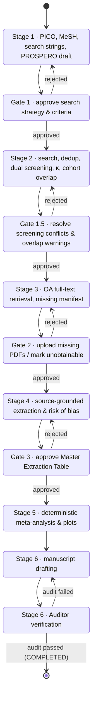

# Architecture — SysRev Meta-Analysis Agent

A PRISMA 2020-compliant, human-in-the-loop (HITL) pipeline for systematic reviews and
meta-analyses. This document describes the state machine, data contracts, persistence
model, external clients and the verification workflow. It also lists what is
implemented today and what is not.

---

## 1. Non-negotiable guardrails

| # | Guardrail | Where it is enforced |
|---|-----------|----------------------|
| G1 | **Zero fabrication of literature.** Bibliographic records come only from deterministic API clients (PubMed E-utilities, Europe PMC, OpenAlex, Crossref) or user-uploaded PDFs. An LLM never writes a citation, identifier or study datum from its weights. | `src/apis/*` build `StudyRecord`s only from fields present in API responses. Invalid identifiers are **dropped, never "repaired"**. Each record carries a `SearchProvenance` (database, query, endpoint, timestamp, reported hit count). |
| G2 | **Zero LLM arithmetic.** Effect sizes, pooled estimates, heterogeneity, bias tests and Median/IQR→Mean/SD conversions are computed by deterministic code. | `ExtractedValue` rejects any value that is not literally the number printed in its `verbatim_quote` (§4.3). Derived numbers can only originate from `src/stats_engine` (§9.5), run from a human-approved analysis plan. The Auditor cross-checks manuscript numbers against `stats_output.json`. |
| G3 | **Humans own every gate.** The pipeline cannot pass a HITL gate without a recorded, authenticated human decision. | `PipelineStateMachine` refuses gate exits unless `actor_type == HUMAN` and a matching `GateDecision` is supplied (§3). The HTTP gate endpoint requires an enrolled reviewer's bearer token, and the repository refuses to persist a gate decision without an active enrolled reviewer (§6). |
| G4 | **Append-only audit trail.** | `state_transitions`, `gate_decisions` and `source_evidence` rows raise on ORM update/delete (§5). |

---

## 2. Repository layout

```
src/
  core/            Settings, enums, identifier normalisation, exceptions
    schemas/       Pydantic v2 data contracts (one module per stage)
  state/           State machine (machine.py), SQLAlchemy models (db.py), repository.py
  apis/            Async, rate-limited clients: PubMed, Europe PMC, OpenAlex, Unpaywall, Crossref
  screening/       Deduplication, Cohen's kappa + conflicts, PRISMA tracker, cohort-overlap detector,
                   dual automated (LLM) screening + human adjudication, reviewer-reporting facts
  llm/             Provider-agnostic LLM interface, config and registry (no provider built in)
  fulltext/        Stage 3: OA retrieval (Europe PMC XML, Unpaywall PDF), safe download,
                   content-addressed storage, uploads + identity matching, Gate 2 manifest
  pdf_extractor/   pdfplumber/pypdf parsing (pages, blocks, tables, labels) + evidence grounding
  extraction/      Stage 4: proposals → verification → Master Extraction Table; RoB drafts
  stats_engine/    Stage 5 deterministic statistics (§9.5), validated against R metafor
validation/        R reference script, metafor comparison, VALIDATION_REPORT.md
  auditor/         Stage 6 Auditor Agent                     (contract only — not implemented)
  api_server/      FastAPI app: project state, guards, gate decisions, Stage 2-4 review routes
  search/          Session 5: database registry, protocol editor, search execution, RIS/BibTeX/CSV
                   import, preparation for screening, PRISMA derivation, PRISMA-S report
  ui/              Local Streamlit reviewer UI (Session 4; protocol & search pages in Session 5)
tests/
  unit/            Schemas, identifiers, state machine, persistence, clients, screening, API
  integration/     End-to-end Stage 1→6 flow; opt-in live API smoke tests (`-m live`)
  fixtures/        Synthetic API payloads and a dependency-free synthetic-PDF builder
                   (10.5555 test-prefix DOIs; invented content; not real citations or data)
```

---

## 3. The 6-stage state machine

`src/state/machine.py` is the single source of truth for *what may happen next*. Any
orchestrator (a future LangGraph graph, the CLI, the FastAPI layer) must request
transitions through `PipelineStateMachine.transition()` / `.submit_gate_decision()`;
there is no API that sets a phase directly.



### 3.1 Gate rules

* Only a `HUMAN` actor may leave a gate phase, and only with a `GateDecision` whose
  `gate` matches the current gate.
* `APPROVED` moves forward (guards are evaluated); `REJECTED` moves back (guards are
  skipped — you can always go back) and **must** carry comments.
* `GATE_OUTCOMES` fixes the destination of each verdict; a decision cannot be used to
  jump elsewhere.

### 3.2 Guards

Guards are pure functions over a `GuardContext` snapshot. **Guards fail closed:**
`GuardContext` has no default values, so no caller can obtain a passing guard by
omitting a fact, and `Repository.build_guard_context()` derives every value from
persisted rows. Absent data (no PRISMA snapshot, no manifest rows, no decisions) is
reported as missing work, never as completion.

Screening status is computed per record from the stored `ScreeningDecision`s
(`screening_status()`): a record is *decided* only when an authenticated human
adjudicator decided it, or Reviewer 1 and Reviewer 2 agree on include/exclude. A
`ScreeningConflict` resolution is never a source of truth: it is persisted only as a
mirror of a matching human ADJUDICATOR decision by an active enrolled reviewer
(`save_conflict()` also checks that the conflict matches the stored reviewer decisions),
and the guards ignore conflict rows entirely, so an injected or fabricated resolution
cannot release a missing or conflicting record. A disagreement counts as unresolved
even if no `ScreeningConflict` row was ever saved.

| Transition | Guard (all must hold) |
|------------|------------------------|
| Gate 1 → Stage 2 | Protocol exists; ≥1 search strategy; every strategy `syntax_validated`; every MeSH term `verified` against NLM MeSH; selected databases and strategies agree; **the current version is `approved` by an active enrolled reviewer whose name matches (`approved_reviewer_id`)** (Session 5) |
| Stage 2 → Gate 1.5 | Once the search log is used (§9.7): every approved strategy has an execution, import or a reasoned "not searched" entry; no unacknowledged count discrepancy; records deduplicated after the last search/import; every record attributable to a logged run. Then: ≥1 stored record; **every unique (non-duplicate) record has title/abstract decisions from both reviewers** (a human adjudication decides the verdict but never substitutes for a missing pass); PRISMA snapshot recorded, internally consistent and consistent with stored records |
| Gate 1.5 → Stage 3 | As above, plus 0 unresolved title/abstract disagreements; 0 unresolved possible-duplicate pairs; 0 unresolved cohort-overlap warnings; PRISMA shows 0 records awaiting screening; ≥1 record included |
| Stage 3 → Gate 2 | **Every title/abstract-included record has a full-text manifest entry** |
| Gate 2 → Stage 4 | As above, plus every manifest entry is downloaded, uploaded, `UNOBTAINABLE` with a reason, or structured-text-only **with a human acknowledgement that no usable PDF is available**; **every linked PDF has a positive identity check** (`CONFIRMED` by the deterministic matcher or `HUMAN_CONFIRMED`; a missing check counts as unconfirmed) |
| Stage 4 → Gate 3 | **Every retrieved report has a final full-text eligibility decision** (dual review, adjudication or resolved conflict); **every full-text outcome resting only on automated passes is confirmed by an authenticated human**; ≥1 report included; every included report has ≥1 extracted arm, belongs to a study (§9.3) that has one, or is recorded as qualitative-only by a human; **no included report lacking data is XML-only or without a confirmed PDF**; no arm belongs to a non-included report; 0 values without `SourceEvidence` |
| Gate 3 → Stage 5 | As above, plus every arm approved by a human; **0 master-table items awaiting review; every included study has a human-approved risk-of-bias assessment; no outcome receives arm data from two reports of the same cohort without a documented human resolution (§9.3)**; PRISMA recorded, consistent with stored records and final (nothing awaiting screening, retrieval or assessment) |
| Stage 5 → Stage 6 | **A verified `stats_output.json`**: stored (append-only) with a matching SHA-256, schema- and results-hash-valid, computed from the *latest* human-approved analysis plan and from the *current* approved extraction data (input hash recomputed; any later change blocks Stage 6 until Stage 5 is re-run) (§9.5) |
| Stage 6 → Audit | Manuscript draft exists |
| Audit → COMPLETED | Latest `AuditReport.passed is True` |
| Audit → Stage 6 | Latest `AuditReport.passed is False` |

**PRISMA cross-check.** The stored `PRISMACounts` snapshot must agree with the database:
total identified = stored records; duplicates removed = records with `duplicate_of`;
records screened / excluded / awaiting screening = derived title/abstract status;
reports not retrieved / assessed = manifest `UNOBTAINABLE` / retrieved entries; reports
included and Σ(exclusion reasons) = derived full-text status. Removals other than
duplicates (automation, other reasons) are not yet recorded per record, so any non-zero
value is reported as unverifiable and blocks progress.

`GuardViolationError.violations` lists every failed condition, and
`GET /projects/{id}/guards` exposes them to the UI before a reviewer acts.

---

## 4. Data contracts (`src/core/schemas`)

All models inherit `StrictModel` (`extra="forbid"`, whitespace stripping,
`validate_assignment=True`) or `FrozenModel` (immutable). Unknown fields are rejected,
which blocks an LLM from smuggling extra keys into structured output. All timestamps
must be timezone-aware.

### 4.1 Stage 1 — `protocol.py`
* **`PICOProtocol`** — title, question, P/I/C, `review_design`
  (`comparative` | `single_arm`), `outcomes: list[OutcomeDefinition]` (≥1 primary), study
  designs, inclusion/exclusion criteria, MeSH terms, search strategies, PROSPERO ID
  (`CRD` + 11 digits), versioning, approval fields. `approval_blockers()` lists what
  prevents Gate 1 approval; an `approved` protocol with blockers fails validation.
  * *Comparative* reviews require a `comparator` and may not list designs without a
    comparison group (`single_arm_trial`, `case_series`).
  * *Single-arm* reviews (e.g. stereotactic radiosurgery case series) must not define a
    comparator, may contain only `single_group` outcomes, and exclude `case_control`
    designs, whose outcome-based sampling does not permit estimating proportions or
    incidence.
* **`OutcomeDefinition`** — `clinical_type` (tumour control, AVM obliteration, pain
  relief, hearing preservation, adverse event, OS, PFS, functional outcome, other),
  operational `definition`, `grading_system` (e.g. CTCAE v5.0, BNI), `data_type`
  (dichotomous / continuous / time-to-event / count-rate), `comparison`
  (comparative / single-group), `preferred_effect_measure` and structured
  `timepoints`. Admissible measures:

  | comparison | dichotomous | continuous | time-to-event | count/rate |
  |---|---|---|---|---|
  | comparative | RR, OR, RD | MD, SMD | HR | IRR |
  | single-group | PROPORTION (crude) | MEAN, MEDIAN | KM_PROBABILITY, CUMULATIVE_INCIDENCE, MEDIAN_TIME_TO_EVENT | INCIDENCE_RATE |

  A crude proportion (events ÷ n, censoring ignored) and a Kaplan-Meier probability
  (accounts for right-censoring; Kaplan & Meier 1958) are different quantities and sit
  in different cells, so they cannot be confused or pooled together by schema. Where
  competing risks exist (e.g. death before radiation necrosis), 1 − KM overestimates
  the cumulative incidence (Gooley et al. 1999), hence the separate
  `CUMULATIVE_INCIDENCE` measure. Single-group outcomes need ≥1 timepoint (except
  median time-to-event); KM and cumulative-incidence outcomes need **fixed** timepoints
  (an estimate at time *t*), whereas crude proportions may use "last follow-up" or a
  window.
* **`FollowUpTimepoint`** — `fixed` (value + unit), `window` (min–max + unit) or
  `last_follow_up`. Descriptive only; no time arithmetic.
* **`MeSHTerm`** — starts `verified=False`; may only be marked verified (with
  `verified_at`) after `PubMedClient.mesh_descriptor_exists()` confirms it.
* **`SearchStrategy`** — per-database query with balanced-parentheses/quotes check,
  platform, date limits and filters (PRISMA-S reproducibility); content hash `sha256`;
  validation method, validator and time (Session 5).

### 4.2 Stage 2 — `study.py`, `screening.py`, `cohort.py`
* **`StudyRecord`** — one *report*. Identifiers are normalised on validation (DOI
  lower-cased and stripped of resolver prefixes; PMID canonical integer string; PMCID
  `PMC…`). Carries authors with affiliations, registry IDs, optional
  `RecruitmentPeriod`, `duplicate_of`, and `SearchProvenance`.
* **`ScreeningDecision`** — reviewer role, identity, stage, verdict, rationale. Exclusions
  require a reason; adjudicators must be human; full-text verdicts cannot be `uncertain`.
* **`ScreeningConflict`** — R1/R2 disagreement (or both `uncertain`); resolution fields
  must be set together and resolve to include/exclude.
* **`AgreementStatistics`** — observed/expected agreement and Cohen's κ (`None` when
  undefined).
* **`CohortOverlapWarning`** — canonical pair (`a < b`), score, severity, per-signal
  breakdown, shared authors/institutions/registry IDs; resolution requires `resolved_by`.
* **`DuplicateCandidate`** — a pair the deduplicator matched but refused to merge
  (`match_basis`, `conflict`, optional title similarity). Resolution (`distinct`,
  `duplicate_keep_a`, `duplicate_keep_b`) requires `resolved_by` and `resolved_at`;
  `Repository.resolve_duplicate_candidate()` re-points the dropped cluster's records.

### 4.3 Stages 3–4 — `extraction.py`
* **`FullTextItem`** — the Gate 2 manifest row (first author, year, journal, title, PMID,
  DOI, status). PDF statuses require filename + SHA-256; `UNOBTAINABLE` requires a reason.
* **`SourceEvidence`** (frozen) — PDF filename, optional SHA-256, page number (≥1),
  location type (table/figure/paragraph/supplement), location identifier, **verbatim
  quote**, extractor identity and type.
* **`ExtractedValue`** — `value`, `reported_text`, `unit`, `evidence`. Validation
  requires (i) `reported_text` occurs in `evidence.verbatim_quote` (whitespace-normalised)
  and (ii) `value == parse_reported_number(reported_text)`. The parser handles the
  Unicode minus, Lancet-style mid-dot decimals (`12·5`), thin spaces, thousands
  separators and a lone decimal comma, and performs no arithmetic. Consequently, a
  computed number (e.g. a mean estimated from a median) **cannot** be stored as an
  extracted value.
* **`ExtractedStudyArm`** — arm-level data (n randomised/enrolled, n analysed, events,
  mean, SD, SE, median, Q1, Q3, min, max), each an `ExtractedValue`; `arm_role` includes
  `single_group` for single-arm studies. An author-reported summary is held separately:
  `estimate_type` (crude proportion, Kaplan-Meier, actuarial life table, cumulative
  incidence, incidence rate, median time-to-event), `estimate_scale`
  (percent | proportion), `reported_estimate`, `ci_lower`/`ci_upper` + `ci_level`,
  `follow_up` (`FollowUpTimepoint`), `n_at_risk`, `follow_up_median`, `person_time`.
  Plausibility checks: counts are non-negative integers; events ≤ n analysed ≤ n
  randomised; n at risk ≤ n analysed; SD/SE/follow-up/person-time ≥ 0;
  min ≤ Q1 ≤ median ≤ Q3 ≤ max; estimate and type given together; CI needs both bounds,
  a level and must contain the estimate; probability-type estimates lie within 0–1 or
  0–100 %; KM / life-table / cumulative-incidence estimates require a fixed `follow_up`;
  rates and median times require a unit. A KM probability is therefore never stored as,
  or derived from, `events`/`n`. Human approval requires approver and timestamp.
* **`RiskOfBiasAssessment`** — RoB 2 (5 domains; low/some concerns/high),
  ROBINS-I (7 domains; low/moderate/serious/critical/no information) or NOS (stars:
  selection ≤4, comparability ≤2, outcome/exposure ≤3). For RoB 2 and ROBINS-I the
  overall judgement may not be milder than the worst domain, as both tools' guidance
  specifies.

Session 2 additions: `FullTextItem` records retrieval provenance (attempts, source URL,
licence, XML hash, PDF identity `match_status`); `RiskOfBiasAssessment` gained approval
stamps and draft rules (§9.4); `ScreeningDecision` gained `reviewer_id` (humans) and
`automation` provenance (LLM passes). `master.py` defines `ExtractionItem`,
`EvidenceCheck`, `ExtractionReviewEvent`, `StudyReportLink` and
`QuantitativeUnavailability` (§9.3).

### 4.4 Stage 6 — `audit.py`
* **`NumericClaimCheck`** — manuscript number vs `stats_output.json` key with tolerance;
  the status must agree with the numbers.
* **`CitationCheck`** — citation vs a record in the project database (PMID/DOI).
* **`AuditReport`** — `passed` and `failures` are **computed**; a serialised report that
  claims `passed: true` while containing a failing check is rejected on load. An empty
  report does not pass.

### 4.5 Pipeline — `pipeline.py`
* **`GateDecision`** (frozen; carries `reviewer_id` of the authenticated reviewer),
  **`StateTransition`** (frozen), **`ProjectState`**.
* **`PRISMACounts`** — the PRISMA 2020 flow boxes plus three work-in-progress counters
  (`records_awaiting_screening`, `reports_awaiting_retrieval`,
  `reports_awaiting_assessment`). `records_screened` counts only records with a
  *completed* title/abstract decision. Invariants enforced at construction:
  * screened + awaiting screening = identified − duplicates − automation-ineligible − other removals
  * sought = screened − excluded
  * assessed = sought − not retrieved − awaiting retrieval
  * reports included = assessed − Σ(excluded with reasons) − awaiting assessment
  * studies included ≤ reports included

  `is_final` is true only when nothing is awaiting screening, retrieval or assessment.

---

## 5. Persistence (`src/state/db.py`, `repository.py`)

SQLAlchemy 2.0 typed ORM on SQLite (any SQLAlchemy URL works).

* Query-relevant fields are real, indexed columns; the full validated Pydantic payload is
  stored as JSON and **re-validated on every load**, so a corrupted row fails loudly.
* `source_evidence` is a separate table; `extracted_values.evidence_id` is
  `NOT NULL` + FK, so the database itself refuses a number without provenance.
* Extracted arms are write-once (corrections create a new arm); approval updates only the
  approval columns.
* `reviewers` stores enrolled reviewers with a salted scrypt hash of their token (never
  the token); `gate_decisions.reviewer_id` is a `NOT NULL` foreign key to it.
* `duplicate_candidates` stores unmerged, conflicting duplicate matches awaiting human
  adjudication.
* `state_transitions`, `gate_decisions`, `source_evidence` and (Session 2)
  `extraction_review_events` are append-only (ORM `before_update` / `before_delete`
  listeners raise `AppendOnlyViolationError`).
* Session 2 tables: `fulltext_documents` (every stored PDF/XML with SHA-256, source and
  uploader), `extraction_items` (the Master Extraction Table; a reviewed item can no
  longer be changed — corrections create a new version), `study_report_links`
  (report → study), `quantitative_unavailability` (qualitative-only inclusion).
* Every *human* action persisted in Stages 2–4 (screening adjudication and conflict
  resolution, duplicate-candidate and cohort-overlap resolution, PDF upload or identity
  confirmation, unobtainable / XML-only declarations, extraction review, arm approval,
  study linking, double-counting resolution, risk-of-bias approval) records the reviewer
  id and passes `Repository.require_active_reviewer()`:
  an unknown or revoked reviewer id is refused at the persistence layer, not only at the
  HTTP layer. `approve_extracted_arm()` now takes the authenticated `reviewer_id`.
* `projects.version_id` provides optimistic concurrency; `record_transition()` also
  rejects stale transitions whose `from_phase` no longer matches the stored phase.
* SQLite foreign keys are switched on (`PRAGMA foreign_keys=ON`); datetimes round-trip as
  UTC-aware values.

---

## 6. Human approval integrity

**Problem.** The first version accepted a `reviewer_name` in the request body as proof
of human approval, so any process able to send an HTTP request (including an autonomous
agent) could impersonate the reviewer.

**Mechanism (minimal, local).**

1. **Enrollment out of band.** A human runs
   `python -m src.api_server.reviewer_cli enroll "Dr Jane Doe"` in a terminal. The
   command refuses to run unless stdin and stdout are TTYs and the name is re-typed.
   It prints a token `rvw_<reviewer_id>_<secret>` **once**; the 256-bit secret comes
   from `secrets.token_urlsafe(32)`. `list` and `revoke` subcommands exist.
2. **Only a hash is stored.** `reviewers.token_hash` is scrypt(secret, 16-byte random
   salt; n = 2¹⁴, r = 8, p = 1; RFC 7914), compared in constant time. Reading the
   database does not reveal a usable token.
3. **Bearer authentication on gate decisions.** `POST /projects/{id}/gates/{gate}`
   requires `Authorization: Bearer <token>`. Missing, malformed, wrong or revoked tokens
   return 401 (`WWW-Authenticate: Bearer`). The request body accepts only `verdict` and
   `comments`; a body that names a reviewer is rejected (422), not silently ignored. The
   decision's `reviewer_name` and `reviewer_id` come from the authenticated token.
4. **Persistence enforcement.** `Repository.record_transition()` refuses any gate
   decision whose `reviewer_id` is missing, unknown, revoked, or whose name does not match
   the enrolled reviewer; `gate_decisions.reviewer_id` is a `NOT NULL` foreign key.
5. **Hygiene.** The server is meant to bind to loopback (uvicorn's default
   `127.0.0.1`); file-based SQLite directories are created with mode `0700`. Tokens
   must not be placed in `.env`, the repository, or anywhere an agent process can read.

**Remaining limitations (threat model).** These measures stop an agent that can only
reach the HTTP API, or that only knows a reviewer's name, from approving a gate. They do
**not** protect against a process running as the same OS user with general shell or
file access, which could:

* drive the enrollment CLI through a pseudo-terminal and mint its own token;
* read a token from the human's terminal scrollback, clipboard, password-manager export
  or any file it was saved to;
* write the SQLite file directly (insert a reviewer hash or a transition row), bypassing
  application code entirely; or
* import the library in-process and call the repository with a known `reviewer_id`.

Robust separation therefore requires running the agent as a **different OS user or in a
container** with no access to the database file, the CLI, or the reviewer's session, and
talking to the API only over loopback. Further hardening not yet implemented: token
expiry/rotation, rate limiting of failed authentication, signed (e.g. Ed25519) decisions
verifiable independently of the database, TLS for any non-loopback deployment, and
multi-reviewer sign-off.

---

## 7. Literature API clients (`src/apis`)

All clients share `BaseAPIClient`: an `httpx.AsyncClient`, an `AsyncRateLimiter`
(sliding window, safe under concurrency, injectable clock), retries on 429/500/502/503/504
and transport errors with exponential back-off capped at 60 s, `Retry-After` support
(delta-seconds or HTTP-date), and a `User-Agent` carrying the contact address.

| Client | Endpoint(s) | Paging | Policy honoured |
|--------|-------------|--------|-----------------|
| `PubMedClient` | `esearch.fcgi` (JSON), `efetch.fcgi` (XML via POST, 200 IDs/batch) | `retstart`/`retmax` | `tool` + `email` on every call; 3 req/s, 10 req/s with API key. Queries matching > 10,000 records raise `SearchResultTooLargeError` (ESearch cannot page past 10,000) instead of silently truncating. XML parsed with entity resolution and network access disabled. `mesh_descriptor_exists()` checks `db=mesh`. |
| `EuropePMCClient` | `/search?resultType=core&format=json` | `cursorMark` (≤1000/page) | Configurable rate. |
| `OpenAlexClient` | `/works?search=&filter=` | `cursor` (≤200/page) | `mailto` (polite pool); optional `api_key`. Abstracts rebuilt from the inverted index; author surnames split heuristically and flagged `name_parsed_heuristically=True`. |
| `UnpaywallClient` | `/v2/{doi}?email=` | — | `email` required. `download_pdf()` accepts content only if it begins with `%PDF-` (landing pages are rejected), stores it and returns its SHA-256. |
| `CrossrefClient` | `/works/{doi}` | — | `mailto`; used by the Auditor to confirm cited DOIs exist. |

Rate-limit numbers for Europe PMC, OpenAlex, Unpaywall and Crossref are conservative
configurable defaults (`.env.example`); check each provider's current documentation
before raising them.

---

## 8. Screening algorithms (`src/screening`)

### 8.1 Deduplication (`deduplication.py`)
1. **Exact pass** — union-find over DOI, PMID, PMCID and OpenAlex ID. Before two
   clusters are joined, **every member of one is compared with every member of the
   other**; if any identifier would take two different values in the merged cluster
   (e.g. a shared DOI but different PMIDs, or a DOI→PMID chain linking two different
   DOIs), the merge is refused and the pair is returned as a `PossibleDuplicate`
   (`match_basis = "exact <identifier> (<value>)"`). A conflicting record does not stop
   compatible records sharing the same identifier from merging with each other.
2. **Fuzzy pass** — records are blocked by publication year (±1; unknown years compared
   with all), titles normalised (markup removed, diacritics folded, case-folded,
   punctuation collapsed) and compared with RapidFuzz `token_sort_ratio`
   (vectorised `cdist`). Pairs ≥ threshold (default 95) are merged highest-score first,
   **unless any member of either cluster contradicts the merge** (different DOIs,
   different PMIDs, different first-author surnames). Contradicted pairs are returned as
   `PossibleDuplicate` for human review. This is deliberately conservative: a false merge
   silently deletes a study, while a missed merge is caught at screening.

   Blocked pairs are reported once per pair; `PossibleDuplicate.to_candidate()` converts
   them to persistable `DuplicateCandidate`s, and every candidate must be adjudicated by a
   human before Gate 1.5 can be released.
3. **Representative** — the most complete record (PMID > DOI > abstract > …), ties by
   source priority then `record_id`. Missing identifiers are filled from duplicates,
   never overwritten.

The result is independent of input order (tested by shuffling).

### 8.2 Dual screening support (`agreement.py`)
`cohens_kappa()` implements κ = (p_o − p_e)/(1 − p_e) (Cohen, 1960) for any number of
categories and returns `None` when p_e = 1. `detect_conflicts()` flags disagreements and
double-`uncertain` records; `final_verdicts()` refuses to produce a consensus while any
conflict is unresolved.

### 8.2a Automated dual screening (`llm_screening.py`, `reporting.py`) — Session 2
Two `LLMScreener`s (separate provider instances; distinct labels; neither sees the
other's output) screen each record against the **approved** protocol. Criteria get
stable ids (`I1..`, `E1..`). Replies must match `LLMScreeningResponse`; the
**conservative policy** downgrades an `exclude` to `uncertain` unless it cites a
predefined criterion, the model reports sufficient information, and every supporting
quote occurs (whitespace/typography-normalised) in the screened text. Malformed replies
become `uncertain`; transport failures record nothing and are retried on the next run
(resume = existing decisions are skipped). Decisions are `is_human=False` with
`AutomatedReviewerProvenance` (provider, model, prompt version, prompt/response
SHA-256, raw verdict, policy notes). Every disagreement or `uncertain` becomes a
`ScreeningConflict`; only `adjudicate()` with an enrolled reviewer resolves it.
κ is computed by the existing `cohens_kappa()` over complete pairs.

**Reporting.** `screening_reporting_facts()` derives who screened from stored decisions;
`methods_statement()` renders a deterministic sentence that states the passes are
automated and *not equivalent to independent human reviewers* (and when both passes
used the same model, says so); `check_reviewer_claims()` flags text that describes them
as two human reviewers. Human full-text responsibility: a full-text outcome supported
only by automated passes blocks Gate 3 until a human confirms it.

### 8.3 PRISMA tracker (`prisma.py`)
Counts are derived from recorded events (identification per database, duplicates removed,
per-record screening/retrieval/eligibility outcomes), not typed in. Decisions are
idempotent; re-excluding a record clears its downstream state.

Incomplete screening is represented explicitly: `records_awaiting_screening` is the set of
registered records without a final decision (`register_screening_pool()`, recommended),
or else identified − removed − decided. A snapshot taken mid-screening is therefore valid
but not final, and more decisions than records entering screening raises an error.
`snapshot()` returns a validated `PRISMACounts` or raises `PRISMAInconsistencyError`.

### 8.4 Overlapping Cohort Detector (`cohort_overlap.py`)
Flags report pairs that may describe the same participants; it never excludes or merges.

| Signal | Score in [0, 1] |
|--------|-----------------|
| Shared registry ID (NCT, ISRCTN, EudraCT, ChiCTR, ACTRN, DRKS, CTRI, jRCT, UMIN) | Decisive → composite 1.0, HIGH |
| Co-author overlap | Overlap coefficient of `surname + initial` keys; one shared name in teams ≥4 ×0.5 (name collisions) |
| Affiliation similarity | Share of the smaller study's institutions matched (`token_set_ratio` ≥ 85) after dropping department segments, cities and generic words |
| Recruitment overlap | Overlapping years ÷ shorter period |
| Publication proximity | Substitutes for unknown recruitment at half weight |

Composite = 0.40·co-author + 0.30·affiliation + 0.30·time. A pair is only considered if
it shares a registry ID, at least one author, or (≥50 % institutions and overlapping
known recruitment). Thresholds: flag ≥ 0.45, MODERATE ≥ 0.55, HIGH ≥ 0.70.
**These weights and thresholds are engineering heuristics and have not been validated
against a labelled corpus.** They are configurable, and every warning lists its
individual signals so reviewers can judge them. Candidate pairs come from an inverted
index (shared author key, registry ID or institution token) to avoid all-pairs work.

---

## 9. Verification workflow (end to end)

1. **Search provenance** — each record stores its database, exact query, endpoint, time
   and reported hit count → PRISMA-S reporting and reproducibility.
2. **MeSH verification** — LLM-proposed headings must be confirmed against NLM MeSH before
   Gate 1 can be approved.
3. **Dual screening + κ + human adjudication** — Gate 1.5 cannot open with unresolved
   conflicts or overlap warnings.
4. **Full-text manifest** — Gate 2 cannot open until each missing report is uploaded
   (hash recorded) or explicitly declared unobtainable with a reason.
5. **Source-grounded extraction** — every number is a literal copy from a quoted passage
   on a specific PDF page, enforced at schema and database level; Gate 3 requires human
   approval of every arm.
6. **Deterministic statistics** — Stage 5 writes `stats_output.json`; its SHA-256 is
   stored on the project and referenced by every `AuditReport`.
7. **Independent audit** — each manuscript number is matched to a `stats_output.json`
   key (with explicit tolerance) and each citation to a database record re-verified via
   Crossref/PubMed. `COMPLETED` is reachable only from a passing report; a failing report
   sends the manuscript back for redrafting.

### 9.1 Stage 3 — full-text retrieval (`src/fulltext`) — Session 2
`FullTextRetriever.run()` processes title/abstract-included records one at a time and
commits after each (pause/resume across restarts; `.partial` leftovers are cleaned at
start). Order of preference: Europe PMC open-access **JATS XML** (`/{PMCID}/fullTextXML`,
PMCID via `EXT_ID:<pmid> AND SRC:MED` if needed) for provenance and structured text,
then **Unpaywall** open-access PDF locations. Only URLs returned by these services are
fetched; no paywall or authentication is circumvented. Downloads are streamed with a
byte limit, require a `%PDF-` header within the first 1 KiB, are opened with pypdf, and
are moved atomically into a content-addressed store (`<sha256>.pdf`). Each attempt is
recorded (`RetrievalAttempt`); failures leave the report `MISSING`, never excluded.
XML-only reports are *retrieved* for PRISMA (`OA_STRUCTURED_TEXT`) but are **not
extraction-ready**: numeric evidence must cite a physical PDF page, so they are retried
for a PDF on later runs, block Gate 2 until a reviewer calls `acknowledge_xml_only()`,
and block Gate 3 while included without data unless a PDF is uploaded or the report is
recorded as unavailable for quantitative synthesis. `report_flow()` separates reports
retrieved with a usable PDF, retrieved as structured XML only, and not retrieved.
**Download safety (SSRF):** every request target, including each redirect hop (followed
manually, at most 5), must be http(s) without credentials and resolve only to globally
routable addresses; loopback, private, link-local (incl. cloud metadata), CGNAT,
multicast and reserved ranges are refused before any request is sent. DNS rebinding
between the check and the connection is not prevented. Every PDF (OA or uploaded)
is checked against its record (`assess_match`: DOI/PMID on page 1, fuzzy title,
first-author surname; identical bytes linked to another record); uncertain or mismatched
links block Gate 2 until `confirm_pdf_match()` by a reviewer. `mark_unobtainable()`
needs a reviewer and a reason and counts as PRISMA "not retrieved", distinct from
"assessed and excluded" (`report_flow()`). `build_manifest()` exports the missing-report
manifest (title, authors, year, journal, DOI, PMID, PMCID, status, last attempt) as CSV
or JSON.

### 9.2 PDF parsing and evidence grounding (`src/pdf_extractor`) — Session 2
pdfplumber (MIT) gives per-line text, ruled-table detection and cell extraction; pypdf
reads `/PageLabels`. PyMuPDF was not used (AGPL licence; not needed). Output is a
`ParsedDocument` with physical pages, logical page labels, a heuristic printed page
number, classified blocks (`p{page}.b{n}`: paragraph, heading, table caption, figure
legend, supplementary), tables (`p{page}.t{n}`, cells `…r{row}c{col}`), and per-page
issues: image-only pages (no OCR is performed — flagged for manual review), unreadable or
ragged tables, and table captions without detectable structure. Text-based tables that
have no ruling lines are **not** reconstructed (flagged instead).

`verify_evidence()` checks a `SourceEvidence` against the parsed document: SHA-256 and
filename, page range, image-only page, quote present **on the cited page** (else
`WRONG_PAGE` with the actual pages, or `QUOTE_NOT_FOUND`), the reported number as a whole
token inside the quote, and — for structured ids — that the quote is in the cited
block/table and the number in the cited cell. Matching normalises Unicode compatibility
forms, ligatures, dashes, quotes, soft hyphens, words hyphenated across lines, letter
case and whitespace next to non-digits, but never whitespace between digits, so `12 34`
cannot match `1234` and `12` cannot match `125` or `12.5`. `select_context()` sends only
the highest-scoring blocks/tables (labelled with page and id) to a model.

### 9.3 Master Extraction Table (`src/extraction`) — Session 2
An extractor (LLM or human) submits `ProposedValue`s: number as printed, page, location,
verbatim quote — never a computed value (`value` is parsed from `reported_text`).
`proposal_to_item()` grounds each proposal in the record's linked PDF (another PDF is
refused) and stores an `ExtractionItem` with `data_status` (`reported`, `not_reported`,
`ambiguous`, `contradictory`, `inaccessible`; `derived` is refused in Stage 4), the
`EvidenceCheck` and discrepancy flags — including estimator conflicts (Kaplan-Meier /
actuarial wording recorded as a crude count, competing-risks wording recorded as KM, or
"x of n" wording recorded as KM). Missing data are `value=None`, never zero.

Review (`accept_item`, `reject_item`, `correct_item`) requires an enrolled reviewer; a
reported value can be accepted only if its evidence verified; flagged items need a note;
corrections must themselves verify, or be explicitly `HUMAN_ATTESTED` (e.g. a figure or an
image-only page) with the failed machine check recorded. Every action appends an
`ExtractionReviewEvent` (before/after payloads). `build_arms()` assembles accepted items
into human-approved `ExtractedStudyArm`s keyed by report, outcome, arm, timepoint **and
estimator**, so crude proportions and KM/cumulative-incidence estimates are never merged;
`analysis_compatibility()` states whether an arm can inform an outcome's summary measure
without conversion. Reports are linked to studies (`link_reports_to_study`);
`double_counting_conflicts()` groups approved arms by cohort (study links plus
cohort-overlap warnings a human resolved as overlapping), outcome, arm role, timepoint
and estimator; a group fed by two or more reports blocks Gate 3 → Stage 5 until
`resolve_double_counting()` records either "keep one report" (the others become
`overlapping_cohort` unavailability for that outcome) or a reviewer-attested
`CohortContributionDecision` that the reports contribute non-overlapping samples.
Different outcomes, timepoints and estimators never collide; `record_unavailability()` records an eligible study that is
available only for qualitative synthesis (or not for one outcome) with a reason.
`export_rows()` → CSV/JSON with study and report ids, every evidence field, verification
and review status.

### 9.4 Risk of bias (`src/extraction/rob.py`) — Session 2
`select_rob_tool()` maps design and review type to RoB 2 (randomised), ROBINS-I
(comparative non-randomised studies of interventions; NOS allowed with justification for
cohort/case-control), NOS (single-group cohorts, with justification) or an `EXTERNAL`
human-recorded instrument (case series and single-arm trials, for which none of the three
is designed; e.g. MINORS or the JBI case-series checklist). `LLMRoBDrafter` produces RoB 2
/ ROBINS-I drafts: invalid domains or judgements are refused, only verified quotes are
kept as evidence, unverifiable quotes are listed in `needs_human_attention`, and a domain
without verified support is marked `missing_information`. Schema rules: an automated
draft can never carry an overall judgement; approval requires an enrolled reviewer (id,
name, time) and an overall judgement no milder than the worst domain. GRADE is out of
scope until Session 4.

### 9.5 Stage 5 — deterministic meta-analysis (`src/stats_engine`) — Session 3

**Inputs.** `Repository.load_stage5_inputs()` gathers the protocol outcomes, the extracted
arms, the **full-text-eligible report universe**, report → study links, cohort labels (study links plus human-resolved overlap
warnings), recorded unavailability and `CohortContributionDecision`s, and the
first-author/year labels; its canonical SHA-256 is the *input hash*. `run_stage5()` refuses
to run outside Stage 5, without an approved plan, or with arms for reports not included at
full text; `run_plan()` refuses any arm not approved by a human or belonging to a report
outside the eligible set.

**Analysis plan** (`AnalysisPlan` / `AnalysisSpec`, `src/core/schemas/stats.py`). Approved
by an enrolled reviewer (`POST /projects/{id}/stats/plan`, bearer token; the persistence
layer re-checks the reviewer and that each spec's measure is admissible for the outcome and
its timepoints are pre-specified in the protocol). Per analysis: outcome, measure, one or
more **structured timepoints** (several only with a written justification), primary model,
τ² estimator (REML default, DL), random-effects CI (HKSJ default, ad hoc HKSJ, Wald),
common-effect method (MH default for RR/OR), proportion method (GLMM default), for
KM/cumulative incidence the **declared CI scale** of the authors' intervals, whether KM and
actuarial estimates may be combined (default no; needs a reason), explicit arm selections
for multi-arm reports, confidence level and display decimals. Plans are append-only.

**Input integrity** (`inputs.py`). Per analysis and report: human-recorded unavailability
→ excluded with the human's reason; estimators never substituted (crude counts for
PROPORTION/RR/OR; KAPLAN_MEIER (+ACTUARIAL if allowed) for KM; CUMULATIVE_INCIDENCE
only for cumulative incidence; raw summaries for MD/SMD); the arm's structured follow-up
must equal a plan timepoint exactly (no unit conversion; "24 months" ≠ "2 years"); exactly
one arm per role unless the plan selects one; several reports of one cohort only if a
human documented non-overlapping participants for that outcome — otherwise all are
excluded as `overlapping_cohort`. Every exclusion is listed with a reason code.

**Report accounting.** Every full-text-eligible report appears exactly once in each
analysis's `reports` ledger: `included` (with its analysis unit) or `excluded` with a reason
code. Three cases are kept distinct: `recorded_unavailable` (a reviewer recorded the
report as unusable for the outcome), `confirmed_not_reported` (a reviewer recorded that the
source does not report it — `QuantitativeUnavailability.reason_code = "not_reported"`; the
only status that asserts non-reporting), and the neutral
`outcome_data_not_extracted_or_unverified` (no approved, verified extraction exists; this
makes no claim about the paper). Missing data are never treated as zero events. The ledger
is in `stats_output.json` and in each analysis's Markdown and CSV table.
`excluded` lists a study/cohort once, with all its reports, and only when none of its
reports contributes; a non-contributing report of a contributing cohort is recorded in the
ledger only, so duplicate reports are never counted as separate studies.

**Independent model failures.** Each model is estimated on its own. If one fails (e.g. a
zero Hartung-Knapp SE when all study estimates are identical), the others are kept: a
failed sensitivity model is reported as a warning with its reason, and a failed primary
model gives `not_estimable` with the reason while the included studies, heterogeneity and
any estimable auxiliary models remain in the output, labelled as sensitivity results. No
other interval is substituted as primary.

**Methods** (each validated against metafor; see `validation/VALIDATION_REPORT.md`).

| Measure | Study level | Common effect | Random effects |
|---|---|---|---|
| Crude proportion | logit; Clopper-Pearson CI for display | binomial ML | **binomial-normal GLMM** (ML, 7-node adaptive Gauss-Hermite; Stijnen et al. 2010), no continuity correction; sensitivity: logit IV with 0.5 added only to 0 %/100 % studies |
| KM / cumulative incidence at *t* | SE = \|g(U) − g(L)\| / (2z) on the declared scale g; the CI must be symmetric on that scale within the rounding of the printed numbers, else not pooled | IV | IV on the declared scale |
| RR, OR | log; double-zero/double-all-event studies excluded; 0.5 added to all cells of single-zero studies (IV only) | **Mantel-Haenszel** (RBG / Greenland-Robins variance) | IV |
| MD, SMD | m₁ − m₂; Hedges' g with exact J | IV | IV |

Random effects: REML (global maximum of the restricted likelihood, Brent root finding) or
DL; CIs by HKSJ t(k−1) (IntHout et al., *BMC Med Res Methodol* 2014;14:25), ad hoc HKSJ
(never narrower than Wald) or Wald. Heterogeneity: Q, I² (Q-based), model I² = τ²/(τ²+s²),
H², τ² and I² Q-profile CIs. Prediction interval t(k−2) only for k ≥ 3. With k = 1 the
study's own estimate is reported (`single_study`) and no pooled, heterogeneity or
prediction statistic is computed. All-zero (or all-event) proportion data are
`descriptive_only`. HR, RD, IRR, incidence rates, means, medians and median survival are
`unsupported`: in particular **no HR is ever derived from survival percentages**, and SDs,
event counts or timepoints are never derived or converted.

**Output** (`StatsOutput`, schema 1.0.0). Per analysis: status and reason, included
studies (inputs used, yᵢ, vᵢ, CIs on both scales, weights, continuity-correction flags),
excluded studies with reason codes, common/random/sensitivity results, heterogeneity,
settings, methods, warnings and limitations; globally: engine/Python/numpy/scipy/platform
versions, numeric-precision statement, plan SHA-256, input SHA-256 and a results
fingerprint that the schema re-verifies on load (tampering fails validation). Floats are
stored at full binary64 precision. `write_artifacts()` writes `stats_output.json`
(canonical JSON, exactly the hashed bytes), `report.md`, per-analysis Markdown/CSV tables,
deterministic SVG forest plots and a `manifest.json` of file hashes. `flatten()` gives the
Auditor `"<analysis>.<model>.<field>"` keys.

**Pipeline integration.** `record_stats_output()` (Stage 5 only) **re-runs the approved
plan on the current data once and rejects the artifact unless its analyses are identical**
(results fingerprint; the first differing fields are reported), so a numerically altered
but hash-consistent `StatsOutput` cannot be recorded. It then stores the canonical JSON in
the append-only `stats_outputs` table and sets the project hash. Status checks and guards
do not recompute; they re-verify hashes, plan identity and the input hash. Direct writes to
the database file bypass this and remain outside the threat model (§6). The Stage 5 → 6 guard
re-verifies the stored artifact (§3.2), so setting a hash by hand, editing the stored JSON,
approving a new plan or changing approved data after the run all block Stage 6.

---

## 10. Implementation status

| Component | Status |
|-----------|--------|
| Data contracts (all stages) | Implemented and tested |
| State machine, guards, HITL gates | Implemented and tested |
| SQLAlchemy persistence, append-only trail | Implemented and tested |
| PubMed, Europe PMC, OpenAlex, Unpaywall, Crossref clients | Implemented; tested with mocked HTTP only. Live smoke tests (`pytest -m live`) were executed but all 6 failed with `ProxyError: 403 Forbidden` from the sandbox egress proxy before reaching any API. **Real API behaviour remains unverified** |
| Deduplication (with cluster-level identifier-conflict blocking), κ/conflicts, PRISMA tracker (with pending-screening accounting), cohort overlap | Implemented and tested |
| Fail-closed guards derived from persisted records, incl. PRISMA cross-check | Implemented and tested |
| FastAPI (state, guards, gate decisions, Stage 2–4 review routes) | Implemented and tested; every human action requires an enrolled reviewer's bearer token. LLM runs and retrieval are started from Python, not over HTTP |
| Reviewer enrollment CLI and token authentication | Implemented and tested; see §6 for the threat model and limitations |
| Single-arm / case-series protocol and outcome schemas; crude vs KM vs cumulative-incidence distinction | Implemented and tested (schemas only; no statistics) |
| LLM provider interface + registry (`src/llm`) | Implemented and tested with scripted providers. Session 4 adds Anthropic Messages and OpenAI Responses adapters (§9.6), registered only on request (`register_api_providers`) |
| Anthropic / OpenAI adapters, capability catalogue, per-task model/effort, usage ledger, budget guard (Session 4) | Implemented and tested with **mocked HTTP only**. **No live API call was made during development** (no credentials in the build environment). OpenAI catalogue entries and Responses usage fields were checked against the official documentation on 2026-10-30; Anthropic entries come from Anthropic's API reference cached 2026-10-06 |
| Dual automated screening, conservative policy, resume, conflicts, κ, authenticated adjudication, reporting facts | Implemented and tested (mocked models). Screening accuracy of any real model is **unvalidated** |
| Stage 3 retrieval (Europe PMC XML, Unpaywall PDF), downloads, uploads, identity matching, manifest, pause/resume | Implemented and tested with respx-mocked HTTP only; **no live retrieval was executed** |
| PDF parsing and evidence grounding | Implemented and tested on generated synthetic PDFs; not yet evaluated on real journal PDFs (multi-column layouts, rotated tables, unruled tables) |
| Master Extraction Table, review workflow, arms, exports, study linking, qualitative-only | Implemented and tested |
| LLM extraction proposals / RoB drafts | Implemented and tested with scripted replies; real-model quality unvalidated |
| JATS XML parsing for evidence; OCR; supplementary-file retrieval | Not implemented (XML is stored with provenance only; image-only pages are flagged) |
| PICO structuring / manuscript drafting agents | Not implemented |
| Statistics engine (`stats_engine`, Session 3) | Implemented for crude proportions (GLMM + logit IV), KM / cumulative incidence at time *t* (from reported CIs), RR, OR (IV, MH), MD, SMD; validated against metafor 4.4-0 / lme4 (1,475 comparisons; `validation/VALIDATION_REPORT.md`). HR, RD, IRR, rates, means, medians: reported as unsupported |
| Forest plots, tables, Markdown report | Implemented (matplotlib SVG, deterministic) |
| PRISMA diagram rendering, GRADE SoF | Not implemented |
| Auditor | Contract (`AuditReport`) only |
| Protocol editor, database selection, search execution (PubMed/Europe PMC/OpenAlex), RIS/BibTeX/CSV import, preparation for screening, search log, PRISMA derivation, PRISMA-S report (Session 5) | Implemented and tested with **mocked HTTP and synthetic export files only**; no live database call; parsers not tested on real vendor exports. Subscription-database APIs and a ClinicalTrials.gov API search are not implemented (manual import). Protocol amendments after Gate 1 and update (top-up) searches after screening has started are not supported |
| Model discovery / "Refresh Models" (issue #9) | Not implemented (deferred from Session 5): needs official model-list calls for both providers, versioned catalogue snapshots with sources, unverified-model flags that block execution, a reviewed manual override, and the mocked acceptance scenarios listed in the issue |
| Local UI (Streamlit, Session 4) | First usable version: projects, phase/blockers, authenticated advance and gate decisions, per-task model settings, keys, AI steps, screening queue and adjudication, PDF upload/identity, extraction accept/reject/arms, RoB approval, statistics and forest plots, usage/costs. Tested headlessly (Streamlit AppTest) on Linux; **not yet run on a Windows machine**. Session 5 adds protocol editing/approval, searches, imports, deduplication decisions and PRISMA recomputation. Not in the UI: item corrections, study linking, double counting, analysis-plan editing (use the API/Python) |

### 9.6 Real AI providers and the local UI (`src/llm`, `src/workflows`, `src/ui`) — Session 4

**Adapters** (`src/llm/adapters.py`) call `POST /v1/messages` (Anthropic, header
`anthropic-version: 2026-10-21`, adaptive thinking, `output_config.effort`) and
`POST /v1/responses` (OpenAI, `reasoning.effort`, `store: false`) with `httpx`. They send
the configured model and effort exactly as given: no fallback model, no automatic effort
change, no `temperature` (removed on Anthropic API version 2026-10-21 and not accepted by
reasoning models). A different served model (other than a dated snapshot of the requested
ID) or, on OpenAI, a different echoed effort discards the result.

**Capability catalogue** (`src/llm/model_catalogue.json`, overridable by
`<data_dir>/model_catalogue.json`) lists, per exact model ID, the accepted effort values,
output limit and list prices with their source. A configuration is validated against it
*before* any request; unknown models, unlisted efforts, a temperature or an excessive
output limit raise `UnsupportedConfigurationError`. Effort values are provider-specific
strings and are not mapped across providers.

**Errors.** `ProviderAccessError` (401/403/404), `InsufficientFundsError` (Anthropic
`billing_error`/"credit balance", OpenAI `insufficient_quota`) and
`UnsupportedConfigurationError` (400 parameter rejections) are never retried and halt a
batch run (`LLMRunHaltError`). Rate limits, overload (529) and 5xx are retried at most
twice with capped backoff; a connection failure before sending is retried; a read
timeout is *not* retried because the request may already have been billed. Refusal,
truncation at the output limit and empty output raise `LLMOutputError`; the item records
nothing and can be retried.

**Per-task settings** (`ProjectAISettings`, append-only versions in
`project_ai_settings`): provider, exact model, effort (`None` = provider default, not
sent) and output limit for `screening_reviewer_1`, `screening_reviewer_2`, `extraction`,
`verification` and `risk_of_bias`, plus local warning/stop thresholds. No credentials.

**Audit trail** (`llm_calls`, append-only): one row per call (also failed, budget-blocked
and duplicate-skipped calls) with task, requested and served model, effort sent and
effective, reported tokens (input, output, reasoning, cache read/write), list-price cost
estimate and its basis, provider request id, attempts, latency and SHA-256 of prompt and
reply. Prompts, replies and keys are not stored. Raw token fields are kept as reported;
`total_tokens` (used for project totals and token thresholds) follows each provider's
semantics: OpenAI `input_tokens` already include cached tokens and `output_tokens`
include reasoning tokens (total = input + output); Anthropic input, cache-read and
cache-creation tokens are disjoint (total = all three + output).

**Cost controls** (issues #3/#4, minimal scope): bounded retries; resumable runs (existing
decisions are skipped); identical successful requests (same task, model, effort, prompt)
are not repeated unless forced — but only once their *validated* result was persisted
(`llm_call_outcomes` links the call to the saved extraction items, verification or RoB
draft); a reply that failed JSON/schema validation or grounding is billed and logged but
never blocks an ordinary retry; the two screening passes never share a cache key; a
local stop threshold refuses to *start* calls once recorded estimated spend or tokens
reach it. This is not a hard spending cap (estimates can differ from invoices; a call in
flight completes); a cost threshold with an unpriced model is refused. No batching,
adaptive routing or response caching is implemented.

**Advisory verification** (`src/extraction/ai_verification.py`): a separately configured
model judges whether the quote/page supports a pending AI-proposed value as recorded.
Stored in `ai_verifications` with `is_human = false`; it never changes an item's status.
The deterministic evidence check remains the gate.

**Credentials** (`src/llm/credentials.py`): UI session memory → environment / `.env` →
OS credential store (`keyring`, optional). Keys are registered for redaction; error
texts, ledger rows and log records pass through `redact()`. Claude subscription or
Claude Code development credits and ChatGPT subscriptions do not pay for API calls.

**UI** (`src/ui`): Streamlit, bound to 127.0.0.1. Human actions are API calls (in-process
FastAPI app, or `SYSREV_API_URL`) with the reviewer's bearer token; AI steps run the
existing runners through `src.workflows.AIWorkflow`, which checks the phase and never
moves the state machine. New API endpoints: `GET /projects`, authenticated
`POST /projects/{id}/advance` (non-gate transitions, guards apply), and read-only
`/screening/{stage}/decisions`, `/extraction/ai-verifications`, `/ai/settings`,
`/ai/usage`.

### 9.7 Protocol editor, searches and imports (`src/search`) — Session 5

**Protocol editor** (`protocol_editor.py`, `PUT /projects/{id}/protocol`): drafts are
validated by `PICOProtocol` on every save. Version, status, approval fields and
verification flags in the submitted body are discarded; MeSH terms are verified only by
`verify_mesh()` (`PubMedClient.mesh_descriptor_exists`), strategies only by a clean API
preview (`validation_method = api_preview` for PubMed, whose ESearch reports query errors;
`api_accepted` for Europe PMC/OpenAlex, where a successful call is the only evidence) or an
authenticated `human_attestation` (subscription databases, registers). A strategy is
identified by the SHA-256 of its executable fields (database, platform, query, dates,
languages, filters). On save, verification is carried over only for an unchanged MeSH
descriptor or an unchanged strategy hash; changes are grouped as *eligibility*,
*outcomes*, *search* or *administrative* material changes and returned with the list of
invalidated items. Editing an approved protocol creates version *n*+1 as a draft (voiding
the approval); approval (`POST /protocol/approve`) requires an enrolled reviewer and no
`approval_blockers()`, and marks older approved versions `superseded`. Editing is allowed
only in Stage 1. Every action is in the append-only `protocol_events` table with the full
protocol payload.

**Databases** (`databases.py`): PubMed, Europe PMC and OpenAlex are executed through the
existing clients. Embase, Scopus, Web of Science, Cochrane CENTRAL and ClinicalTrials.gov
are manual-import sources (subscription, institutional API entitlement, or not
implemented). ClinicalTrials.gov is a register (PRISMA "registers" box).

**Search log** (`search_runs`, append-only; `SearchRun`): previews, executions, imports,
"not searched" declarations, acknowledgements and deduplication runs, each written after
the event and — except previews — by an authenticated reviewer. Executions record the exact
query (filters appended as `AND (...)`; date limits as E-utilities `datetype=pdat`
`mindate`/`maxdate`, Europe PMC `FIRST_PDATE:[a TO b]`, OpenAlex
`from_/to_publication_date` filters; language limits must be written into the query), the
protocol version, the reported count, the records retrieved and stored, every raw response
body (content-addressed, SHA-256; `api_key` removed from the recorded URL), and PubMed
date partitions. `PubMedClient.esearch_all()` halves the publication-date range until each
slice has ≤ 10,000 records and requires the union of distinct PMIDs to equal the total
count, otherwise `SearchIncompleteError` (nothing saved; a `failed` attempt is logged and
never counts as a search). Retrieved < reported is a `count_mismatch` that blocks Stage 2 →
Gate 1.5 until acknowledged. Direct retrieval is refused above 50,000 records.

**Imports** (`importers.py`): RIS (tag/value lines, continuation lines, `TY`…`ER`),
BibTeX (nested braces, common LaTeX accents) and CSV (delimiter sniffing, header aliases,
reviewer overrides). Only present fields are mapped; invalid identifiers are dropped with a
warning; an entry without a title refuses the whole file, so stored records always equal
the entries in the file. The file is stored content-addressed with its SHA-256, each raw
entry in `search_raw_records` (append-only), and the same file cannot be imported twice.
Reconciliation (`identification.import_totals`): the vendor-reported total for the whole
search (declared with any import of the strategy) is compared with the records imported
across all its files: *matched*, *mismatch*, *unknown* (no total declared — never treated as
a match and never replaced by the imported count; record provenance keeps
`total_hits_reported = None`) or *conflicting* (different totals declared). All but
*matched* block Stage 2 → Gate 1.5 and AI screening until an authenticated acknowledgement
with a reason is recorded **after the last import** whose summary equals the current
counts; any further import therefore invalidates it. A manual search with no results is an
attested zero-record import with a declared total of 0.

Restrictions: every API run and import stores the strategy's `protocol_restrictions`
(date limits, languages, separate filters) and `restrictions_applied`: `applied_by_system`
(API request), `confirmed_by_reviewer` (authenticated statement at import, with an optional
note), `not_confirmed` or `none_defined`. The vendor query is stored exactly as in the
protocol and never rewritten; for imports nothing is recorded as "sent". Imported records
whose publication year lies outside the protocol date limits are counted as a warning.

Current status (`identification.strategy_state`, `run_effects`): derived from the
chronological log. A successful execution/import makes a strategy *searched* and supersedes
earlier "not searched" declarations (which remain in the log, marked superseded); a later
declaration replaces an earlier one; a failed attempt never counts as a search; declaring a
searched strategy "not searched" is refused. The PRISMA-S report (strategy table, database
lists, Markdown, CSV with `current_effect` and `strategy_status` columns) and the readiness
checks use the same functions.

**Preparation** (`SearchService.prepare_for_screening`): resets `duplicate_of`, runs the
existing `Deduplicator` with `exact_match_title_floor = 60` (a shared DOI/PMID with
token-sort title similarity < 60 becomes a `DuplicateCandidate` instead of a merge; an
unvalidated engineering threshold), stores candidates for human adjudication
(`POST /duplicates/{id}/resolve`), records per-source identified/duplicate/unique counts
and saves the PRISMA snapshot. Human duplicate decisions are kept and re-applied when the
preparation is re-run (e.g. after a further import), and the same pair is not proposed
again. Preparation, searches and imports are refused once screening decisions exist
(update searches are not supported).
Records stay *records*: duplicates of one report are linked by `duplicate_of`; reports of
one study and overlapping cohorts are linked later (§9.3, §8.4), never merged here.

**PRISMA** (`prisma_sync.derive_prisma`, `POST /prisma/recompute`): every count is derived
from stored records, decisions and manifest rows with the same status functions as the
guards. **PRISMA-S report** (`reporting.py`, `GET /searches/report`): databases searched
are only those with an execution or import; selected databases without one are listed as
not searched (with the recorded reason).

### Statistical methods not yet implemented
Meta-regression; subgroup interaction tests; Egger's / Begg's tests and trim-and-fill;
leave-one-out; network meta-analysis; Bayesian models; median/IQR/range → mean/SD
(Wan et al. 2014; Luo et al. 2018); reconstruction of individual participant data from
Kaplan-Meier curves. Each must be validated against a reference implementation before use.

---

## 11. Development

```bash
pip install -e ".[dev]"
pytest                 # unit + integration (live tests excluded by default)
pytest -m live         # opt-in, real network; set SYSREV_NCBI_EMAIL
ruff check src tests && ruff format --check src tests
mypy                   # strict mode over src/
python -m src.api_server.reviewer_cli enroll "Dr Jane Doe"   # human, in a terminal
uvicorn src.api_server.main:app --reload                       # binds 127.0.0.1
```

---

## 12. References

1. Page MJ, McKenzie JE, Bossuyt PM, et al. The PRISMA 2020 statement: an updated
   guideline for reporting systematic reviews. *BMJ* 2021;372:n71. doi:10.1136/bmj.n71
2. Rethlefsen ML, Kirtley S, Waffenschmidt S, et al. PRISMA-S: an extension to the PRISMA
   Statement for Reporting Literature Searches in Systematic Reviews. *Syst Rev*
   2021;10:39. doi:10.1186/s13643-020-01542-z
3. Higgins JPT, Thomas J, Chandler J, et al. (eds). *Cochrane Handbook for Systematic
   Reviews of Interventions*, version 6. Cochrane; www.training.cochrane.org/handbook
4. Sterne JAC, Savović J, Page MJ, et al. RoB 2: a revised tool for assessing risk of bias
   in randomised trials. *BMJ* 2019;366:l4898.
5. Sterne JAC, Hernán MA, Reeves BC, et al. ROBINS-I: a tool for assessing risk of bias in
   non-randomised studies of interventions. *BMJ* 2016;355:i4919.
6. Wells GA, Shea B, O'Connell D, et al. The Newcastle-Ottawa Scale (NOS) for assessing
   the quality of nonrandomised studies in meta-analyses. Ottawa Hospital Research
   Institute (web resource).
7. Cohen J. A coefficient of agreement for nominal scales. *Educ Psychol Meas*
   1960;20:37-46.
8. Kaplan EL, Meier P. Nonparametric estimation from incomplete observations.
   *J Am Stat Assoc* 1958;53:457-481.
9. Gooley TA, Leisenring W, Crowley J, Storer BE. Estimation of failure probabilities in
   the presence of competing risks: new representations of old estimators. *Stat Med*
   1999;18:695-706.
10. Percival C, Josefsson S. The scrypt Password-Based Key Derivation Function. RFC 7914,
    IETF; 2016.
11. Sayers E. A General Introduction to the E-utilities. In: *Entrez Programming Utilities
   Help*. NCBI; https://www.ncbi.nlm.nih.gov/books/NBK25497/
12. Slim K, Nini E, Forestier D, Kwiatkowski F, Panis Y, Chipponi J. Methodological index
    for non-randomized studies (MINORS): development and validation of a new instrument.
    *ANZ J Surg* 2003;73:712-716.
13. Munn Z, Barker TH, Moola S, et al. Methodological quality of case series studies: an
    introduction to the JBI critical appraisal tool. *JBI Evid Synth* 2020;18:2127-2133.
14. Europe PMC RESTful Web Service documentation; Unpaywall REST API documentation
    (https://europepmc.org/RestfulWebService; https://unpaywall.org/products/api).
