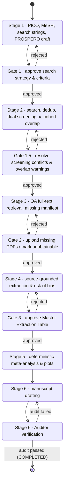

# Architecture — SysRev Meta-Analysis Agent

A PRISMA 2020-compliant, human-in-the-loop (HITL) pipeline for systematic reviews and
meta-analyses. This document describes the state machine, data contracts, persistence
model, external clients and the verification workflow. It also lists what is
implemented today and what is not.

---

## 1. Non-negotiable guardrails

| # | Guardrail | Where it is enforced |
|---|-----------|----------------------|
| G1 | **Zero fabrication of literature.** Bibliographic records come only from deterministic API clients (PubMed E-utilities, Europe PMC, OpenAlex, Crossref) or user-uploaded PDFs. An LLM never writes a citation, identifier or study datum from its weights. | `src/apis/*` build `StudyRecord`s only from fields present in API responses. Invalid identifiers are **dropped, never "repaired"**. Each record carries a `SearchProvenance` (database, query, endpoint, timestamp, reported hit count). |
| G2 | **Zero LLM arithmetic.** Effect sizes, pooled estimates, heterogeneity, bias tests and Median/IQR→Mean/SD conversions are computed by deterministic code. | `ExtractedValue` rejects any value that is not literally the number printed in its `verbatim_quote` (§4.3). Derived numbers can only originate from `src/stats_engine` (planned). The Auditor cross-checks manuscript numbers against `stats_output.json`. |
| G3 | **Humans own every gate.** The pipeline cannot pass a HITL gate without a recorded human decision. | `PipelineStateMachine` refuses gate exits unless `actor_type == HUMAN` and a matching `GateDecision` is supplied (§3). |
| G4 | **Append-only audit trail.** | `state_transitions`, `gate_decisions` and `source_evidence` rows raise on ORM update/delete (§5). |

---

## 2. Repository layout

```
src/
  core/            Settings, enums, identifier normalisation, exceptions
    schemas/       Pydantic v2 data contracts (one module per stage)
  state/           State machine (machine.py), SQLAlchemy models (db.py), repository.py
  apis/            Async, rate-limited clients: PubMed, Europe PMC, OpenAlex, Unpaywall, Crossref
  screening/       Deduplication, Cohen's kappa + conflicts, PRISMA tracker, cohort-overlap detector
  pdf_extractor/   Stage 4 source-grounded extraction        (contract only — not implemented)
  stats_engine/    Stage 5 deterministic statistics          (interface only — not implemented)
  auditor/         Stage 6 Auditor Agent                     (contract only — not implemented)
  api_server/      FastAPI app: project state, guard inspection, gate decisions
  ui/              Reviewer UI                               (placeholder)
tests/
  unit/            Schemas, identifiers, state machine, persistence, clients, screening, API
  integration/     End-to-end Stage 1→6 flow; opt-in live API smoke tests (`-m live`)
  fixtures/        Synthetic API payloads (10.5555 test-prefix DOIs; not real citations)
```

---

## 3. The 6-stage state machine

`src/state/machine.py` is the single source of truth for *what may happen next*. Any
orchestrator (a future LangGraph graph, the CLI, the FastAPI layer) must request
transitions through `PipelineStateMachine.transition()` / `.submit_gate_decision()`;
there is no API that sets a phase directly.



### 3.1 Gate rules

* Only a `HUMAN` actor may leave a gate phase, and only with a `GateDecision` whose
  `gate` matches the current gate.
* `APPROVED` moves forward (guards are evaluated); `REJECTED` moves back (guards are
  skipped — you can always go back) and **must** carry comments.
* `GATE_OUTCOMES` fixes the destination of each verdict; a decision cannot be used to
  jump elsewhere.

### 3.2 Guards

Guards are pure functions over a `GuardContext` snapshot. In production the snapshot is
computed from the database by `Repository.build_guard_context()`, so guards reflect
persisted facts, not what an agent claims.

| Transition | Guard (all must hold) |
|------------|------------------------|
| Gate 1 → Stage 2 | Protocol exists; ≥1 search strategy; every strategy `syntax_validated`; every MeSH term `verified` against NLM MeSH |
| Stage 2 → Gate 1.5 | ≥1 record identified |
| Gate 1.5 → Stage 3 | ≥1 record; 0 unresolved screening conflicts; 0 unresolved cohort-overlap warnings; PRISMA counts satisfy invariants |
| Gate 2 → Stage 4 | Every full-text item is downloaded, uploaded, or marked `UNOBTAINABLE` with a reason |
| Stage 4 → Gate 3 | ≥1 extracted arm; 0 values without `SourceEvidence` |
| Gate 3 → Stage 5 | As above, plus every arm approved by a human; PRISMA flow final (no reports awaiting retrieval/assessment) |
| Stage 5 → Stage 6 | `stats_output.json` produced (hash recorded) |
| Stage 6 → Audit | Manuscript draft exists |
| Audit → COMPLETED | Latest `AuditReport.passed is True` |
| Audit → Stage 6 | Latest `AuditReport.passed is False` |

`GuardViolationError.violations` lists every failed condition, and
`GET /projects/{id}/guards` exposes them to the UI before a reviewer acts.

---

## 4. Data contracts (`src/core/schemas`)

All models inherit `StrictModel` (`extra="forbid"`, whitespace stripping,
`validate_assignment=True`) or `FrozenModel` (immutable). Unknown fields are rejected,
which blocks an LLM from smuggling extra keys into structured output. All timestamps
must be timezone-aware.

### 4.1 Stage 1 — `protocol.py`
* **`PICOProtocol`** — title, question, P/I/C, `outcomes: list[OutcomeDefinition]` (≥1
  primary; effect measure must suit the data type: RR/OR/RD for dichotomous, MD/SMD for
  continuous, HR for time-to-event), study designs, inclusion/exclusion criteria, MeSH
  terms, search strategies, PROSPERO ID (`CRD` + 11 digits), versioning, approval
  fields. `approval_blockers()` lists what prevents Gate 1 approval; an `approved`
  protocol with blockers fails validation.
* **`MeSHTerm`** — starts `verified=False`; may only be marked verified (with
  `verified_at`) after `PubMedClient.mesh_descriptor_exists()` confirms it.
* **`SearchStrategy`** — per-database query with balanced-parentheses/quotes check,
  date limits and filters (PRISMA-S reproducibility).

### 4.2 Stage 2 — `study.py`, `screening.py`, `cohort.py`
* **`StudyRecord`** — one *report*. Identifiers are normalised on validation (DOI
  lower-cased and stripped of resolver prefixes; PMID canonical integer string; PMCID
  `PMC…`). Carries authors with affiliations, registry IDs, optional
  `RecruitmentPeriod`, `duplicate_of`, and `SearchProvenance`.
* **`ScreeningDecision`** — reviewer role, identity, stage, verdict, rationale. Exclusions
  require a reason; adjudicators must be human; full-text verdicts cannot be `uncertain`.
* **`ScreeningConflict`** — R1/R2 disagreement (or both `uncertain`); resolution fields
  must be set together and resolve to include/exclude.
* **`AgreementStatistics`** — observed/expected agreement and Cohen's κ (`None` when
  undefined).
* **`CohortOverlapWarning`** — canonical pair (`a < b`), score, severity, per-signal
  breakdown, shared authors/institutions/registry IDs; resolution requires `resolved_by`.

### 4.3 Stages 3–4 — `extraction.py`
* **`FullTextItem`** — the Gate 2 manifest row (first author, year, journal, title, PMID,
  DOI, status). PDF statuses require filename + SHA-256; `UNOBTAINABLE` requires a reason.
* **`SourceEvidence`** (frozen) — PDF filename, optional SHA-256, page number (≥1),
  location type (table/figure/paragraph/supplement), location identifier, **verbatim
  quote**, extractor identity and type.
* **`ExtractedValue`** — `value`, `reported_text`, `unit`, `evidence`. Validation
  requires (i) `reported_text` occurs in `evidence.verbatim_quote` (whitespace-normalised)
  and (ii) `value == parse_reported_number(reported_text)`. The parser handles the
  Unicode minus, Lancet-style mid-dot decimals (`12·5`), thin spaces, thousands
  separators and a lone decimal comma, and performs no arithmetic. Consequently, a
  computed number (e.g. a mean estimated from a median) **cannot** be stored as an
  extracted value.
* **`ExtractedStudyArm`** — arm-level data (n randomised/analysed, events, mean, SD, SE,
  median, Q1, Q3, min, max), each an `ExtractedValue`. Plausibility checks: counts are
  non-negative integers, events ≤ n analysed ≤ n randomised, SD/SE ≥ 0,
  min ≤ Q1 ≤ median ≤ Q3 ≤ max; human approval requires approver and timestamp.
* **`RiskOfBiasAssessment`** — RoB 2 (5 domains; low/some concerns/high),
  ROBINS-I (7 domains; low/moderate/serious/critical/no information) or NOS (stars:
  selection ≤4, comparability ≤2, outcome/exposure ≤3). For RoB 2 and ROBINS-I the
  overall judgement may not be milder than the worst domain, as both tools' guidance
  specifies.

### 4.4 Stage 6 — `audit.py`
* **`NumericClaimCheck`** — manuscript number vs `stats_output.json` key with tolerance;
  the status must agree with the numbers.
* **`CitationCheck`** — citation vs a record in the project database (PMID/DOI).
* **`AuditReport`** — `passed` and `failures` are **computed**; a serialised report that
  claims `passed: true` while containing a failing check is rejected on load. An empty
  report does not pass.

### 4.5 Pipeline — `pipeline.py`
* **`GateDecision`** (frozen), **`StateTransition`** (frozen), **`ProjectState`**.
* **`PRISMACounts`** — the PRISMA 2020 flow boxes plus two work-in-progress counters.
  Invariants enforced at construction:
  * screened = identified − duplicates − automation-ineligible − other removals
  * sought = screened − excluded
  * assessed = sought − not retrieved − awaiting retrieval
  * reports included = assessed − Σ(excluded with reasons) − awaiting assessment
  * studies included ≤ reports included

  `is_final` is true only when nothing is awaiting retrieval or assessment.

---

## 5. Persistence (`src/state/db.py`, `repository.py`)

SQLAlchemy 2.0 typed ORM on SQLite (any SQLAlchemy URL works).

* Query-relevant fields are real, indexed columns; the full validated Pydantic payload is
  stored as JSON and **re-validated on every load**, so a corrupted row fails loudly.
* `source_evidence` is a separate table; `extracted_values.evidence_id` is
  `NOT NULL` + FK, so the database itself refuses a number without provenance.
* Extracted arms are write-once (corrections create a new arm); approval updates only the
  approval columns.
* `state_transitions`, `gate_decisions`, `source_evidence` are append-only (ORM
  `before_update` / `before_delete` listeners raise `AppendOnlyViolationError`).
* `projects.version_id` provides optimistic concurrency; `record_transition()` also
  rejects stale transitions whose `from_phase` no longer matches the stored phase.
* SQLite foreign keys are switched on (`PRAGMA foreign_keys=ON`); datetimes round-trip as
  UTC-aware values.

---

## 6. Literature API clients (`src/apis`)

All clients share `BaseAPIClient`: an `httpx.AsyncClient`, an `AsyncRateLimiter`
(sliding window, safe under concurrency, injectable clock), retries on 429/500/502/503/504
and transport errors with exponential back-off capped at 60 s, `Retry-After` support
(delta-seconds or HTTP-date), and a `User-Agent` carrying the contact address.

| Client | Endpoint(s) | Paging | Policy honoured |
|--------|-------------|--------|-----------------|
| `PubMedClient` | `esearch.fcgi` (JSON), `efetch.fcgi` (XML via POST, 200 IDs/batch) | `retstart`/`retmax` | `tool` + `email` on every call; 3 req/s, 10 req/s with API key. Queries matching > 10,000 records raise `SearchResultTooLargeError` (ESearch cannot page past 10,000) instead of silently truncating. XML parsed with entity resolution and network access disabled. `mesh_descriptor_exists()` checks `db=mesh`. |
| `EuropePMCClient` | `/search?resultType=core&format=json` | `cursorMark` (≤1000/page) | Configurable rate. |
| `OpenAlexClient` | `/works?search=&filter=` | `cursor` (≤200/page) | `mailto` (polite pool); optional `api_key`. Abstracts rebuilt from the inverted index; author surnames split heuristically and flagged `name_parsed_heuristically=True`. |
| `UnpaywallClient` | `/v2/{doi}?email=` | — | `email` required. `download_pdf()` accepts content only if it begins with `%PDF-` (landing pages are rejected), stores it and returns its SHA-256. |
| `CrossrefClient` | `/works/{doi}` | — | `mailto`; used by the Auditor to confirm cited DOIs exist. |

Rate-limit numbers for Europe PMC, OpenAlex, Unpaywall and Crossref are conservative
configurable defaults (`.env.example`); check each provider's current documentation
before raising them.

---

## 7. Screening algorithms (`src/screening`)

### 7.1 Deduplication (`deduplication.py`)
1. **Exact pass** — union-find over DOI, PMID, PMCID and OpenAlex ID (transitive).
2. **Fuzzy pass** — records are blocked by publication year (±1; unknown years compared
   with all), titles normalised (markup removed, diacritics folded, case-folded,
   punctuation collapsed) and compared with RapidFuzz `token_sort_ratio`
   (vectorised `cdist`). Pairs ≥ threshold (default 95) are merged highest-score first,
   **unless any member of either cluster contradicts the merge** (different DOIs,
   different PMIDs, different first-author surnames). Contradicted pairs are returned as
   `PossibleDuplicate` for human review. This is deliberately conservative: a false merge
   silently deletes a study, while a missed merge is caught at screening.
3. **Representative** — the most complete record (PMID > DOI > abstract > …), ties by
   source priority then `record_id`. Missing identifiers are filled from duplicates,
   never overwritten.

The result is independent of input order (tested by shuffling).

### 7.2 Dual screening support (`agreement.py`)
`cohens_kappa()` implements κ = (p_o − p_e)/(1 − p_e) (Cohen, 1960) for any number of
categories and returns `None` when p_e = 1. `detect_conflicts()` flags disagreements and
double-`uncertain` records; `final_verdicts()` refuses to produce a consensus while any
conflict is unresolved.

### 7.3 PRISMA tracker (`prisma.py`)
Counts are derived from recorded events (identification per database, duplicates removed,
per-record screening/retrieval/eligibility outcomes), not typed in. Decisions are
idempotent; re-excluding a record clears its downstream state. `snapshot()` returns a
validated `PRISMACounts` or raises `PRISMAInconsistencyError`.

### 7.4 Overlapping Cohort Detector (`cohort_overlap.py`)
Flags report pairs that may describe the same participants; it never excludes or merges.

| Signal | Score in [0, 1] |
|--------|-----------------|
| Shared registry ID (NCT, ISRCTN, EudraCT, ChiCTR, ACTRN, DRKS, CTRI, jRCT, UMIN) | Decisive → composite 1.0, HIGH |
| Co-author overlap | Overlap coefficient of `surname + initial` keys; one shared name in teams ≥4 ×0.5 (name collisions) |
| Affiliation similarity | Share of the smaller study's institutions matched (`token_set_ratio` ≥ 85) after dropping department segments, cities and generic words |
| Recruitment overlap | Overlapping years ÷ shorter period |
| Publication proximity | Substitutes for unknown recruitment at half weight |

Composite = 0.40·co-author + 0.30·affiliation + 0.30·time. A pair is only considered if
it shares a registry ID, at least one author, or (≥50 % institutions and overlapping
known recruitment). Thresholds: flag ≥ 0.45, MODERATE ≥ 0.55, HIGH ≥ 0.70.
**These weights and thresholds are engineering heuristics and have not been validated
against a labelled corpus.** They are configurable, and every warning lists its
individual signals so reviewers can judge them. Candidate pairs come from an inverted
index (shared author key, registry ID or institution token) to avoid all-pairs work.

---

## 8. Verification workflow (end to end)

1. **Search provenance** — each record stores its database, exact query, endpoint, time
   and reported hit count → PRISMA-S reporting and reproducibility.
2. **MeSH verification** — LLM-proposed headings must be confirmed against NLM MeSH before
   Gate 1 can be approved.
3. **Dual screening + κ + human adjudication** — Gate 1.5 cannot open with unresolved
   conflicts or overlap warnings.
4. **Full-text manifest** — Gate 2 cannot open until each missing report is uploaded
   (hash recorded) or explicitly declared unobtainable with a reason.
5. **Source-grounded extraction** — every number is a literal copy from a quoted passage
   on a specific PDF page, enforced at schema and database level; Gate 3 requires human
   approval of every arm.
6. **Deterministic statistics** — Stage 5 writes `stats_output.json`; its SHA-256 is
   stored on the project and referenced by every `AuditReport`.
7. **Independent audit** — each manuscript number is matched to a `stats_output.json`
   key (with explicit tolerance) and each citation to a database record re-verified via
   Crossref/PubMed. `COMPLETED` is reachable only from a passing report; a failing report
   sends the manuscript back for redrafting.

---

## 9. Implementation status

| Component | Status |
|-----------|--------|
| Data contracts (all stages) | Implemented and tested |
| State machine, guards, HITL gates | Implemented and tested |
| SQLAlchemy persistence, append-only trail | Implemented and tested |
| PubMed, Europe PMC, OpenAlex, Unpaywall, Crossref clients | Implemented; tested with mocked HTTP. Live smoke tests exist (`pytest -m live`) but **have not been run against the real services** in the development sandbox (outbound access was blocked) |
| Deduplication, κ/conflicts, PRISMA tracker, cohort overlap | Implemented and tested |
| FastAPI (state, guards, gate decisions) | Implemented and tested; endpoints for system steps not yet exposed |
| LLM agents (PICO structuring, screening reviewers, drafting) | Not implemented |
| PDF extraction (`pdf_extractor`) | Contract only |
| Statistics engine (`stats_engine`) | Interface only — raises `NotImplementedError` |
| Plotting, PRISMA diagram rendering, GRADE SoF | Not implemented |
| Auditor | Contract (`AuditReport`) only |
| UI | Placeholder |

### Planned statistical methods (Stage 5) and their references
Inverse-variance fixed effect; Mantel-Haenszel; DerSimonian-Laird random effects
(DerSimonian & Laird, *Control Clin Trials* 1986;7:177-188); REML; Hartung-Knapp
adjustment (Hartung & Knapp, *Stat Med* 2001;20:3875-3889); Cochran's Q, I² and τ²
(Higgins & Thompson, *Stat Med* 2002;21:1539-1558); Egger's test (Egger et al., *BMJ*
1997;315:629-634); Begg's test (Begg & Mazumdar, *Biometrics* 1994;50:1088-1101);
trim-and-fill (Duval & Tweedie, *Biometrics* 2000;56:455-463); leave-one-out;
meta-regression; Median/IQR/range → mean/SD (Wan et al., *BMC Med Res Methodol*
2014;14:135; Luo et al., *Stat Methods Med Res* 2018;27:1785-1805). Optional
cross-validation against R `metafor` (Viechtbauer, *J Stat Softw* 2010;36(3):1-48).
Each method must be validated against published worked examples before use.

---

## 10. Development

```bash
pip install -e ".[dev]"
pytest                 # unit + integration (live tests excluded by default)
pytest -m live         # opt-in, real network; set SYSREV_NCBI_EMAIL
ruff check src tests && ruff format --check src tests
mypy                   # strict mode over src/
uvicorn src.api_server.main:app --reload
```

---

## 11. References

1. Page MJ, McKenzie JE, Bossuyt PM, et al. The PRISMA 2020 statement: an updated
   guideline for reporting systematic reviews. *BMJ* 2021;372:n71. doi:10.1136/bmj.n71
2. Rethlefsen ML, Kirtley S, Waffenschmidt S, et al. PRISMA-S: an extension to the PRISMA
   Statement for Reporting Literature Searches in Systematic Reviews. *Syst Rev*
   2021;10:39. doi:10.1186/s13643-020-01542-z
3. Higgins JPT, Thomas J, Chandler J, et al. (eds). *Cochrane Handbook for Systematic
   Reviews of Interventions*, version 6. Cochrane; www.training.cochrane.org/handbook
4. Sterne JAC, Savović J, Page MJ, et al. RoB 2: a revised tool for assessing risk of bias
   in randomised trials. *BMJ* 2019;366:l4898.
5. Sterne JAC, Hernán MA, Reeves BC, et al. ROBINS-I: a tool for assessing risk of bias in
   non-randomised studies of interventions. *BMJ* 2016;355:i4919.
6. Wells GA, Shea B, O'Connell D, et al. The Newcastle-Ottawa Scale (NOS) for assessing
   the quality of nonrandomised studies in meta-analyses. Ottawa Hospital Research
   Institute (web resource).
7. Cohen J. A coefficient of agreement for nominal scales. *Educ Psychol Meas*
   1960;20:37-46.
8. Sayers E. A General Introduction to the E-utilities. In: *Entrez Programming Utilities
   Help*. NCBI; https://www.ncbi.nlm.nih.gov/books/NBK25497/
